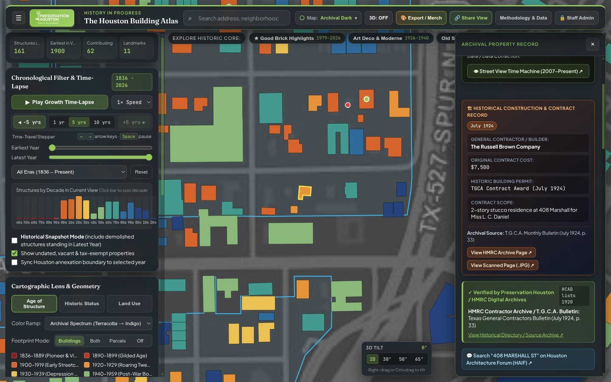
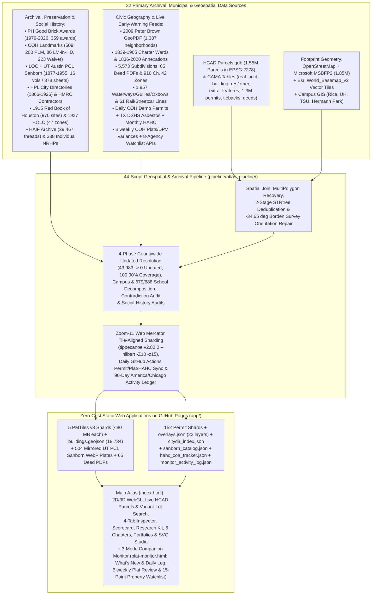

# Preservation Houston | The Houston Building Atlas (v2)

**An Open-Source, GPU-Accelerated Historical Cartography, Preservation Advocacy & Architectural Archive of `1,507,897` dated structures across Harris County, Texas (`1823-2026`).**

- **Live Web Application:** [`https://davemorris-gcp.github.io/houston-building-atlas/`](https://davemorris-gcp.github.io/houston-building-atlas/)
- **Companion 3-Mode Monitor (`What's New & Daily Log`, `Biweekly Plat Review` & `15-Point Watchlist`):** [`https://davemorris-gcp.github.io/houston-building-atlas/plat-monitor.html`](https://davemorris-gcp.github.io/houston-building-atlas/plat-monitor.html)
- **Live External Archive & Municipal Link Health Monitor (`55` Domains / `776` URLs):** [**GitHub Issue #1**](https://github.com/davemorris-gcp/houston-building-atlas/issues/1)



---

## Overview

**The Houston Building Atlas v2** replaces Preservation Houston's legacy cloud GIS prototype with a self-contained, zero-cost web application built on **MapLibre GL JS v4.7.1**, **PMTiles v3.2.0**, and a **44-script geospatial & archival Python pipeline** (`pipeline/atlas_pipeline/`).

Every building footprint in Harris County (`1,507,897` countywide structures across 5 Zoom-11 tile-aligned `.pmtiles` shards with `100.00%` dated coverage and `0` undated buildings, plus `18,734` curated inner-core structures in `buildings.geojson`, `2,216` verified overrides, countywide live HCAD tax-parcel rendering, and live address search across ~325,000 unimproved vacant lots) is paired with **4-Tier Evidentiary Provenance Badges** (explicitly labeling `3,047` Historic Core HCAD rounded-decade estimates as `c. 1920 (HCAD Est.)` and flagging 1926 City Directory contradictions), 1-click public misattribution flagging (`⚑ Wrong Building`, `⚑ Flag`, `⚑ Flag Error`), plain-English Chapter 33/42 legal protection rules, a 1-click 5-Step House History Research Kit (`16` Sanborn volumes / `878` sheets `1877-1955` + `39` digitized Houston City Directories `1866-1926`), `22` preservation and social-history overlays (`1915 Red Book of Houston`, `1937 HOLC Redlining`), annual (`2020-2025`) & `2026 YTD` demolition permit benchmarks, and automated daily/biweekly/monthly early-warning feeds wrapped inside a 3-mode Companion Monitor (`What's New & Daily Log` 90-day Central Time ledger, `Biweekly Plat Review`, and `15-Point Property Watchlist`).



---

## Documentation Ecosystem Map

To ensure engineering architecture, archival methodology, third-party server dependencies, and public/staff manual curation procedures stay organized and easy to find, documentation is structured across the following surfaces:

| Surface | Audience | Link / Location |
| :--- | :--- | :--- |
| **1. Master Source Catalog, External Server Dependencies & Public/Staff Curation Playbooks** | All readers, PH staff, public contributors, maintainers | [**Chapter 10 (`docs/10-sources-integrations-and-curation-workflows.md`)**](docs/10-sources-integrations-and-curation-workflows.md) |
| **2. Ten-Chapter Engineering & Archival Reference Manual** | Developers, GIS analysts, architectural historians | [`docs/01`](docs/01-architecture-and-rendering.md) through [`docs/10`](docs/10-sources-integrations-and-curation-workflows.md) (indexed below) |
| **3. Google Sheets 10-Tab Moderation, Historical Audit Queue & City Directory Batch Auditor Guide** | PH administrators & data curators | [`docs/GOOGLE_SHEETS_AND_CITY_DIRECTORY_GUIDE.md`](docs/GOOGLE_SHEETS_AND_CITY_DIRECTORY_GUIDE.md) + in-sheet `Admin_Hub_&_Quick_Filter`, `Historical_Audit_Queue` & `Instructions_&_Apps_Script` (`SOP 1-13`) |
| **4. Biweekly Plat & 15-Point Endangered Property Monitoring Guides** | PH advocacy staff, interns & Planning Commission reviewers | [`docs/PRESERVATION_MONITORING_AUTOMATION_ARCHITECTURE.md`](docs/PRESERVATION_MONITORING_AUTOMATION_ARCHITECTURE.md) + *Plat Report Monitoring Guide* Google Doc (linked inside [`app/plat-monitor.html`](app/plat-monitor.html) & `Admin_Hub_&_Quick_Filter!H16`) |
| **5. In-App Public Overview & Methodology (`About` Modal)** | General public & map visitors | `#about-modal` inside [`app/index.html`](app/index.html) |
| **6. Live Weekly External Archive Link Health Status (`55` Domains / `776` URLs)** | Maintainers & PH admins | [**GitHub Issue #1**](https://github.com/davemorris-gcp/houston-building-atlas/issues/1) (pinned in Google Sheet Cell `Admin_Hub_&_Quick_Filter!H14`) |

---

## Comprehensive 10-Chapter Engineering & Archival Manual (`docs/`)

### [Chapter 1: WebGL + PMTiles Architecture, Basemaps, 3D Extrusion & Client UX](docs/01-architecture-and-rendering.md)
- Replacing Google Earth Engine with MapLibre GL JS v4.7.1 and PMTiles v3.2.0.
- **Zoom-11 Web Mercator tile-aligned 5-shard `.pmtiles` partitioning** (`houston_buildings_{nw_w,nw_e,ne,sw,se}.pmtiles`, keeping every shard under GitHub's 100 MB limit with zero dropped buildings at `z >= 12`).
- RFC 7233 `HTTP 206 Partial Content` byte-range serving in `app/server.py`.
- **Basemap Engineering:** Replacing watermarked Carto tiles; capping Esri raster underlays at `maxzoom: 16` to eliminate Esri's `HTTP 200` `"Map data not yet available"` placeholder PNGs at `z >= 17`; layering crisp OpenFreeMap vector street casings; and adding `Solid Dark` (`#0B0E11`) and `Solid Light` (`#F5F2EB`) figure-ground poster modes.
- **3D Extrusion & Hardware Depth Occlusion:** Sub-centimeter prime-modulo height tie-breaker (`(year_built % 97) * 0.0003m`) to stop roof Z-fighting; ground-plane layer ordering; and `selected-feature-3d-extrusion` (`body`, `roof_collar`, `base_collar`, `corner_rib`, and `occluder` meshes sharing the GPU depth buffer).
- **Client UX:** Four-way overlapping feature cycling (`#map-overlap-bar`), Polygon Isolation Mode (`#isolate=`), High-Resolution Vector `.SVG` / T-Shirt / Coaster Export Studio (`#export-studio-modal`), and native browser Back/Forward history navigation (`pushState` vs. `replaceState`).

### [Chapter 2: Building Footprints, Spatial Joins & Countywide Geometry Repairs](docs/02-building-footprints-and-geometry-repairs.md)
- Combining OpenStreetMap, Microsoft US Building Footprints v2 (`1,847,281` polygons), Esri `World_Basemap_v2` vector tiles, and HCAD `Parcels.gdb` (`1,546,683` parcels in `EPSG:2278`).
- Two-stage spatial deduplication (`1,672,100 -> 1,507,553` footprints) and partial-block compound carve-outs (`Bethel Institutional Missionary Baptist Church`).
- **Countywide Polygon Orientation & Party-Wall Repair (`fix_polygon_orientations.py`):** Replacing `155,497` unrotated cardinal fallback boxes (`0°/90°` rectangles that sat crooked across Downtown's `-34.65°` 1836 Borden Survey grid) with parcel-oriented `shapely.oriented_envelope` footprints, and fixing `5,609` zero-lot-line party-wall misattributions caused by `ring[0]` first-vertex matching (`AT&T Central Building`, `Sam Houston Hotel`, Market Square rowhouses).
- **Multi-Block `MultiPolygon` Parcel Recovery (`recover_dropped_footprints.py`):** Preserving all sub-polygons of `5,573` multi-part HCAD parcels across street rights-of-way (recovering all 4 blocks of `Camden City Centre` at `301 St Joseph Pkwy`, `GreenStreet`, and `Marriott Marquis`).
- **Warehouse District & Bridge Deck Audit (`fix_warehouse_district.py`):** Removing the `420m` **Elysian Viaduct highway bridge deck** fused into `902 Hardy St`, separating the `1850` Richey-Fant House + `1949` Last Concert Café + `1986` Stage at `1403 Nance St`, and suppressing open-air METRO transit canopies.
- **Multi-Footprint Industrial & Circular Storage Tank Recovery (`fix_industrial_multi_footprints.py`):** Preserving `4,746` multi-building industrial footprints and extracting `+7,292` circular petrochemical storage tanks (`12,038` total footprints) across the Houston Ship Channel and ExxonMobil Baytown Refinery.

### [Chapter 3: 100% Countywide Chronology, Institutional Campuses & Undated Resolution](docs/03-chronology-institutions-and-undated-resolution.md)
- **Decomposing Tax-Exempt Institutional Super-Parcels (`enrich_institutions.py`):** Splitting `year_built = 0` super-parcels into `525` individually dated campus structures across **Rice University** (`112` buildings, excluding `SPECNAME = 'Covered Walkway'` polygons that fused Lovett Hall and Fondren Library), **University of Houston & UHD** (`169`), **Texas Southern University** (`64`), **Hermann Park, Houston Zoo & Museum District** (`154`), **UST / Menil / TMC** (`26`), and **Sam Houston Park / The Heritage Society** (`12` relocated 19th-century structures).
- **Four-Phase Countywide Undated (`year_built == 0`) Resolution (`resolve_undated_countywide.py`):** How all `43,983` undated footprints across `18,303` parcels were brought to **100.00% dated coverage (`0` undated)** with explicit `year_source` provenance badges (`curated_landmark`, `hcad_extra_feature`, `hcad_tieback`, `adjacent_owner`, `hcad_permit`, `campus_contiguity`, `hcad_deed`, `subdivision_median`, `blockface_median`).
- **Civic & Stadium Corrections:** Restoring the `1910` Harris County Courthouse, `1952` Juvenile Justice Center, `1939` City Hall, `1926` Julia Ideson Building, `1940` Air Terminal Museum, and separating `2012` Shell Energy Stadium (`2200 Texas Ave`) from `1911` Union Station / Daikin Park (`501 Crawford St`).
- **HPL ContentDM City Directory Audit (`1866-1926`, `city_directory_audit.py`):** Solving OCLC's CloudFront WAF TCP reset and switching from `^all^and` (`95%` false positives) to `^exact^and` contiguous phrase matching across `3,176` rounded-decade properties.

### [Chapter 4: Preservation Layers, Landmark Designation Reports, HAIF & Archival Photography](docs/04-landmarks-good-brick-haif-and-photos.md)
- **Preservation Houston Good Brick Awards (`1979-2026`):** Filtering `460` raw entries to `359` place-based awards (`338` snapped sites) onto verified building footprints (`5500 Main St` Kinder Building vs. `5501 Main St` St. Paul's UMC; `301 E 5th St` Lund House & Modern Print Shop; `1125 Providence St` San Jacinto Warehouse).
- **City of Houston Landmark Designation Reports (`448` Official HPO PDFs):** Crawling `archaeology.houstontx.gov` (`var mydata`) and Wayback Machine CDX (`628` PDFs), fixing `11` off-by-one HPO server filename typos (`16PL128 -> 16PL127`, `08L203 -> 08L202`), filling `+140` missing dates (`99.8%` dated) and `+144` architectural styles, applying `75` HCAD year overrides, and generating the 61-item post-2016 TPIA request checklist (`coh_landmarks_missing_pdfs_tpia.csv`).
- **Houston Architecture Info Forum (`HAIF`) Integration (`29,467` Threads):** Indexing 97 subforums via Wayback CDX while loading `media.invisioncic.com` photos directly; linking `5,576` HAIF threads across `3,894` parcel keys and `6,248` addresses; populating `building_name` + `alt_names` (`AKA`); and fixing URL-escaped UTF-8 strings (`%C3%A9`) and fused slash-words (`Stheights`).
- **Archival Photography & Wikimedia Relevance Filtering (`photoService.js`):** Filtering out off-topic aircraft cockpits and portraits at Hobby Airport / Downtown, enabling `.tif` HABS/Highsmith transcoding, adding the interactive **⇄ Then & Now** comparison slider, and framing uncropped vertical architecture photos over an ambient blurred backdrop.

### [Chapter 5: Neighborhoods, Historic Wards, Annexation History, Subdivisions & Deed Restrictions](docs/05-neighborhoods-wards-subdivisions-and-deeds.md)
- **Multi-Source Neighborhood Harmonization (`1,387` Boundaries):** Extracting `661` vernacular neighborhood polygons from the **2009 Peter Brown / Tony Topping ISO 32000 GeoPDF** (`/OC2` & `/OC13` lossless raster strips + `/OC4` vector labels in `EPSG:2278`), merging with COH GIS layers, and fixing **11 official COH GIS spelling errors** (`Woodkind Heights -> Woodland Heights`, `Idlywood -> Idylwood`, `Breaburn -> Braeburn`, `Yoacum -> Yocum`, `Nottingham Forrest -> Nottingham Forest`).
- **Historic Wards (`1839-1905`) & Debunking the Erroneous 1920 COH GIS Ward Layer:** Forensic proof that COH's `WardBoundaries_1920` (`Layer 6`) was traced in 2018 from a March 1981 library exhibit poster drawn with magic marker onto a `22 sq. mi.` 1920 street map (15 years after Houston abolished wards in 1905), and reconstruction of the **4 authentic `9 sq. mi.` (`3 x 3 mile`) municipal charter ward eras (`1839`, `1866`, `1896`, `1903-1905`)**.
- **City of Houston Annexation History (`1836-2020`):** Dissolving incremental "donut slice" seams, restoring the repealed `1839` tilted survey hole subtracted from the `1840` 9-sq-mi square, and separating `full_purpose` city limits from the **Nov. 20, 1963 (`Ord. 63-1219`) `"10-ft strip"` defensive highway spokes**, the 1965 `IAH` airport strips, and 770+ Limited-Purpose MUD SPA strips.
- **Platted Subdivisions (`5,573` Polygons), WHCA Map Forensics & 3-Tier Deed Restrictions:** Diagnosing the 2019 WHCA map bugs (`BELTZ -> "Belt 3"` misplacing *Germantown*, `lgl_3` wrap-around creating `"WH ??"` blocks, single-lot replat islands), hosting **65 full-text searchable Deed Restriction PDFs** (`app/public/deeds/`), mapping **910 COH Chapter 42 SMLS / SMBL / Conservation zones**, and linking to the Harris County Clerk Real Property & Map archives.

### [Chapter 6: Library of Congress & UT Austin PCL Sanborn Atlases, Historical Map Spyglass & Lost Houston](docs/06-sanborn-maps-and-lost-houston.md)
- **Georeferenced Historical Maps (`1869-1969`) & Spyglass Lens Math:** Fixing the `512 px` vs. `256 px` WebGL world-size zoom offset (`effectiveTileZoom = vpZoom + 1`) and 3D perspective projection inside `#spyglass-canvas`.
- **Sanborn Fire Insurance Atlases (`1877-1955`, `16` Volumes / `878` Sheets across LOC & UT Austin PCL):** Leveraging LOC CloudFront power-of-two wavelet pre-caching (`pct:12.5` & `pct:25` in `< 60 ms`), resolving `-covr` and `-0001s` skeleton map suffixes, and mirroring `504` local WebP plates from `6` UT Austin PCL volumes (`1877`, `1917`, `1919`, `1924 Vol. 2 & 3`, `1948 Vol. 6`) in `app/public/data/sanborn_ut/`.
- **Lost Houston (`74` Verified Demolished Landmarks):** Sanborn Underwriters material color coding, purging `7` extant false positives, fixing the `-34.65°` Borden Survey grid rotation (`fit_rect_in_parcel`), bidirectional "Previous Historic Structures on This Site" cross-referencing (`1837 First Capitol` & `1883 Capitol Hotel` under the `1913 Rice Hotel`), primary-source citations, and **Historical Snapshot Mode**.

### [Chapter 7: Historical Waterways, Railroads, Multi-Era Permits & HMRC Contractor Archives](docs/07-waterways-railroads-permits-and-contractors.md)
- **Historical Waterways, Pre-1960s Oxbows & Buried Gullies (`1,957` Features):** Merging USGS NHD, HCFCD (`M3` sub-basins), and TNRIS into `218` continuous open bayous/creeks with culvert confluence snapping, plus **7 daylighted/buried historic gullies** and pre-channelization White Oak Bayou oxbows.
- **Historical Railroads, Streetcars & Depots (`61` Corridors + `14` Depots):** Merging FraN and TxDOT active trunks with abandoned rail trails (*Columbia Tap*, *MKT*, *SA&AP*), **1891-1938 electric streetcar & Galveston-Houston Interurban lines**, and 14 historic depots/shops.
- **Multi-Era Building Permits, HMRC Contractor Monographs & Relocated Structures:** Streaming `1,300,027` HCAD permits and `649,693` appraiser remodel notes into **152 on-demand prefix shards (`permits_<prefix3>.json`)**; extracting 1917-1929 contractor records from *The Russell Brown Company* and the *T.G.C.A. Monthly Bulletin* (`408 Marshall St` built **July 1924** for **\$7,500**); migrating retired `digital.houstonlibrary.org` links (`HTTP 302`) to `cdm17006.contentdm.oclc.org`; and filtering out HCAD `permit_type = 15` (`OMITTED IMPS`) false positives.
- **Live Daily Demolition, Sewer Disconnection & Asbestos Early-Warning Pipeline (`fetch_live_permits.py` & `.github/workflows/update_live_permits.yml`):** Automated daily surveillance across **City of Houston Sold Permits** and **Texas DSHS Online Asbestos & Demolition Notifications**, surfacing active preservation alerts (`active_permit_alerts.json`, including the `1894`/`1928` **John Henry Kirby Mansion** at `2000 Smith St`) and crowdsourced `[SITE ACTIVITY OBSERVATION]` field reporting.

### [Chapter 8: Crowdsourced Moderation Pipeline, Live HCAD API & Admin Operations](docs/08-crowdsourcing-and-admin-operations.md)
- Zero-cost 10-tab Google Sheets moderation backend (`Pending_Submissions` -> `Approved_Edits` live CSV hydration + `Historical_Audit_Queue` (`250` prioritized contradictions) + `Admin_Hub_&_Quick_Filter` + 12 Saved Filter Views + `🔒 Staff Admin` mode), **4-Tier Evidentiary Provenance System**, and 1-click public misattribution flagging (`⚑ Wrong Building`, `⚑ Flag`, `⚑ Flag Error`).
- Live HCAD ArcGIS REST appraisal lookup, countywide viewport parcels, & live vacant-lot address search (`hcadLink.js`, `hcadViewportParcels.js`).
- Pre-warmed O(1) global search index (`search_index.json`, `25,329` entries) and complete **44-script pipeline rebuild reference table**.
- Automated 4-layer verification suite (`45` stratified property archetypes across `15` equivalence classes) and live [**External Archive & Municipal Link Health Report (GitHub Issue #1)**](https://github.com/davemorris-gcp/houston-building-atlas/issues/1).

### [Chapter 9: Preservation Practice Stack, House History Research Kit, Social History Equity Layers, Guided Chapters & HAHC COA Tracker](docs/09-preservation-practice-social-history-and-hahc.md)
- **Responsive 4-Tab Property Inspector (`Overview`, `History`, `Permits`, `HCAD & Parcel`)**, Desktop `760px/820px` 2-Column Wide View, Mobile 3-State Bottom Sheet (`Peek`/`Half`/`Full`), Printable Archival Property Dossier (`#dossier-modal`), and `[SITE ACTIVITY OBSERVATION]` field reporting.
- **3-Pillar Legal Protection & Historic Tax-Credit Scorecard**, 3-tier COH Landmark distinction (`200` `PLM` vs. `86` `LM-in-HD` vs. **`223` Vulnerable `90-Day Waiver Landmarks`** under Ch. 33 Sec. 33-250), 7-tier `Historic Status` color lens, `60` Surveyed Potential Historic Districts (`2019` COH Plan), `238` Individual NRHP Properties (incl. `16` demolished `"Gone"` sites), and `7` Cultural Arts Districts.
- **One-Click 5-Step House History Research Kit** (`citydir_index.json` across `39` HPL City Directories `1866-1926` + `16` historic street renamings) and **UT Austin PCL Sanborn expansion** (`504` local WebP plates solving Anubis cross-origin PoW challenges).
- **1915 *Red Book of Houston* (`970` African American heritage sites + `85` Rice Quartex plates)** and **1937 HOLC Redlining Zones (`47` zones + HARC/NOAA Urban Heat Watch & Ch. 42 protection disparity metrics)**.
- **6 Guided Citywide Visual Chapters (*"How Houston Was Built"*)**, Countywide **Architect / Builder / Style Map Portfolios** (`guidedChaptersAndPortfolios.js`), and **Monthly HAHC COA & Designation Precedent Tracker** (`403` filings across `283` parcels in `hahc_coa_tracker.json`).

### [Chapter 10: Complete Feature Reference, Primary Source Catalog, External Third-Party Server Dependencies & Public/Staff Curation Playbooks](docs/10-sources-integrations-and-curation-workflows.md)
- Complete URL deep-link parameter & expected-behavior reference across `app/index.html` and `app/plat-monitor.html`.
- Exhaustive catalog of all **32 primary archival, municipal, county, state, federal, university, and community datasets**.
- **Four-Tier External Third-Party Server Dependency & Resilience Matrix** (distinguishing Tier A locally bundled GitHub Pages assets vs. Tier B browser runtime APIs/tiles vs. Tier C daily GitHub Actions ingestion feeds vs. Tier D outbound deep-linked archives monitored weekly by [GitHub Issue #1](https://github.com/davemorris-gcp/houston-building-atlas/issues/1)).
- **Role-Separated Manual Curation Playbooks:** Step-by-step instructions for **(a) the General Public** (zero login required) and **(b) Preservation Houston Staff & Designated Sheet Editor Admins**.

---

## Quickstart & Local Development

### 1. Run the Web Application Server (`HTTP 206` Byte-Range Enabled)
The frontend lives in `app/` and requires zero build step or external Node bundler. Start the RFC 7233 byte-range server (`app/server.py`) so PMTiles v3 archives stream via `HTTP 206 Partial Content`:

```bash
python3 app/server.py --port 8787
```

Then open **`http://localhost:8787`** (Main Atlas) or **`http://localhost:8787/plat-monitor.html`** (Biweekly Plat & 15-Point Property Monitor) in any modern browser.

### 2. Run the Geospatial Data Pipeline (`pipeline/`)
The Python geospatial pipeline uses [`uv`](https://github.com/astral-sh/uv) (`Python 3.13`) and `tippecanoe v2.82.0`:

```bash
cd pipeline
uv sync

# Example: Pull latest Approved_Edits from Google Sheets and refresh search & overrides
uv run python -m atlas_pipeline.sync_curated_edits
uv run python -m atlas_pipeline.enrich_styles_and_search_index
```

### 3. Automated Testing, 45-Archetype Verification & Live External Archive Link Health
Every pull request and push to `main` is gated by a deterministic verification pipeline (`.github/workflows/deploy-pages.yml`), paired with an automated weekly Monday external archive link crawler (`.github/workflows/external-link-health.yml`) that publishes live status to [**GitHub Issue #1: External Archive Link Health Report (Automated CI Monitor)**](https://github.com/davemorris-gcp/houston-building-atlas/issues/1) (also linked directly inside the Moderation Google Sheet on `Admin_Hub_&_Quick_Filter` Cell `H14` and `Instructions_&_Apps_Script` Row `21`):

```bash
# Regenerate the 45 Stratified Property & Overlay Archetypes (15 equivalence classes x 3)
node scripts/build_test_archetypes.mjs

# Layer 1: Fast deterministic schema, WGS84 bounds, GitHub Pages bundle size, Activity Log, Plat/Watchlist & URL-validator unit tests (60 tests)
node tests/unit/run_all.mjs

# Layer 1B: Python pipeline tests (schema, multi-cycle Excel layouts, historical PH-* backfill, Page-3 DPV parser, campus sentinels & Activity Log diffs; 121 tests)
uv run --directory pipeline pytest tests -v

# Layer 2: Headless Chromium Playwright E2E suite (HTTP 206 PMTiles check, global modals, Guided Chapters 1..6, Portfolios, 3-Mode Plat Monitor, live vacant-lot search, and all 45 archetypes across 4 inspector tabs + Wide View; 40 tests)
uv run --directory pipeline pytest ../tests/e2e -v

# Layer 3: Live external municipal, county, state, university & archival HTTP 200/206 + soft-404 link health crawler (776 unique URLs across 55 domains)
node scripts/check_external_links.mjs
```

---

## Repository Structure

```text
houston-building-atlas/
├── README.md                                  # Master overview, ecosystem map & 10-chapter index
├── .github/workflows/
│   ├── deploy-pages.yml                       # Pre-deploy Layer 1 + Layer 2 E2E gate & GitHub Pages deploy
│   ├── external-link-health.yml               # Weekly Monday live link crawler updating GitHub Issue #1
│   └── update_live_permits.yml                # Daily COH sold permits, DSHS asbestos, Plats & HAHC sync
├── docs/                                      # Comprehensive 10-chapter engineering, source & curation manual
│   ├── 01-architecture-and-rendering.md
│   ├── 02-building-footprints-and-geometry-repairs.md
│   ├── 03-chronology-institutions-and-undated-resolution.md
│   ├── 04-landmarks-good-brick-haif-and-photos.md
│   ├── 05-neighborhoods-wards-subdivisions-and-deeds.md
│   ├── 06-sanborn-maps-and-lost-houston.md
│   ├── 07-waterways-railroads-permits-and-contractors.md
│   ├── 08-crowdsourcing-and-admin-operations.md
│   ├── 09-preservation-practice-social-history-and-hahc.md
│   ├── 10-sources-integrations-and-curation-workflows.md
│   ├── GOOGLE_SHEETS_AND_CITY_DIRECTORY_GUIDE.md
│   ├── PRESERVATION_MONITORING_AUTOMATION_ARCHITECTURE.md
│   ├── superpowers/                           # Archived Oct 5, 2026 Day-1 initial prototype notes
│   └── images/                                # Screenshots & raw archival source scans
├── scripts/
│   ├── build_test_archetypes.mjs              # Deterministically selects 45 archetypes across 15 classes
│   └── check_external_links.mjs               # Polite per-host HTTP 200/206 & soft-404 archive crawler
├── tests/
│   ├── fixtures/stratified_archetypes.json    # 45 canonical Harris County property & overlay archetypes
│   ├── unit/                                  # Layer 1 Node.js unit, schema, bundle & URL-validator tests
│   └── e2e/                                   # Layer 2 Playwright Headless Chromium WebGL & DOM E2E suite
├── app/                                       # Zero-build static WebGL + PMTiles web applications
│   ├── index.html                             # Main Atlas UI, 4-Tab Inspector, Research Kit & Modals
│   ├── plat-monitor.html                      # 3-Mode Companion Monitor (What's New & Daily Log, Plat Review & Watchlist)
│   ├── server.py                              # Local RFC 7233 HTTP 206 Partial Content & HCAD proxy server
│   ├── css/styles.css                         # Preservation Houston Archival Dark/Light design system
│   ├── js/
│   │   ├── app.js                             # Main controller, 4-Tab Inspector, Scorecard, Research Kit & Export Studio
│   │   ├── mapController.js                   # MapLibre GL JS v4.7.1 + 5-shard PMTiles + 3D + Spyglass
│   │   ├── filterStore.js                     # Reactive filter state, 22 layer flags & URL query/hash codec
│   │   ├── palettes.js                        # Era/Status/Use palettes, basemaps & historical map catalogs
│   │   ├── curatedEdits.js                    # Google Sheets Approved_Edits CSV hydration, 4-Tier Provenance & 1-click Flag client
│   │   ├── guidedChaptersAndPortfolios.js     # 6 Guided Citywide Chapters & Architect/Style Portfolio mode (with primary citations)
│   │   ├── photoService.js                    # Multi-source archival photo resolver, cross-parcel exclusion & provenance scorer
│   │   ├── hcadLink.js                        # Live HCAD ArcGIS REST & encrypted token appraisal client
│   │   ├── hcadViewportParcels.js             # Countywide HCAD viewport parcels, Residential_Grade joins & live vacant-lot search
│   │   ├── clerkSearchHelpers.js              # Harris County Clerk RP.aspx / MC.aspx legal block & subdivision helpers
│   │   ├── platMonitorHelpers.js              # Multi-HCAD Lookup Ages, agenda classification, developer watch & demo stats
│   │   ├── watchlistSyncHelpers.js            # Ownership-partitioned 3-way Watchlist cloud reconciliation & deletion tombstones
│   │   ├── activityLogHelpers.js              # Cross-stream Activity Log IDs, 90d ledger compaction & live browser delta sync
│   │   └── urlValidators.js                   # Canonical external URL validator & retired-pattern blocker
│   └── public/
│       ├── deeds/                             # 65 mirrored full-text searchable deed restriction PDFs
│       └── data/
│           ├── houston_buildings_nw_w.pmtiles # Far NW Shard (<80 MB, Zoom-11 Web Mercator tile-aligned)
│           ├── houston_buildings_nw_e.pmtiles # Near NW Shard (<70 MB, Zoom-11 Web Mercator tile-aligned)
│           ├── houston_buildings_ne.pmtiles   # NE Shard (<55 MB, Zoom-11 Web Mercator tile-aligned)
│           ├── houston_buildings_sw.pmtiles   # SW Shard (<70 MB, Zoom-11 Web Mercator tile-aligned)
│           ├── houston_buildings_se.pmtiles   # SE Shard (<60 MB, Zoom-11 Web Mercator tile-aligned)
│           ├── buildings.geojson              # 18,734 deeply curated inner-core footprints
│           ├── curated_overrides.json         # 2,216 verified archival overrides & multi-building keys
│           ├── overlays.json                  # 22 vector overlays (Landmarks, HDs, Red Book, HOLC, HAHC, 74 Lost Houston, etc.)
│           ├── sanborn_catalog.json           # 16 Sanborn volumes / 878 sheets (1877-1955, LOC + UT PCL)
│           ├── sanborn_ut/                    # 504 mirrored UT Austin PCL Sanborn WebP thumbnails & plates
│           ├── citydir_index.json             # 39 HPL City Directories (1866-1926) OCR sightings & street map
│           ├── historical_audit_summary.json  # Cross-dataset contradiction audit & 3,047 Historic Core HCAD rounded-decade summary
│           ├── deed_restrictions_catalog.json # 3-tier deed restrictions (30 digests, 65 PDFs) & Ch. 42 catalog
│           ├── hahc_coa_tracker.json          # 403 monthly HAHC COA & Designation filings across 283 parcels
│           ├── active_permit_alerts.json      # Daily rolling 45-day COH Demo/Sewer & TX DSHS Asbestos alerts
│           ├── plat_agenda_monitor.json       # Biweekly Planning Commission Plats, Section K DPVs & Public Hearing Notices
│           ├── property_watchlist.json        # 27 staff-confirmed watched properties across 15 multi-agency checks
│           ├── monitor_activity_log.json      # 90-day America/Chicago Daily Run Ledger & 4-stream change history
│           ├── haif_index.json                # 5,576 HAIF architecture threads linked to parcels & addresses
│           ├── building_photos.json           # 279 curated HABS, HPO, HMRC, HAIF & Wikimedia photos
│           ├── search_index.json              # 25,329 pre-compiled global autocomplete entries
│           └── permits/                       # 152 on-demand HCAD permit shards (permits_001..152.json)
└── pipeline/                                  # 44-script geospatial & archival Python pipeline (uv / Python 3.13)
    ├── pyproject.toml
    └── atlas_pipeline/
```
