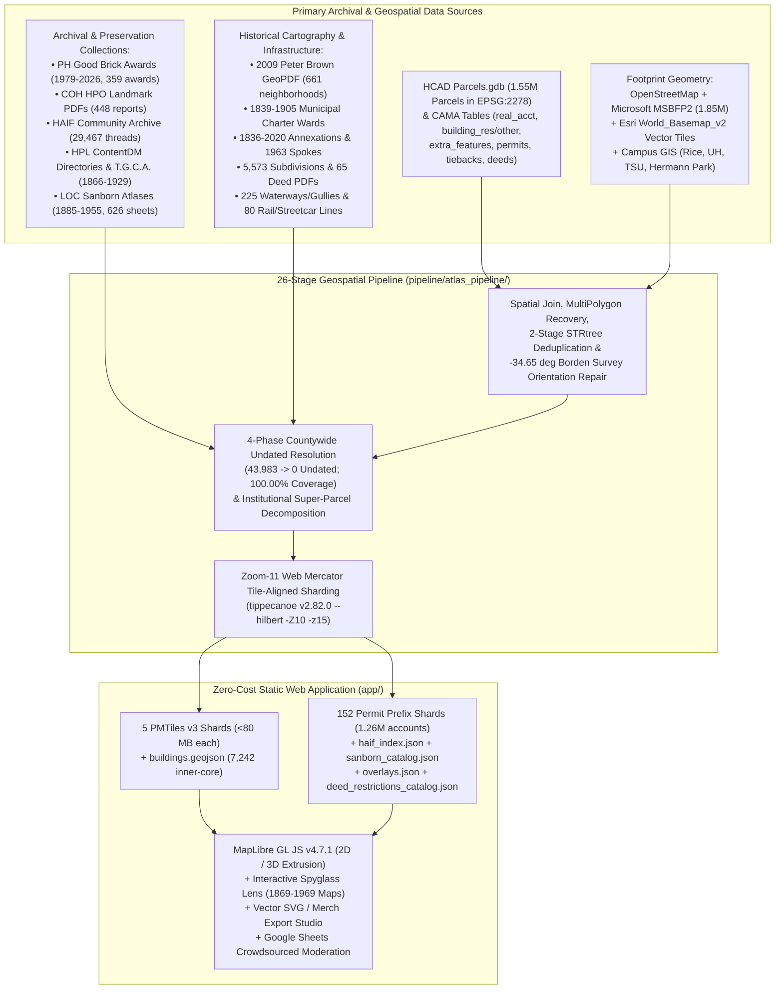

# Preservation Houston | The Houston Building Atlas (v2)

**An Open-Source, GPU-Accelerated Historical Cartography & Architectural Archive of 1,507,553 dated structures across Harris County, Texas (`1823-2026`).**


---

## Overview

**The Houston Building Atlas v2** replaces Preservation Houston's legacy cloud GIS prototype with a self-contained, zero-cost web application built on **MapLibre GL JS v4.7.1**, **PMTiles v3.2.0**, and a 26-stage geospatial data pipeline (`pipeline/atlas_pipeline/`).

Every building footprint in Harris County (`1,507,553` countywide structures across 5 Zoom-11 tile-aligned `.pmtiles` shards, plus `7,242` deeply curated historic inner-core structures) is paired with verified chronological provenance, architectural metadata, historical overlays, and primary archival sources spanning two centuries of Houston's growth.



---

## Comprehensive Engineering & Data Documentation (`docs/`)

Because creating a high-precision historical building atlas across 1.51 million structures required solving dozens of cartographic, geometric, OCR, and archival puzzles, we have documented every data source, transformation, bug diagnosis, and topological repair in an eight-chapter reference manual under [`docs/`](docs/):

### [Chapter 1: WebGL + PMTiles Architecture, Basemaps, 3D Extrusion & Client UX](docs/01-architecture-and-rendering.md)
- Replacing Google Earth Engine with MapLibre GL JS v4.7.1 and PMTiles v3.2.0.
- **Zoom-11 Web Mercator tile-aligned 5-shard `.pmtiles` partitioning** (`houston_buildings_{nw_w,nw_e,ne,sw,se}.pmtiles`, keeping every shard under GitHub's 100 MB limit with zero dropped buildings at `z >= 12`).
- RFC 7233 `HTTP 206 Partial Content` byte-range serving in `app/server.py`.
- **Basemap Engineering:** Replacing watermarked Carto tiles; capping Esri raster underlays at `maxzoom: 16` to eliminate Esri's `HTTP 200` `"Map data not yet available"` placeholder PNGs at `z >= 17`; layering crisp OpenFreeMap vector street casings; and adding `Solid Dark` (`#0B0E11`) and `Solid Light` (`#F5F2EB`) figure-ground poster modes.
- **3D Extrusion & Hardware Depth Occlusion:** Sub-centimeter prime-modulo height tie-breaker (`(year_built % 97) * 0.0003m`) to stop roof Z-fighting; ground-plane layer ordering; and `selected-feature-3d-extrusion` (`body`, `roof_collar`, `base_collar`, `corner_rib`, and `occluder` meshes sharing the GPU depth buffer).
- **Client UX:** Four-way overlapping feature cycling (`overlapStack`), Polygon Isolation Mode (`#isolate=`), High-Resolution Vector `.SVG` / T-Shirt / Coaster Export Studio (`#export-studio-modal`), and native browser Back/Forward history navigation (`pushState` vs. `replaceState`).

### [Chapter 2: Building Footprints, Spatial Joins & Countywide Geometry Repairs](docs/02-building-footprints-and-geometry-repairs.md)
- Combining OpenStreetMap, Microsoft US Building Footprints v2 (`1,847,281` polygons), Esri `World_Basemap_v2` vector tiles, and HCAD `Parcels.gdb` (`1,546,683` parcels in `EPSG:2278`).
- Two-stage spatial deduplication (`1,672,100 -> 1,507,553` footprints) and partial-block compound carve-outs (`Bethel Institutional Missionary Baptist Church`).
- **Countywide Polygon Orientation & Party-Wall Repair (`fix_polygon_orientations.py`):** Replacing `155,497` unrotated cardinal fallback boxes (`0°/90°` rectangles that sat crooked across Downtown's `-34.65°` 1836 Borden Survey grid) with parcel-oriented `shapely.oriented_envelope` footprints, and fixing `5,609` zero-lot-line party-wall misattributions caused by `ring[0]` first-vertex matching (`AT&T Central Building`, `Sam Houston Hotel`, Market Square rowhouses).
- **Multi-Block `MultiPolygon` Parcel Recovery (`recover_dropped_footprints.py`):** Preserving all sub-polygons of `5,573` multi-part HCAD parcels across street rights-of-way (recovering all 4 blocks of `Camden City Centre` at `301 St Joseph Pkwy`, `GreenStreet`, and `Marriott Marquis`).
- **Warehouse District & Bridge Deck Audit (`fix_warehouse_district.py`):** Removing the `420m` **Elysian Viaduct highway bridge deck** fused into `902 Hardy St`, separating the `1850` Richey-Fant House + `1949` Last Concert Café + `1986` Stage at `1403 Nance St`, and suppressing open-air METRO transit canopies.
- **Multi-Footprint Industrial & Circular Storage Tank Recovery (`fix_industrial_multi_footprints.py`):** Preserving `4,746` multi-building industrial footprints and extracting `+7,292` circular petrochemical storage tanks (`12,038` total footprints) across the Houston Ship Channel and ExxonMobil Baytown Refinery.
- **Main House vs. Carriage House Disambiguation (`C. Milby Dow House`)**, cross-parcel party-wall suppression (`suppress_shard_hcads` on `Rutherford B. H. Yates House`), and synchronizing `3,840` legacy synthetic rectangles in `buildings.geojson` with aligned shard footprints (`408 Marshall St`).

### [Chapter 3: 100% Countywide Chronology, Institutional Campuses & Undated Resolution](docs/03-chronology-institutions-and-undated-resolution.md)
- **Decomposing Tax-Exempt Institutional Super-Parcels (`enrich_institutions.py`):** Splitting `year_built = 0` super-parcels into `525` individually dated campus structures across **Rice University** (`112` buildings, excluding `SPECNAME = 'Covered Walkway'` polygons that fused Lovett Hall and Fondren Library), **University of Houston & UHD** (`169`), **Texas Southern University** (`64`), **Hermann Park, Houston Zoo & Museum District** (`154`), **UST / Menil / TMC** (`26`), and **Sam Houston Park / The Heritage Society** (`12` relocated 19th-century structures).
- **Four-Phase Countywide Undated (`year_built == 0`) Resolution (`resolve_undated_countywide.py`):** How all `43,983` undated footprints across `18,303` parcels were brought to **100.00% dated coverage (`0` undated)** with explicit `year_source` provenance badges (`curated_landmark`, `hcad_extra_feature`, `hcad_tieback`, `adjacent_owner`, `hcad_permit`, `campus_contiguity`, `hcad_deed`, `subdivision_median`, `blockface_median`).
- **Civic & Stadium Corrections:** Restoring the `1910` Harris County Courthouse, `1952` Juvenile Justice Center, `1939` City Hall, `1926` Julia Ideson Building, `1940` Air Terminal Museum, and separating `2012` Shell Energy Stadium (`2200 Texas Ave`) from `1911` Union Station / Daikin Park (`501 Crawford St`).
- **HPL ContentDM City Directory Audit (`1866-1926`, `city_directory_audit.py`):** Solving OCLC's CloudFront WAF TCP reset and switching from `^all^and` (`95%` false positives) to `^exact^and` contiguous phrase matching across `3,176` rounded-decade properties.

### [Chapter 4: Preservation Layers, Landmark Designation Reports, HAIF & Archival Photography](docs/04-landmarks-good-brick-haif-and-photos.md)
- **Preservation Houston Good Brick Awards (`1979-2026`):** Filtering `460` raw entries to `359` place-based awards (`339` sites) and snapping street-centerline geocodes onto verified building footprints (`5500 Main St` Kinder Building vs. `5501 Main St` St. Paul's UMC; `301 E 5th St` Lund House & Modern Print Shop; `1125 Providence St` San Jacinto Warehouse).
- **City of Houston Landmark Designation Reports (`448` Official HPO PDFs):** Crawling `archaeology.houstontx.gov` (`var mydata`) and Wayback Machine CDX (`628` PDFs), fixing `11` off-by-one HPO server filename typos (`16PL128 -> 16PL127`, `08L203 -> 08L202`), filling `+140` missing dates (`99.8%` dated) and `+144` architectural styles, applying `75` HCAD year overrides, and generating the 61-item post-2016 TPIA request checklist (`coh_landmarks_missing_pdfs_tpia.csv`).
- **Houston Architecture Info Forum (`HAIF`) Integration (`29,467` Threads):** Indexing 97 subforums via Wayback CDX while loading `media.invisioncic.com` photos directly; linking `7,741` footprints across `3,892` HCAD accounts to `3,385` HAIF threads; populating `building_name` + `alt_names` (`AKA`) across `4,833` HCAD accounts; and fixing URL-escaped UTF-8 strings (`%C3%A9`) and fused slash-words (`Stheights`).
- **Archival Photography & Wikimedia Relevance Filtering (`photoService.js`):** Filtering out off-topic aircraft cockpits and portraits at Hobby Airport / Downtown, enabling `.tif` HABS/Highsmith transcoding, adding the interactive **⇄ Then & Now** comparison slider, and framing uncropped vertical architecture photos over an ambient blurred backdrop.

### [Chapter 5: Neighborhoods, Historic Wards, Annexation History, Subdivisions & Deed Restrictions](docs/05-neighborhoods-wards-subdivisions-and-deeds.md)
- **Multi-Source Neighborhood Harmonization (`1,387` Boundaries):** Extracting `661` vernacular neighborhood polygons from the **2009 Peter Brown / Tony Topping ISO 32000 GeoPDF** (`/OC2` & `/OC13` lossless raster strips + `/OC4` vector labels in `EPSG:2278`), merging with COH GIS layers, and fixing **11 official COH GIS spelling errors** (`Woodkind Heights -> Woodland Heights`, `Idlywood -> Idylwood`, `Breaburn -> Braeburn`, `Yoacum -> Yocum`, `Nottingham Forrest -> Nottingham Forest`).
- **Historic Wards (`1839-1905`) & Debunking the Erroneous 1920 COH GIS Ward Layer:** Forensic proof that COH's `WardBoundaries_1920` (`Layer 6`) was traced in 2018 from a March 1981 library exhibit poster drawn with magic marker onto a `22 sq. mi.` 1920 street map (15 years after Houston abolished wards in 1905!), and reconstruction of the **4 authentic `9 sq. mi.` (`3 x 3 mile`) municipal charter ward eras (`1839`, `1866`, `1896`, `1903-1905`)**.
- **City of Houston Annexation History (`1836-2020`):** Dissolving incremental "donut slice" seams, restoring the repealed `1839` tilted survey hole subtracted from the `1840` 9-sq-mi square, and separating `full_purpose` city limits from the **Nov. 20, 1963 (`Ord. 63-1219`) `"10-ft strip"` defensive highway spokes**, the 1965 `IAH` airport strips, and 770+ Limited-Purpose MUD SPA strips.
- **Platted Subdivisions (`5,573` Polygons), WHCA Map Forensics & 3-Tier Deed Restrictions:** Diagnosing the 2019 WHCA map bugs (`BELTZ -> "Belt 3"` misplacing *Germantown*, `lgl_3` wrap-around creating `"WH ??"` blocks, single-lot replat islands), hosting **65 full-text searchable Deed Restriction PDFs** (`app/public/deeds/`), mapping **910 COH Chapter 42 SMLS / SMBL / Conservation zones**, and linking to the Harris County Clerk Real Property archive.

### [Chapter 6: Library of Congress Sanborn Fire Insurance Atlases, Historical Map Spyglass & Lost Houston](docs/06-sanborn-maps-and-lost-houston.md)
- **Georeferenced Historical Maps (`1869-1969`) & Spyglass Lens Math:** Fixing the `512 px` vs. `256 px` WebGL world-size zoom offset (`effectiveTileZoom = vpZoom + 1`) and 3D perspective projection inside `#spyglass-canvas`.
- **LOC Sanborn Fire Insurance Atlases (`1885-1955`, `626` IIIF Sheets across 10 Volumes):** Leveraging CloudFront power-of-two wavelet pre-caching (`pct:12.5` & `pct:25` in `< 60 ms` vs. `pct:35` 6-second cold decodes), resolving non-sequential `-covr` and `-0001s` skeleton map suffixes, matching printed sheet `code` vs. `sp`, and using canonical `/item/sanborn08580_...` URLs.
- **Lost Houston (`73` Surveyed Demolished Landmarks):** Sanborn Underwriters material color coding, fixing the `-34.65°` Borden Survey grid rotation (`fit_rect_in_parcel`), bidirectional "Previous Historic Structures on This Site" cross-referencing (`1837 First Capitol` & `1883 Capitol Hotel` under the `1913 Rice Hotel`), and **Historical Snapshot Mode**.

### [Chapter 7: Historical Waterways, Railroads, Multi-Era Permits & HMRC Contractor Archives](docs/07-waterways-railroads-permits-and-contractors.md)
- **Historical Waterways & Buried Gullies (`225` Segments, `1,896.8 km`):** Merging USGS NHD, HCFCD (`M3` sub-basins), and TNRIS into `218` continuous open bayous/creeks with culvert confluence snapping, plus **7 daylighted/buried historic gullies** traced from 1836-1954 maps (*Downtown East & West Gullies*, *Frost Town Gully*, *Freedmen's Town Gully*, *Carter's Gully*, *Montrose Mandell Swale*, *Blodgett Gully*).
- **Historical Railroads, Streetcars & Depots (`80` Corridors + `14` Depots):** Merging FraN and TxDOT active trunks with abandoned rail trails (*Columbia Tap*, *MKT*, *SA&AP*), **1891-1938 electric streetcar & Galveston-Houston Interurban lines**, and 14 historic depots/shops.
- **Multi-Era Building Permits, HMRC Contractor Monographs & Relocated Structures:** Streaming `1,300,027` HCAD permits and `649,693` appraiser remodel notes into **152 on-demand prefix shards (`permits_<prefix3>.json`)**; extracting 1917-1929 contractor records from *The Russell Brown Company* and the *T.G.C.A. Monthly Bulletin* (`408 Marshall St` built **July 1924** for **\$7,500**); migrating retired `digital.houstonlibrary.org` links (`HTTP 302`) to `cdm17006.contentdm.oclc.org` + inline PDF endpoints; and filtering out HCAD `permit_type = 15` (`OMITTED IMPS`) false positives from the **385 Relocated Historic Structures**.
- **Live Daily Demolition, Sewer Disconnection & Asbestos Early-Warning Pipeline (`fetch_live_permits.py` & `.github/workflows/update_live_permits.yml`):** Automated daily surveillance across **City of Houston Sold Permits** (`cohtora.houstontx.gov` WebFOCUS + weekly `.xlsx` reports) and **Texas DSHS Online Asbestos & Demolition Notifications** (`vo.ras.dshs.state.tx.us`, including 3-page PDF extraction via `pdftotext`), surfacing `15` active preservation alerts (`active_permit_alerts.json`, including the `1894`/`1928` **John Henry Kirby Mansion** at `2000 Smith St`) on the map and in the Inspector Panel.

### [Chapter 8: Crowdsourced Moderation Pipeline, Live HCAD API & Admin Operations](docs/08-crowdsourcing-and-admin-operations.md)
- Zero-cost Google Sheets moderation backend (`Pending_Submissions` -> `Approved_Edits` live CSV hydration + `Admin_Hub_&_Quick_Filter` + 12 Saved Filter Views).
- Live HCAD ArcGIS REST & encrypted token-brokered appraisal lookup (`hcadService.js`).
- Pre-warmed O(1) global search index (`search_index.json`) and complete 26-script pipeline rebuild reference table.
- Automated 4-layer verification suite (`45` stratified property archetypes across `15` equivalence classes) and live [**External Archive & Municipal Link Health Report (GitHub Issue #1)**](https://github.com/davemorris-gcp/houston-building-atlas/issues/1).

---

## Quickstart & Local Development

### 1. Run the Web Application Server (`HTTP 206` Byte-Range Enabled)
The frontend lives in `app/` and requires zero build step or external Node bundler. Start the RFC 7233 byte-range server (`app/server.py`) so PMTiles v3 archives stream via `HTTP 206 Partial Content`:

```bash
python3 app/server.py --port 8787
```

Then open **`http://localhost:8787`** in any modern browser.

### 2. Run the Geospatial Data Pipeline (`pipeline/`)
The Python geospatial pipeline uses [`uv`](https://github.com/astral-sh/uv) (`Python 3.13`) and `tippecanoe v2.82.0`:

```bash
cd pipeline
uv sync

# Example: Re-apply curated overrides and recompile modified PMTiles shards
uv run python -m atlas_pipeline.update_pmtiles_from_overrides
```

### 3. Automated Testing, 45-Archetype Verification & Live External Archive Link Health
Every pull request and push to `main` is gated by a deterministic verification pipeline (`.github/workflows/deploy-pages.yml`), paired with an automated weekly Monday external archive link crawler (`.github/workflows/external-link-health.yml`) that publishes live status to [**GitHub Issue #1: External Archive Link Health Report (Automated CI Monitor)**](https://github.com/davemorris-gcp/houston-building-atlas/issues/1) (also linked directly inside the Moderation Google Sheet on `Admin_Hub_&_Quick_Filter` Cell `H14` and `Instructions_&_Apps_Script` Row `21`):

```bash
# Regenerate the 45 Stratified Property & Overlay Archetypes (15 equivalence classes x 3)
node scripts/build_test_archetypes.mjs

# Layer 1: Fast deterministic schema, WGS84 bounds, GitHub Pages bundle size, filterStore, portfolio & dead-URL pattern unit tests (~1.3s)
node tests/unit/run_all.mjs

# Layer 2: Headless Chromium Playwright E2E suite (HTTP 206 PMTiles check, global modals, Guided Chapters 1..6, Portfolios, Plat Monitor, and all 45 archetypes across 4 inspector tabs + Wide View, harvesting rendered external URLs)
uv run --directory pipeline pytest ../tests/e2e -v

# Layer 3: Live external municipal, county, state, university & archival HTTP 200/206 + soft-404 link health crawler (776 unique URLs across 55 domains)
node scripts/check_external_links.mjs
```

---

## Repository Structure

```text
houston-building-atlas/
├── README.md                                  # Master overview, architecture & documentation index
├── .github/workflows/
│   ├── deploy-pages.yml                       # Pre-deploy Layer 1 + Layer 2 E2E gate & GitHub Pages deploy
│   ├── external-link-health.yml               # Weekly Monday live link crawler updating GitHub Issue #1
│   └── update_live_permits.yml                # Daily COH sold permits, DSHS asbestos & HAHC COA sync
├── docs/                                      # Comprehensive 8-chapter engineering & archival manual
│   ├── 01-architecture-and-rendering.md
│   ├── 02-building-footprints-and-geometry-repairs.md
│   ├── 03-chronology-institutions-and-undated-resolution.md
│   ├── 04-landmarks-good-brick-haif-and-photos.md
│   ├── 05-neighborhoods-wards-subdivisions-and-deeds.md
│   ├── 06-sanborn-maps-and-lost-houston.md
│   ├── 07-waterways-railroads-permits-and-contractors.md
│   ├── 08-crowdsourcing-and-admin-operations.md
│   ├── GOOGLE_SHEETS_AND_CITY_DIRECTORY_GUIDE.md
│   └── images/                                # 27 screenshots & raw archival source scans
├── scripts/
│   ├── build_test_archetypes.mjs              # Deterministically selects 45 archetypes across 15 classes
│   └── check_external_links.mjs               # Polite per-host HTTP 200/206 & soft-404 archive crawler
├── tests/
│   ├── fixtures/stratified_archetypes.json    # 45 canonical Harris County property & overlay archetypes
│   ├── unit/                                  # Layer 1 Node.js unit, schema, bundle & URL-validator tests
│   └── e2e/                                   # Layer 2 Playwright Headless Chromium WebGL & DOM E2E suite
├── app/                                       # Static WebGL + PMTiles web application
│   ├── index.html                             # Main Atlas UI, Modals, Guided Tours & Export Studio
│   ├── server.py                              # RFC 7233 HTTP 206 Partial Content & HCAD proxy server
│   ├── css/styles.css                         # Preservation Houston Archival Dark/Light design system
│   ├── js/
│   │   ├── app.js                             # Application controller, Inspector, Search & History state
│   │   ├── map.js                             # MapLibre GL JS v4.7.1 + 5-shard PMTiles + 3D + Spyglass
│   │   ├── config.js                          # Era palettes, basemaps, historical map tile catalogs
│   │   ├── photoService.js                    # Multi-source archival photo resolver & relevance scorer
│   │   ├── hcadService.js                     # Live HCAD ArcGIS REST & encrypted token client
│   │   ├── exportStudio.js                    # High-res vector SVG & 300-DPI PNG Merch/Print generator
│   │   └── dataService.js                     # GeoJSON, overlays, and Google Sheets CSV loader
│   └── public/
│       ├── deeds/                             # 65 mirrored full-text searchable deed restriction PDFs
│       └── data/
│           ├── houston_buildings_nw_w.pmtiles # Far NW Shard (390,992 footprints, 78.5 MB)
│           ├── houston_buildings_nw_e.pmtiles # Near NW Shard (299,221 footprints, 64.5 MB)
│           ├── houston_buildings_ne.pmtiles   # NE Shard (247,550 footprints, 51.8 MB)
│           ├── houston_buildings_sw.pmtiles   # SW Shard (314,327 footprints, 66.1 MB)
│           ├── houston_buildings_se.pmtiles   # SE Shard (255,463 footprints, 55.6 MB)
│           ├── buildings.geojson              # 7,242 deeply curated inner-core footprints
│           ├── curated_overrides.json         # Verified archival overrides & multi-building keys
│           ├── overlays.json                  # Landmarks, Good Brick, Wards, Subdivisions, Rail, Waterways
│           ├── sanborn_catalog.json           # 626 Library of Congress Sanborn IIIF sheets (1885-1955)
│           ├── deed_restrictions_catalog.json # 3-tier deed restrictions & COH Chapter 42 catalog
│           ├── haif_index.json                # 7,741 buildings linked to 3,385 HAIF threads
│           ├── building_photos.json           # Curated HABS, HPO, HAIF & Wikimedia archival photos
│           ├── search_index.json              # Pre-compiled global autocomplete index
│           └── permits/                       # 152 on-demand HCAD permit shards (permits_001..152.json)
└── pipeline/                                  # 26-stage geospatial & archival Python pipeline
    ├── pyproject.toml
    └── atlas_pipeline/
```
