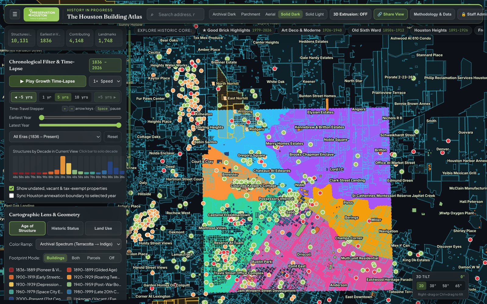
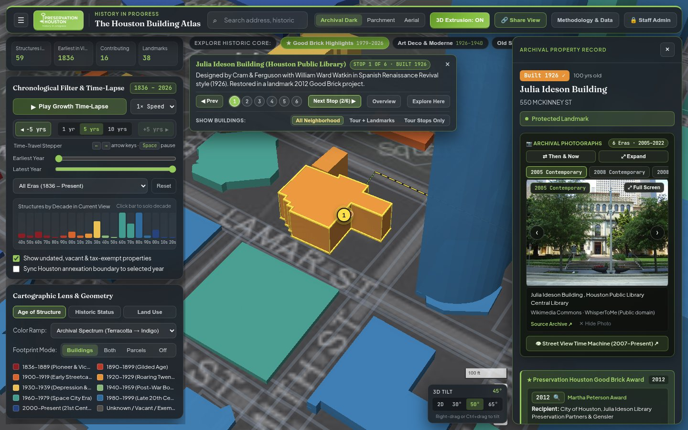
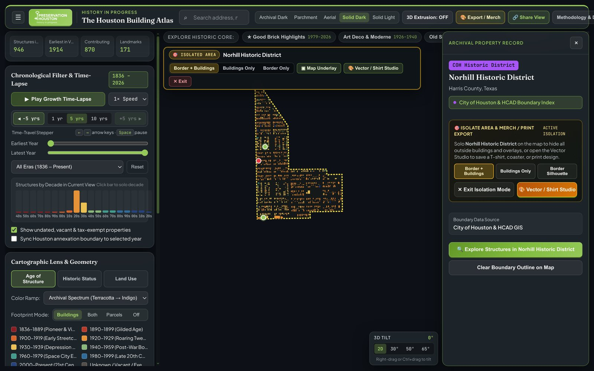
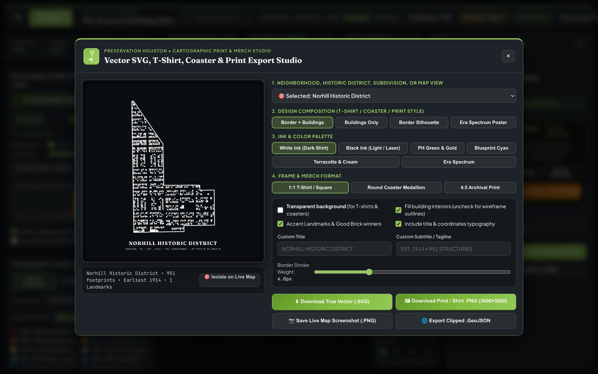

# Chapter 1: WebGL + PMTiles Architecture, Basemaps, 3D Extrusion & Client UX

[← Back to Master README](../README.md) | [Next: Chapter 2 - Building Footprints & Geometry Repairs →](02-building-footprints-and-geometry-repairs.md)

---

## 1. Replacing Google Earth Engine with a Zero-Cost Open-Source Stack

The original Preservation Houston Building Atlas prototype relied on proprietary hosted cloud GIS vector and feature-view assets paired with a commercial web mapping API frontend. That architecture created three structural bottlenecks:

1. **Authentication and Recurring Cloud Costs:** GEE asset serving required active Google Cloud billing, service-account token brokerage, and proprietary `FeatureView` tile quotas.
2. **Opaque Server-Side Geometry:** Updating a single building date, splitting a merged warehouse polygon, or adding a historic overlay required re-ingesting gigabytes of shapefiles into Google's cloud pipeline.
3. **Limited Client-Side Interactivity:** GEE `FeatureView` layers offered restricted client-side expression filtering, no true 3D building extrusion with hardware depth occlusion, and no sub-millisecond hover inspection across overlapping historic layers.

In October 2026, the platform was re-architected into **The Houston Building Atlas v2**, a zero-cost, self-contained web application powered by **MapLibre GL JS v4.7.1**, **PMTiles v3.2.0**, and a dual-tier rendering engine that combines GPU-accelerated vector tiles (`1,507,553` footprints across all of Harris County) with an interactive historic core (`7,242` curated inner-loop structures) and an HTML5 2D Canvas fallback for headless or software-rendered environments.



---

## 2. Zoom-11 Tile-Aligned 5-Shard PMTiles Partitioning

A central engineering challenge was packaging **1,507,553 Harris County building footprints** (each carrying 15+ metadata attributes including HCAD account ID, construction year, provenance source, architectural style, architect, historic district, and land use) into static files that can be hosted directly inside a standard GitHub repository without Git LFS or external cloud buckets.

GitHub enforces a strict **100 MB per-file hard limit** (`50 MB` warning threshold). A single monolithic `.pmtiles` archive for Harris County with full polygon precision at zoom 15 exceeds 310 MB, and using standard `tippecanoe` automatic feature-dropping flags (`--drop-densest-as-needed` or `--coalesce-densest-as-needed`) causes two unacceptable artifacts:
- At zoom levels 12 to 14, residential bungalows in dense historic neighborhoods (such as the Heights, Montrose, and Freedmen's Town) randomly disappear until the user zooms to level 15.
- When partitioning a county into spatial quadrants, any split line that does not fall on an exact Web Mercator tile boundary causes `tippecanoe` to clip or duplicate shared boundary tiles across shards.

### Solution: Web Mercator Zoom-11 Tile-Aligned Sharding (`split_pmtiles_quadrants.py`)

Instead of arbitrary lat/lon bounding boxes, `pipeline/atlas_pipeline/split_pmtiles_quadrants.py` partitions the county along exact **Zoom-11 Web Mercator slippy-map tile boundaries**:

| Boundary Constant | Coordinate (`EPSG:4326`) | Web Mercator Tile Boundary | Purpose |
| :--- | :--- | :--- | :--- |
| `SPLIT_LAT` | `29.76437738° N` | Between row `Y = 846` and `Y = 847` at `Z = 11` | North / South division along the Buffalo Bayou / I-10 corridor |
| `SPLIT_LON_EAST` | `-95.361328125° W` | Between col `X = 481` and `X = 482` at `Z = 11` | East / West division through Downtown Houston |
| `SPLIT_LON_WEST` | `-95.537109375° W` | Between col `X = 480` and `X = 481` at `Z = 11` | Subdivides the dense Northwest quadrant along Beltway 8 / Memorial City |

Each building is assigned to a single shard based on its primary vertex (`ring[0]`), and compiled via `tippecanoe v2.82.0` (`--hilbert -Z10 -z15 --no-feature-limit --no-tile-size-limit` at high zooms) so that **zero buildings are dropped at `z >= 12`**:

| PMTiles Shard | Spatial Sector | Building Footprints | Archive Size | GitHub Limit Status |
| :--- | :--- | ---: | ---: | :--- |
| `houston_buildings_nw_w.pmtiles` | Far Northwest (Cypress, Katy, Addicks, Spring Branch West) | `390,992` | `78.5 MB` | Under 100 MB limit |
| `houston_buildings_nw_e.pmtiles` | Near Northwest (Heights, Garden Oaks, Spring Branch East, Aldine) | `299,221` | `64.5 MB` | Under 100 MB limit |
| `houston_buildings_ne.pmtiles` | Northeast (Kingwood, Humble, Kashmere Gardens, Fifth Ward, Crosby) | `247,550` | `51.8 MB` | Under 100 MB limit |
| `houston_buildings_sw.pmtiles` | Southwest (Montrose, River Oaks, Meyerland, Sharpstown, Alief) | `314,327` | `66.1 MB` | Under 100 MB limit |
| `houston_buildings_se.pmtiles` | Southeast (Downtown South, Third Ward, Clear Lake, Pasadena, Baytown) | `255,463` | `55.6 MB` | Under 100 MB limit |
| **Total (5 Shards)** | **Full Harris County Coverage** | **1,507,553** | **316.5 MB** | **All shards < 80 MB** |

### HTTP 206 Byte-Range Serving (`app/server.py`)

PMTiles v3 operates by issuing HTTP `Range: bytes=start-end` requests to read only the specific B-tree directory pages and compressed MVT tile payloads needed for the current viewport. Python's standard `http.server.SimpleHTTPRequestHandler` ignores `Range` headers and returns `HTTP 200 OK` with the entire 78 MB file on every tile request.

To make local development and self-hosted deployments instantaneous, `app/server.py` implements an RFC 7233 `Range` parser that:
- Advertises `Accept-Ranges: bytes` and CORS headers (`Access-Control-Allow-Origin: *`, `Access-Control-Expose-Headers: Content-Range, Content-Length, Accept-Ranges`).
- Parses `Range: bytes=start-end` requests and streams only the requested slice with `HTTP 206 Partial Content`.
- Wraps `send_head()` and `copyfile()` in socket disconnect handlers (`BrokenPipeError`, `ConnectionResetError`) so rapid map panning never crashes or floods server logs.

---

## 3. Basemap Engineering & Eliminating Missing-Tile Placeholders

Selecting and configuring the underlying basemap required solving two subtle tile-provider failure modes discovered during testing:

### Problem 1: Carto Raster Watermarks
Early builds used Carto's dark and light raster tile endpoints (`basemaps.cartocdn.com`). Without an enterprise commercial contract, Carto periodically injects `"API KEY REQUIRED"` watermark tiles across high-zoom urban views. All Carto endpoints were removed from `app/js/config.js`.

### Problem 2: Esri Zoom 17+ Placeholder PNGs (`maxzoom: 16` Fix)
We replaced Carto with Esri's public `Canvas/World_Dark_Gray_Base` and `Canvas/World_Light_Gray_Base` raster tiles, plus `World_Imagery` (satellite) and `World_Topo_Map`. However, when zooming past level 16 (`z = 17` to `z = 20`) to inspect individual building footprints or courtyard bungalows, the basemap suddenly turned into a grid of gray squares reading `"Map data not yet available"`.

Investigation of network responses revealed why MapLibre was not over-zooming the zoom-16 tiles:
- Instead of returning `HTTP 404 Not Found` at `z >= 17`, Esri's `World_Dark_Gray_Base` and `World_Light_Gray_Base` servers return `HTTP 200 OK` with a valid `256x256` PNG image containing the rendered text `"Map data not yet available"`.
- Because the HTTP status is `200`, MapLibre treats the placeholder image as a genuine map tile and renders it instead of scaling up the zoom-16 tile.

### Solution: Hybrid Raster + OpenFreeMap Vector Basemap Architecture
In `app/js/config.js` and `app/js/map.js`:
1. All Esri raster tile sources (`Archival Dark`, `Archival Light`, `Esri World Imagery`, `Topographic`) are explicitly capped at `maxzoom: 16` (`World_Imagery` at `maxzoom: 18`), instructing MapLibre to stop requesting tiles above zoom 16 and smoothly upscale the crisp zoom-16 raster canvas up to zoom 20.
2. For `Archival Dark` and `Archival Light`, the atlas layers **OpenFreeMap** (`https://tiles.openfreemap.org/planet`) vector road casings, road fills, waterways, parks, and crisp highway/street-name labels directly on top of the Esri canvas. Even at zoom 19.5, street casings and street numbers remain razor-sharp vector geometry.
3. Two pure vector-free canvas modes were added to `#basemap-select`:
   - `Solid Dark (No Map Underlay)` (`#0B0E11` obsidian background)
   - `Solid Light (No Map Underlay)` (`#F5F2EB` warm archival vellum background)
   These modes hide all raster and street layers (`visibility: none`), turning the 1.51 million color-coded building footprints into a pure figure-ground architectural poster where negative space reveals Houston's street grid, bayous, and rail corridors.

---

## 4. 3D Extrusion, Z-Fighting Elimination & Hardware Depth Occlusion

When users toggle **3D Buildings** (`3D: ON` or via the bottom-right **3D Tilt Dock** at `2D`, `30°`, `50°`, or `65°`), building footprints extrude to their structural heights (`height_m`, derived from story counts and LIDAR/OSM roof heights). Three WebGL rendering problems had to be solved to achieve clean 3D visuals:



### 4.1 Deterministic Sub-Centimeter Height Tie-Breaker (Eliminating Roof Shimmer)
When adjacent rowhouses, townhomes, or overlapping compound wings share the exact same `height_m` value (for example, `8.0m` for a two-story structure), WebGL's depth buffer suffers from coplanar polygon Z-fighting on roof surfaces, producing flickering diagonal stripes as the camera rotates.

In `app/js/map.js` (`_getExtrusionHeightExpr`), every extruded building receives a deterministic sub-centimeter vertical offset based on its construction year:
```javascript
['+', ['coalesce', ['get', 'height_m'], 5.0], ['*', ['%', ['coalesce', ['get', 'year_built'], 0], 97], 0.0003]]
```
This adds at most `2.9 centimeters` (`0.029m`) of height variation across prime modulo 97, which is invisible to the human eye but guarantees distinct floating-point depth values in the GPU depth buffer.

### 4.2 Ground-Plane Layer Ordering Beneath 3D Extrusions
In MapLibre GL JS, any `fill` or `line` layer placed *after* a `fill-extrusion` layer in the style stack is painted in 2D screen space directly on top of the 3D buildings, making ground parcels, historic district fills, and unextruded footprints appear to float across the middle of skyscrapers.

To prevent this, `map.js` inserts all 2D ground layers (`parcels-fill`, `buildings-fill`, `buildings-outline`, `pmtiles-buildings-fill`, `selected-parcel-highlight`, and boundary overlays) *beneath* `pmtiles-buildings-3d` and `buildings-3d`, and automatically sets `buildings-fill` and `buildings-outline` opacity to `0` whenever `is3D` is active.

### 4.3 Hardware Depth-Occluded 3D Selection Wireframe (`selected-feature-3d-extrusion`)
Highlighting a selected building in 3D mode is notoriously difficult in MapLibre:
- If you draw a 2D `line` layer (`selected-feature-outline`) over the selected building, the 2D ground ring renders straight through the 3D roof of the building (and through any taller building standing in front of it), creating a confusing "X-ray" double image.
- If you simply re-color the entire 3D building solid cyan, its architectural era color is lost.

Instead, `_build3DSelectionWireframeFeatures(feature)` in `app/js/map.js` dynamically constructs a multi-part `fill-extrusion` geometry (`selected-feature-3d-extrusion`) that shares the GPU's hardware depth buffer:
1. **`body`:** The selected building's own 3D volume (`+0.04m` above roof) so its interior depth-writes into the WebGL Z-buffer and masks the back-facing wall segments.
2. **`roof_collar`:** A `0.9m` thick hollow collar ring extruded at `[h - 0.35m, h + 0.18m]` around the roof perimeter, rendered in bright cyan (`#00F5D4`).
3. **`base_collar`:** A `0.9m` thick hollow collar ring at `[0m, min(0.55m, h * 0.15)]` around the ground base.
4. **`corner_rib`:** Vertical `0.85m x 0.85m` 3D corner columns at every exterior vertex where the wall angle turns by more than `12°`, creating true vertical wireframe edges that are naturally occluded by the building's own front walls.
5. **`occluder`:** Neighboring 3D buildings within `150m` from the active viewport are copied into the same `fill-extrusion` layer with their era colors so taller foreground buildings cleanly occlude the selected building's wireframe in the shared hardware depth pass.

---

## 5. Multi-Layer Overlap Cycling, Isolation Mode, Export Studio & Browser History

### 5.1 Four-Way Overlapping Feature Selection & Click-to-Cycle UX
A single click in historic Houston frequently intersects multiple stacked cartographic features: for example, a **1912 bungalow** (`buildings-fill`) standing inside a **Lost Houston demolished site** (`lost-houston-fill`), a **Platted Subdivision** (`subdivisions-fill`), a **Historic Ward** (`wards-fill`), and a **City of Houston Annexation polygon** (`annexations-fill`).

To ensure every layer is reachable without turning off overlays:
- Clicking any point on the map collects all intersecting features across buildings, Lost Houston footprints, waterways, railroads, subdivisions, neighborhoods, wards, historic districts, and annexations into an ordered `overlapStack`.
- Clicking the **same spot again** (`< 18 px` screen distance) automatically cycles to the next overlapping feature in the stack (`2 of 4`, `3 of 4`, etc.).
- Both a floating map bar (`#map-overlap-bar`) and an inspector header strip (`#inspector-overlap-stack`) display one-click pills for every overlapping feature at that coordinate.

### 5.2 Polygon Isolation Mode & Vector Export / Merch Studio
When inspecting any boundary polygon (a neighborhood, historic ward, platted subdivision, historic district, or annexation era), users can click **Isolate Polygon Buildings** (`#isolate=type:name`):

|  |  |
| :---: | :---: |
| *Polygon Isolation Mode on Norhill Historic District* | *Vector SVG & T-Shirt Export Studio* |

- **Client-Side Point-in-Polygon Clipping:** `_applyPolygonIsolationFilter` computes the bounding box and exact multi-ring geometry of the chosen polygon, hiding all building footprints outside its boundary across both the curated GeoJSON source and the 5 countywide PMTiles shards.
- **High-Resolution SVG & 300-DPI PNG Export Studio (`#export-studio-modal`):** Users can open the **Export / Merch** studio (`app/js/exportStudio.js`) to generate publication-ready vector `.SVG` files and `3000 x 3600 px` transparent or solid-backdrop `.PNG` posters in five presets:
  1. *Archival Map Print (Framed Poster)*
  2. *T-Shirt Graphic - White Ink (Transparent)*
  3. *T-Shirt Graphic - Black Ink (Transparent)*
  4. *T-Shirt Graphic - Full Color Era Spectrum (Transparent)*
  5. *Drink Coaster / Circular Medallion*

### 5.3 Deep-Linking & Native Browser Back / Forward Navigation (`popstate`)
Every meaningful view state in the atlas is encoded in the URL hash (`#lat=...&lng=...&z=...&pitch=...&bearing=...&start=...&end=...&mode=...&ramp=...&basemap=...&layers=...&spy=...&hcad=...&bnd=...&isolate=...&tour=...`).

To make exploring the map feel like navigating a native hypertext archive, `app/js/app.js` distinguishes between **continuous camera/slider adjustments** and **discrete user selections**:
- **Continuous adjustments** (`moveend`, time-slider dragging, layer checkbox toggles) call `window.history.replaceState(...)`, updating the URL bar in place without cluttering browser history.
- **Discrete navigation actions** (clicking a building footprint, selecting a boundary or Lost Houston landmark, cycling an overlap pill, starting or advancing a guided walking tour, or clearing selection) call `window.history.pushState(...)`.
- A `window.addEventListener('popstate', ...)` handler restores the exact camera position, active layers, time filter, and open inspector dossier when the user clicks the browser **Back** or **Forward** buttons.

---

[← Back to Master README](../README.md) | [Next: Chapter 2 - Building Footprints & Geometry Repairs →](02-building-footprints-and-geometry-repairs.md)
