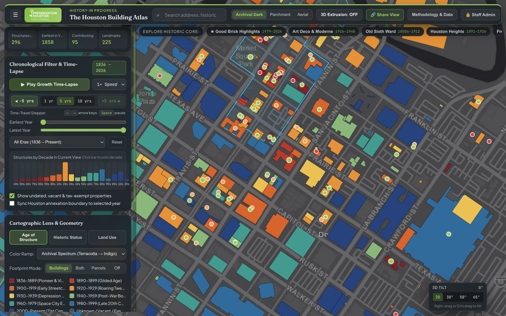
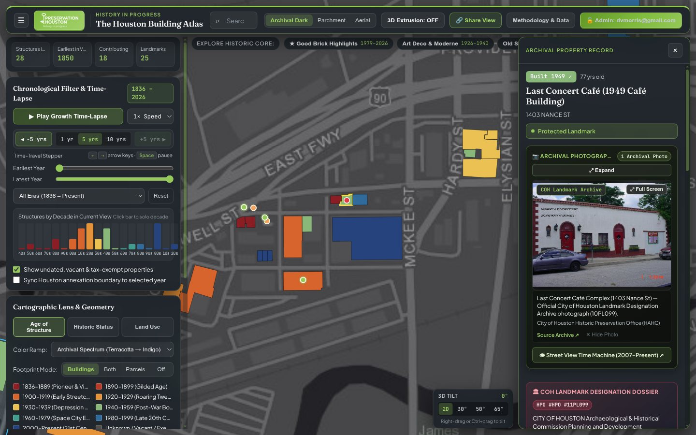
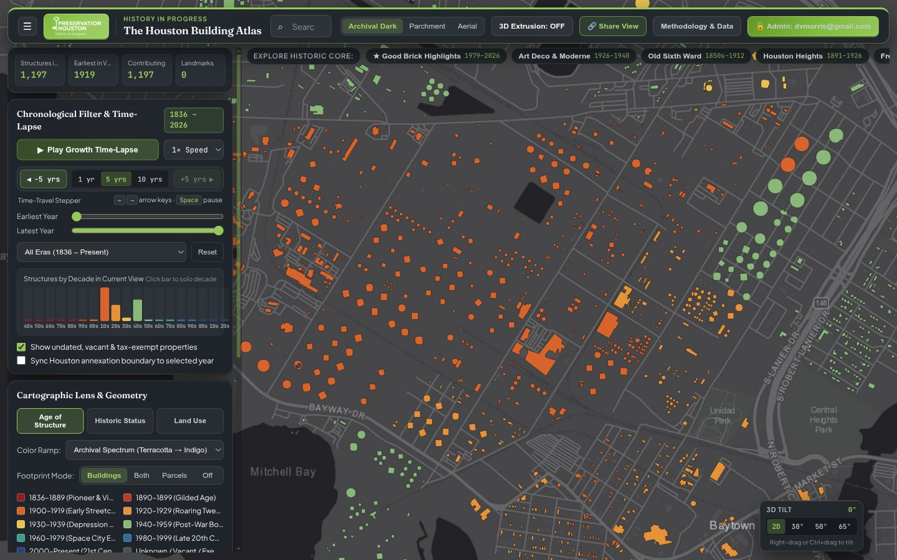
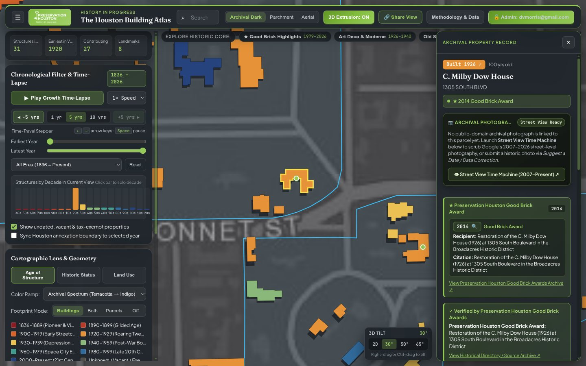

# Chapter 2: Building Footprints, Spatial Joins & Countywide Geometry Repairs

[← Chapter 1: Architecture & Rendering](01-architecture-and-rendering.md) | [Back to Master README](../README.md) | [Next: Chapter 3 - Chronology & Undated Resolution →](03-chronology-institutions-and-undated-resolution.md)

---

## 1. Multi-Source Footprint Ingestion & Spatial Join Pipeline

No single open dataset contains accurate building outlines and historical construction dates for all 1.51 million structures in Harris County:
- **Harris County Appraisal District (`HCAD`)** provides authoritative parcel polygons (`Parcels.gdb`, `1,546,683` parcels in `EPSG:2278` NAD83 Texas South Central Feet) and tabular appraisal records (`real_acct.txt`, `building_res.txt`, `building_other.txt`), but HCAD does not publish public building roof outlines.
- **OpenStreetMap (`OSM`)** provides high-precision footprints in Downtown, the Texas Medical Center, and university campuses, along with `height`, `building:levels`, and `name` tags, but covers less than 18% of suburban Harris County.
- **Microsoft US Building Footprints v2 (`MSBFP2`)** provides `1,847,281` machine-learning-derived roof polygons across Harris County (`Texas.geojson.zip`), but carries zero attribute metadata (no dates, no addresses, no parcel IDs) and systematically misses circular industrial structures while occasionally fusing adjacent commercial roofs or highway viaducts.
- **Esri `World_Basemap_v2` Vector Tiles** capture circular storage tanks and newer post-2022 subdivision construction missed by earlier ML passes.

### High-Throughput Spatial Join (`build_countywide_shards.py`)
Processing 1.85 million footprints against 1.55 million multi-vertex parcel polygons in Python requires careful vectorized spatial indexing:
1. `Parcels.gdb` is read directly via `pyogrio.raw.read` into raw WKB byte arrays, parsed in bulk with `shapely.from_wkb`, transformed from `EPSG:2278` (US Survey Feet) to `EPSG:4326` via `pyproj.Transformer`, and indexed in a C-level `shapely.STRtree`.
2. Each footprint is matched to its containing HCAD parcel (`HCAD_NUM`), inheriting the parcel's `site_addr_1`, `year_built`, `econ_bld_class`, `land_use`, and historic designations.
3. For multi-building parcels (such as apartment complexes, historic homesteads with carriage houses, or commercial plazas), individual buildings within the parcel are matched against HCAD's `building_res.txt` and `building_other.txt` sub-records so distinct construction dates on the same tax parcel are preserved where available.

---

## 2. Two-Stage Spatial Deduplication (`1,672,100 → 1,507,553` Footprints)

When merging OpenStreetMap inner-core footprints, Microsoft US Building Footprints, Esri basemap extractions, and HCAD parcel-derived fallback structures, naive concatenation produced `164,547` duplicate overlapping polygons (which caused dark opacity stacking in 2D mode and severe Z-fighting in 3D mode).

In `pipeline/atlas_pipeline/recover_dropped_footprints.py`, deduplication runs in two geometric passes:

1. **Stage 1 - Exact Centroid Stack Collapse:** Collapses exact duplicate polygons sharing the same rounded centroid (`1e-5°` tolerance), retaining the polygon with the highest vertex count and richest attribute provenance (`1,672,100 → 1,622,520`).
2. **Stage 2 - `shapely.STRtree` True Polygon Intersection (`> 12%` Area Overlap):** Queries all spatially intersecting footprints across the county. When two footprints overlap by more than `12%` of the smaller polygon's area, the pipeline retains the higher-fidelity polygon (prioritizing curated/OSM footprints with real multi-vertex roof traces over synthetic bounding boxes).
3. **Partial-Block Compound Carve-Out:** When a large HCAD parcel fallback polygon overlaps smaller, real OSM/Microsoft building footprints that cover `15% to 85%` of the parcel (for example, `Bethel Institutional Missionary Baptist Church` at `1202 Andrews St`, `0090620000001`), suppressing the entire parcel fallback would leave the remaining half of the block blank, while keeping it uncut would cause a double-drawn overlap. The pipeline computes `large_poly.difference(unary_union(real_footprints))` and retains any clean sub-polygon (`>= 120 m²`) representing the unmapped wing.

---

## 3. Countywide Polygon Orientation & Party-Wall Repair (`fix_polygon_orientations.py`)

One of the most visually striking geometric bugs discovered in the initial countywide build affected **155,497 fallback footprints** and **5,609 Downtown / inner-core party-wall buildings**.



### Bug 1: Unrotated Cardinal Fallback Boxes (`0° / 90°` North-South Rectangles)
When a tax parcel had a valid HCAD building record (`sq_ft > 0`) but no matching Microsoft or OSM roof polygon, the initial pipeline generated a synthetic rectangular footprint around the parcel centroid using:
```python
# Legacy buggy fallback generator:
ring = [[lon - dx, lat - dy], [lon + dx, lat - dy], [lon + dx, lat + dy], [lon - dx, lat + dy]]
```
Because those coordinates were offset purely along cardinal Longitude/Latitude axes (`0° / 90°`), every fallback building was drawn as a strict North-South / East-West rectangle. In Downtown Houston, Midtown, East Downtown, and Montrose - where the street grid follows the **1836 Borden Survey angle of `-34.65°` (or `+55.35°` East of North)** - these fallback boxes sat crooked at a `35°` angle to the streets and sliced across neighboring buildings!

**The Fix:** `pipeline/atlas_pipeline/fix_polygon_orientations.py` projects the parcel geometry into `EPSG:2278` (Texas South Central Feet), computes the parcel's **minimum-area rotated bounding rectangle (`shapely.oriented_envelope`)**, extracts the exact primary edge angle $\theta$ of the parcel lot lines, and constructs the building footprint centered at `parcel.representative_point()` and rotated by $\theta$ (clamped to `82%` of the parcel's width and depth and intersected with `parcel.buffer(-1.5)`). All **155,497** fallback footprints across the 5 PMTiles shards now align with their local street and lot grid.

### Bug 2: `ring[0]` First-Vertex Party-Wall Misattribution
In `build_countywide_shards.py`, the initial spatial join tested only the **first exterior ring vertex (`ring[0]`)** of each OSM/Microsoft footprint against `Parcels.gdb` instead of the footprint's interior centroid (`representative_point()`).

In dense zero-lot-line districts (Downtown, Warehouse District, Market Square), where building walls sit directly on the parcel boundary line, floating-point coordinate rounding caused `ring[0]` to land `2 to 10 centimeters` inside the neighboring parcel or the public street right-of-way:
- **1,576 real OSM/Microsoft footprints** whose `ring[0]` touched the street ROW failed to match any parcel, causing the pipeline to drop the real footprint and substitute a synthetic fallback box.
- **4,033 party-wall footprints** had their `ring[0]` land just across the shared lot line inside their neighbor's parcel, stealing the neighbor's `HCAD_NUM`, address, and `year_built` while leaving their own parcel empty!

| Historic Building | HCAD Account | Buggy `ring[0]` Result | Corrected `representative_point()` Result |
| :--- | :--- | :--- | :--- |
| **AT&T Central Building** (`1121 Capitol St`) | `0011050000010` | `ring[0]` landed inside `1115 Capitol St` (`0011050000001`, 1925); `1121 Capitol` fell back to a cardinal square | Restored real `3,281 m²` L-shaped footprint aligned at `-34.65°` (`Built 1950`) |
| **Sam Houston Hotel** (`1117 Prairie St`) | `0010600000004` | `ring[0]` landed inside `509 Main St` (`0010600000009`, 1916), turning Sam Houston Hotel into a rotated square | Restored real U-shaped hotel court footprint (`Built 1924`) and separated `509 Main St` |
| **1015 - 1019 Congress Ave** (Market Square Row) | `0010250000008` / `009` / `014` | Cascading 1-lot westward shift across 3 contiguous party-wall row buildings | Each storefront footprint matched to its true parcel centroid |

---

## 4. Multi-Block `MultiPolygon` Parcel Recovery (`recover_dropped_footprints.py`)

When inspecting multi-block urban complexes such as **Camden City Centre** (`301 St Joseph Pkwy`, `1274570010001`), only 1 of its 4 city blocks initially appeared on the map.

### Root Cause
In `Parcels.gdb`, `5,573` HCAD accounts are multi-part `MultiPolygon` geometries that span across public street rights-of-way (for example, `1274570010001` consists of 4 separate city block polygons totaling `25,383 m²`). The initial parcel reader collapsed every `MultiPolygon` to its single largest constituent polygon (`max(geoms, key=lambda g: g.area)`), silently discarding the other 3 city blocks and any building footprints standing on them!

### The Fix
`pipeline/atlas_pipeline/recover_dropped_footprints.py` preserves all constituent sub-polygons (`>= 25 m²`) of every `MultiPolygon` in `Parcels.gdb` as independent spatial index entries sharing the parent `HCAD_NUM`, and pulls missing inner-loop footprints directly from OpenStreetMap via the Overpass API. This recovered **6,315 missing footprints across 2,718 multi-part parcels**, including:
- All 4 city blocks of **Camden City Centre** (`301 St Joseph Pkwy`, `1274570010001`, `1999 / 2007`)
- All 3 blocks of **GreenStreet / Forever 21** (`1201 Fannin St`, `1261190010001`, `1983 / 2001`)
- Both blocks of **Marriott Marquis Houston** (`1777 Walker St`, `1262580010001`, `2016`)
- Multi-wing footprints at **Houston Center** (`1221 McKinney St`), **Post Midtown Square** (`302 Gray St`), and **Bayou Place** (`500 Texas Ave`)

---

## 5. Warehouse District & Elysian Viaduct Bridge Deck Audit (`fix_warehouse_district.py`)

A detailed geometric audit of the Downtown North / Warehouse District / Hardy Yards corridor (`pipeline/atlas_pipeline/fix_warehouse_district.py`) uncovered several classic photogrammetric and ML extraction errors:



1. **The 420-Meter Elysian Viaduct Highway Bridge Deck (`902 Hardy St`, `1412870010001`):**
   - On the north bank of Buffalo Bayou, a gigantic `420m`-long ribbon polygon stretched across the railroad yards and was colored as a `2014` building at `902 Hardy St`.
   - Inspection revealed that Microsoft's ML roof detector had traced the elevated concrete deck of the **Elysian Viaduct bridge** over the rail yards, and because one corner touched parcel `1412870010001`, the bridge deck inherited the parcel's residential townhome account!
   - The pipeline strips the bridge deck polygon and replaces it with the actual `2014` townhome footprint on the lot (`92 m²`).
2. **Last Concert Café & Richey-Fant House (`1403 Nance St`, `1344850010002`):**
   - Previously, the historic complex at `1403 Nance St` and its neighbor at `904 William St` (`1344850010001`) were merged into a single `1949` rectangle.
   - Using HCAD sub-building records and historic surveys, `fix_warehouse_district.py` separates the parcel into its three distinct structures: the **1850 Richey-Fant House** (`1401 Nance St`, one of Houston's oldest surviving residences), the **1949 Last Concert Café** (`1403 Nance St`), and the **1986 Outdoor Stage & Patio Wing**, while restoring `904 William St` (`1930`) to its own footprint.
3. **Open-Air Transit Canopies (`suppress_only: true`):**
   - Open-air METRO transit canopy roofs (`1508 Burnett St`, `0021530000001`, and `711 N San Jacinto St`, `0010010000002`) were flagged with `suppress_only: true` so they are omitted from the building layer while retaining parcel clickability in `Parcels` / `Both` mode.
4. **Zero-Lot-Line Historic Warehouses Restored:**
   - Restored full lot-filling brick warehouse footprints for the **Merchant & Manufacturers Building** (`1 Main St`, `1930`), **1201 Naylor St** (`1923`), **1311 Nance St** (`1929`), **1415 Nance St** (`1935`), **1306 Nance St** (`1950`), **1112 Wood St** (`1926`), **1210 Sterrett St** (`1928`), and **1601 Commerce St** (`1926`).

---

## 6. Multi-Footprint Industrial Complexes & Circular Storage Tanks (`fix_industrial_multi_footprints.py`)

Across the Houston Ship Channel, Baytown, Deer Park, Pasadena, and Galena Park, two major issues affected industrial and refinery parcels:



### Bug 1: Single-Polygon Override Collapse on Multi-Building Parcels
When our undated-resolution pipeline assigned a curated historical date to a large refinery or industrial parcel (such as the **1919 Humble Oil / ExxonMobil Baytown Refinery**, `0410020000003`), `curated_overrides.json` stored only a *single* representative polygon per HCAD key. During PMTiles generation, `update_pmtiles_from_overrides.py` suppressed *all* existing footprints sharing that `hcad_num` in the countywide shards and replaced them with the single override polygon - accidentally deleting `4,746` secondary buildings across `132` multi-building industrial and campus parcels!

### Bug 2: Missing Circular Petrochemical Storage Tanks
Microsoft's `MSBFP2` neural network was trained primarily on rectangular residential and commercial roofs and systematically ignored circular petrochemical storage tanks (`man_made=storage_tank`), leaving vast tank farms along the Houston Ship Channel completely blank.

### The Two-Part Fix (`fix_industrial_multi_footprints.py`)
1. **Multi-Polygon Override Retention:** For all 132 multi-building parcels (`>= 3` footprints), `curated_overrides.json` was removed from single-polygon geometry replacement and instead applied its verified historical `year_built`, `year_source`, and `building_name` directly to every constituent footprint in the 5 PMTiles shards (`4,746` shard footprints preserved).
2. **OpenStreetMap + Esri Vector Tile Tank Extraction:** The script queried OpenStreetMap (`building=*` and `man_made=storage_tank`) and decoded zoom-15 Esri `World_Basemap_v2` protobuf vector tiles across all major refinery parcels, spatially deduplicating against existing shard footprints (`< 20%` overlap) and injecting **7,292 missing circular storage tanks and process units** (bringing those 132 industrial complexes from `132` single polygons to **12,038 dated footprints**, including `1,003` structures at the `1919` ExxonMobil Baytown Refinery alone).

---

## 7. Main House vs. Carriage House Disambiguation & Party-Wall Shard Suppression

### 7.1 Picking the Largest Footprint for Primary Overrides (`C. Milby Dow House`)
On multi-structure residential estates, a single HCAD parcel often contains both a large historic main house and a smaller detached garage or carriage house (`#aux_1`). In early runs, `curated_overrides.json` keyed by `hcad_num` could bind to the last-iterated polygon on the parcel rather than the largest one.
- **Example (`1305 South Blvd`, `0530390000028` - C. Milby Dow House in Broadacres):** The curated 1925 William Ward Watkin landmark override accidentally bound to the `93.8 m²` rear corner garage (`bld_004501`) while suppressing the `316.9 m²` main mansion (`bld_000816`)!
- **Fix:** The override matcher sorts all candidate footprints on a parcel by descending geodesic area (`area_m2`) so the primary HCAD key always binds to the main structure, while detached carriage houses receive a dedicated `HCAD#aux_N` key (`0530390000028#aux_1`).

|  |  |
| :---: | :---: |
| *C. Milby Dow House Main Mansion vs. Detached Garage* | *408 Marshall St Synchronized Multi-Building Parcel Outline* |

### 7.2 Cross-Parcel Party-Wall Suppression (`suppress_shard_hcads`)
When a single historic structure's physical roof slightly crosses a modern replatted lot line (for example, the **Rutherford B. H. Yates House** at `1314 Andrews St`, `0090780000008`, whose roof edge touches adjacent parcel `0090780000009` at `1318 Andrews St`), the countywide shard contained an overlapping duplicate polygon keyed to the adjacent parcel (`0090780000009`, `year_built = 0`), causing an ugly `1898` + `Undated` visual collision.
- Adding `"suppress_shard_hcads": ["0090780000009"]` to the override schema instructs `update_pmtiles_from_overrides.py` to suppress the phantom duplicate in the PMTiles shard while keeping the true `1898` landmark polygon clean.

### 7.3 Synchronizing `buildings.geojson` with Repaired PMTiles Shard Geometry (`408 Marshall St`)
Because the atlas renders both the countywide PMTiles shards (`pmtiles-buildings-fill`) and the curated inner-core GeoJSON (`buildings-fill`, `7,242` features), any building where `buildings.geojson` still held an older synthetic rectangle while the PMTiles shard held the repaired multi-building OSM/Microsoft geometry exhibited a dual-outline discrepancy (and when filtering by date, the synthetic rectangle remained visible if its date differed from the shard).
- **Example (`408 Marshall St`, `0370370000007`):** `buildings.geojson` held a legacy `16m x 16m` synthetic rectangle from early seeding, whereas `houston_buildings_sw.pmtiles` held the real 4-building parcel footprint (`369.5 m²`) and HCAD `year_built = 1920` vs. the July 1924 T.G.C.A. contract date (`1924`).
- **Countywide Sync:** All **3,840** features in `buildings.geojson` whose geometry differed from the repaired PMTiles shards were upgraded to the exact aligned `Polygon` / `MultiPolygon` footprints from the shards, and all 4 sub-footprints on multi-building override parcels in the PMTiles shards were synchronized with `curated_overrides.json` dates (`1924` for `408 Marshall St`).

---

[← Chapter 1: Architecture & Rendering](01-architecture-and-rendering.md) | [Back to Master README](../README.md) | [Next: Chapter 3 - Chronology & Undated Resolution →](03-chronology-institutions-and-undated-resolution.md)
