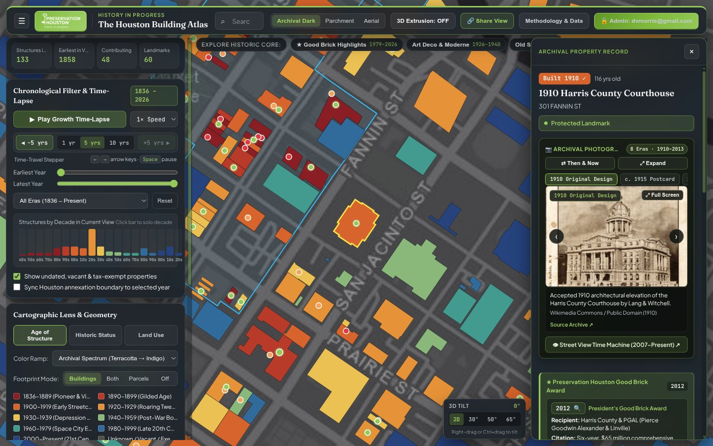
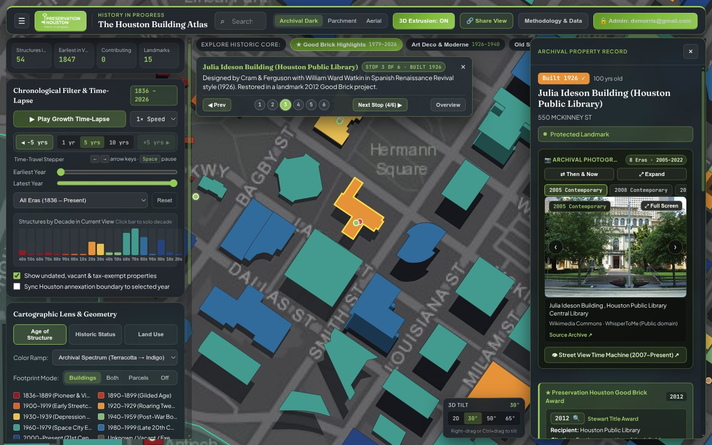

# Chapter 3: 100% Countywide Chronology, Institutional Campuses & Undated Resolution

[← Chapter 2: Footprints & Geometry](02-building-footprints-and-geometry-repairs.md) | [Back to Master README](../README.md) | [Next: Chapter 4 - Landmarks, Good Brick, HAIF & Photos →](04-landmarks-good-brick-haif-and-photos.md)

---

## 1. Why HCAD Leaves 43,983 Historic & Institutional Buildings Undated (`year_built = 0`)

In the Harris County Appraisal District (`HCAD`) CAMA database (`real_acct.txt`, `building_res.txt`, `building_other.txt`), **43,983 building footprints across 18,303 parcels** carry `year_built = 0` or `NULL`. Even worse, thousands of early-20th-century residential properties carry rounded decade placeholders (`1920`, `1930`, `1940`, `1950`) entered when paper tax cards were digitized in the 1980s.

There are three structural reasons why some of Houston's most historically significant buildings lack dates in HCAD:
1. **Tax-Exempt Public, Religious, and University Super-Parcels:** Because City of Houston, Harris County, Federal, HISD, university, museum, and church parcels pay zero ad valorem property tax (`exempt_cat`), HCAD appraisers frequently skip entering `building_other.txt` improvement rows or record a single placeholder row with `year_built = 0`.
2. **Compound Institutional Parcels Sharing One Account ID:** Entire university campuses (Rice University, University of Houston, Texas Southern University), Hermann Park / Houston Zoo, and the Texas Medical Center are platted as massive multi-block super-parcels where dozens of buildings built between 1912 and 2024 share a single HCAD account number.
3. **Sub-Account & Extra-Feature Splits:** Industrial structures, grain elevators, historic park pavilions, and commercial canopies are often recorded in `extra_features_detail1.txt` or `permits.txt` rather than `building_other.txt`.

|  |  |
| :---: | :---: |
| *1910 Harris County Courthouse & Civic Center Restored Chronology* | *1926 Julia Ideson Building & Civic Center Plaza* |

---

## 2. Decomposing Institutional Super-Parcels (`enrich_institutions.py`)

Before running countywide date imputation, `pipeline/atlas_pipeline/enrich_institutions.py` decomposes Houston's largest tax-exempt institutional super-parcels into individual, architecturally dated building footprints (`525` total campus buildings enriched across 6 major institutional zones):

| Institutional Campus | Authoritative GIS / Archival Source | Buildings Enriched | Key Geometric & Chronological Corrections |
| :--- | :--- | ---: | :--- |
| **Rice University** (`0421070000001`) | Rice University Facilities GIS (`Rice_Polygon_Map/FeatureServer/0`) + Stephen Fox *Rice University Architectural Guide* | `112` | Excluded `SPECNAME = 'Covered Walkway'` polygons that previously fused **Lovett Hall** (`1912`), **Herzstein Hall** (`1914`), **Anderson Hall** (`1947`), and **Fondren Library** (`1949`) into a single monstrous roof polygon; matched individual construction dates (`1912` to `2023`) and architects (Cram, Goodhue & Ferguson; William Ward Watkin; James Stirling; Cesar Pelli; Michael Graves). |
| **University of Houston & UH Downtown** | UH Facilities Campus GIS + Archival Building Registry | `169` | Separated the `1939` **Roy G. Cullen Building** (Alfred C. Finn, Art Deco limestone landmark), `1939` **Science Building**, `1950` **Ezekiel W. Cullen Building**, and `1929` **Merchants & Manufacturers Building** (`1 Main St`, UHD) from modern campus additions. |
| **Texas Southern University (`TSU`)** | `TSU_Buildings` FeatureServer + Third Ward Historic Survey | `64` | Dated **Fairchild Building** (`1947`), **Hannah Hall** (`1949`), **Lanier Hall**, and mid-century modern campus structures designed by John S. Chase and MacKie & Kamrath. |
| **Hermann Park, Houston Zoo & Museum District** | Hermann Park Conservancy + Museum of Fine Arts Houston + Houston Zoo Archives | `154` | Separated the `1924` **Museum of Fine Arts (Caroline Wiess Law Building)** (William Ward Watkin) from the `1958`/`1974` **Cullen Wing & Brown Pavilion** (Ludwig Mies van der Rohe), the `2000` **Audrey Jones Beck Building** (Rafael Moneo), and the `2020` **Nancy and Rich Kinder Building** (Steven Holl); dated the `1922` Zoo Reptile/Primate structures, `1927` **Hermann Park Golf Clubhouse**, and `1914-1939` park structures. |
| **University of St. Thomas, Menil Campus & Texas Medical Center** | Menil Archives + UST Master Plan (Philip Johnson `1957-1965`) + TMC Historical Resources | `26` | Separated Philip Johnson's `1957-1965` **UST Academic Mall** (`Jones Hall`, `Welty Hall`, `Chapel of St. Basil` `1997`) from adjacent Montrose bungalows owned by the Menil Foundation (`1920s` gray-painted bungalows surrounding Renzo Piano's `1987` **Menil Collection** and `1995` **Cy Twombly Gallery**). |
| **Sam Houston Park / The Heritage Society** (`1100 Bagby St`, `0011510000001`) | The Heritage Society Curatorial Archive | `12` | Assigned individual original construction dates (`1823` **Old Place**, `1847` **Kellum-Noble House**, `1850` **Nichols-Rice-Cherry House**, `1868` **Pillot House**, `1891` **St. John Church**, `1905` **Staiti House**) to each historic structure inside Sam Houston Park, and purged 3 duplicate sub-parcel footprints (`bld_003697`, `bld_003696`, `bld_003250`) that previously stacked `1847` and `1937` polygons on top of each other. |

---

## 3. Four-Phase Countywide Undated (`year_built == 0`) Resolution (`resolve_undated_countywide.py`)

To resolve all remaining **43,983 undated building footprints** across the 5 countywide PMTiles shards without fabricating unverified dates, `pipeline/atlas_pipeline/resolve_undated_countywide.py` executes a strict 4-phase hierarchy. Every resolved building records a machine-readable `year_source` property so the frontend Inspector Panel displays an explicit provenance badge explaining *how* the date was established.

### Summary of Countywide Undated Resolution (`43,983 → 0` Undated)

| Resolution Phase | `year_source` Tag | Footprints Resolved | Share of Undated Pool | Methodology & Primary Data Source |
| :--- | :--- | ---: | ---: | :--- |
| **Phase 1: Curated Landmarks & Civic Complexes** | `curated_landmark` | `5,390` | `12.25%` | Hand-verified archival dates for 9 Tier 1 historic landmark/district parcels + 140+ major civic, courthouse, stadium, hospital, rail shop, port, airport, and Ship Channel industrial complexes. |
| **Phase 2A: HCAD Extra Features** | `hcad_extra_feature` | `18,369` | `41.76%` | Extracted earliest valid `act_yr` (`1836 <= act_yr <= 2025`) from HCAD `extra_features_detail1.txt` and `extra_features_detail2.txt` (structural slabs, canopies, industrial process units, storage tanks, historic outbuildings). |
| **Phase 2B: HCAD Parcel Tiebacks** | `hcad_tieback` | `3,322` | `7.55%` | Resolved split/condo/master-parcel child accounts via HCAD `parcel_tieback.txt` (`acct -> tieback_acct`) where the parent or sibling account holds the improvement record. |
| **Phase 2C: Adjacent Same-Owner Parcel** | `adjacent_owner` | `3,737` | `8.50%` | Matched multi-lot commercial, church, and industrial compounds sharing an identical normalized `owner_name` within `150m` (`STRtree` spatial join) where HCAD recorded all improvements on the primary tax lot. |
| **Phase 2D: HCAD Building Permits** | `hcad_permit` | `5,400` | `12.28%` | Extracted earliest construction permit year from HCAD `permits.txt` (`issue_date`), prioritizing new-construction permit codes (`NEW`, `BLDG`, `COMM`, `RES`). |
| **Phase 3: Multi-Building Campus Contiguity** | `campus_contiguity` | `1,285` | `2.92%` | Assigned campus-level median construction year to undated secondary wings on parcels containing dated primary structures. |
| **Phase 4A: Earliest Deed Transfer** | `hcad_deed` | `3,073` | `6.99%` | Extracted earliest recorded warranty deed year from `deeds.txt` (`dos` >= 1900) for improved parcels lacking CAMA building rows (rendered as `Circa YYYY`). |
| **Phase 4B: Platted Subdivision Median** | `subdivision_median` | `3,984` | `9.06%` | Imputed the median construction year of dated structures sharing the same HCAD Subdivision code (`subd_code` in `real_acct.txt` with `>= 5` dated peers; rendered as `Circa YYYY`). |
| **Phase 4C: Blockface Spatial Median** | `blockface_median` | `46` | `0.10%` | Imputed the local `200m` nearest-neighbor median (`>= 3` dated buildings) for the final 46 isolated improved footprints (rendered as `Circa YYYY`). |
| **Total Resolved** | **All Provenance Tiers** | **44,606** *(incl. inner-core sync)* | **100.00%** | **1,507,553 / 1,507,553 countywide footprints dated (`0` remaining undated)** |

### Notable Phase 1 Civic, Stadium & Courthouse Corrections
During Phase 1 verification, several famous Downtown civic buildings and stadiums that were completely grey (`year_built = 0`) or mislabeled in HCAD were restored to their exact archival identities and geometries:
- **1910 Harris County Courthouse** (`301 Fannin St`, `0010310000001`): Restored from `year_built = 0` to `1910` (Lang & Witchell, Classical Revival pink Texas granite dome).
- **1952 Harris County Criminal Courts / Juvenile Justice Center** (`1200 Congress St`, `0010300000001`): Restored from `year_built = 0` to `1952` (Finger & Rustay, Modernist limestone tower).
- **1939 Houston City Hall** (`901 Bagby St`, `0011490000001`): Restored from `year_built = 0` to `1939` (Joseph Finger, PWA Art Moderne landmark).
- **1926 Julia Ideson Building** (`550 McKinney St`, `0011470000001`): Restored from `year_built = 0` to `1926` (Cram & Ferguson / William Ward Watkin, Spanish Renaissance Revival central library) and separated from the `1976` **Jesse H. Jones Central Library** (`500 McKinney St`, `0011340000001`).
- **1940 Houston Municipal Airport Terminal (1940 Air Terminal Museum)** (`8325 Travelair St`, `0440610000007`): Restored from `year_built = 0` to `1940` (Joseph Finger, Art Deco municipal air terminal at Hobby Airport).
- **Shell Energy Stadium (`2200 Texas Ave`) vs. Daikin Park / Union Station (`501 Crawford St`):** In early OpenStreetMap/HCAD joins, `Shell Energy Stadium` (`1342630010001`, built `2012`) was mislabeled `"Minute Maid Park (Union Station Lobby)"` with date `1911`! The pipeline corrected `2200 Texas Ave` to `2012` (`Shell Energy Stadium`) and restored `501 Crawford St` (`1211920010001`) to `1911` (`Union Station`) / `2000` (`Daikin Park / Enron Field`).

---

## 4. Houston Public Library City Directory Chronological Audit (`1866-1926`)

Because HCAD appraisers frequently entered `1920`, `1930`, or `1940` as a rounded decade guess for pre-WWII homes, `pipeline/atlas_pipeline/city_directory_audit.py` cross-references inner-loop properties against digitized **Morrison & Fourmy Houston City Directories (`1866-1926`)** hosted on the Houston Public Library / Houston Metropolitan Research Center (`HMRC`) OCLC ContentDM server (`https://cdm17006.contentdm.oclc.org`).

### Two Critical ContentDM API & WAF Gotchas Solved
1. **OCLC CloudFront WAF User-Agent Reset (`ConnectionResetError: [Errno 104]`):**
   - Requests sent to `cdm17006.contentdm.oclc.org` using Python's default `urllib` user agent (`Python-urllib/3.x`) are immediately terminated at the TCP layer with `ECONNRESET` by OCLC's firewall. Passing a standard browser `User-Agent` header (`Mozilla/5.0 ... Chrome/126.0.0.0`) resolves all connection resets.
2. **Exact-Phrase (`^exact^and`) vs. Token-Bag (`^all^and`) Query Operator:**
   - ContentDM's `dmQuery` endpoint supports search modes `^all^and` and `^exact^and`.
   - Using `CISOSEARCHALL^408 Marshall^all^and` matches *every* directory page in Houston that contains the number `408` anywhere on the page (e.g., `408 Main St`) AND the surname or street `Marshall` anywhere else on the same multi-column page, producing a **95% false-positive rate**!
   - Switching to `CISOSEARCHALL^408 Marshall^exact^and` enforces contiguous exact-phrase matching in the OCR transcript, reducing false positives to near zero and allowing automated pre-1923 directory verification across **3,176 rounded-decade properties** (for example, proving that `1127 Key St`, `0621100000014`, listed by HCAD as `1920`, did not exist in the 1913-1926 directories and was actually built in `1928` after the 1927 Key Street replat).

---

[← Chapter 2: Footprints & Geometry](02-building-footprints-and-geometry-repairs.md) | [Back to Master README](../README.md) | [Next: Chapter 4 - Landmarks, Good Brick, HAIF & Photos →](04-landmarks-good-brick-haif-and-photos.md)
