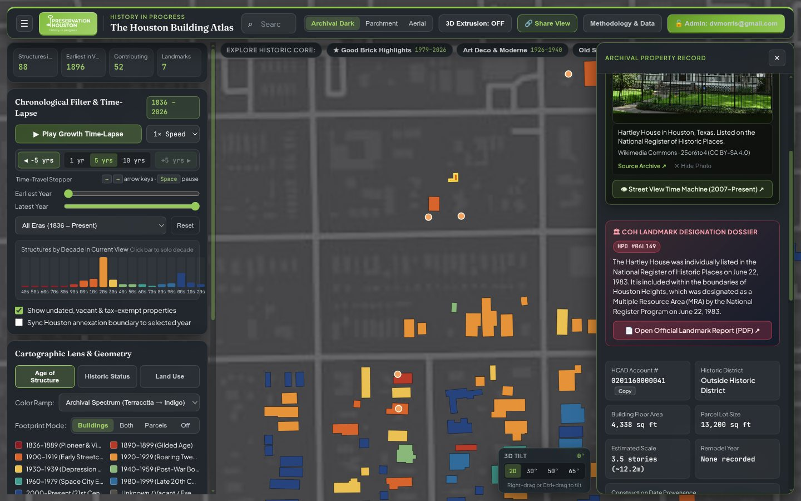
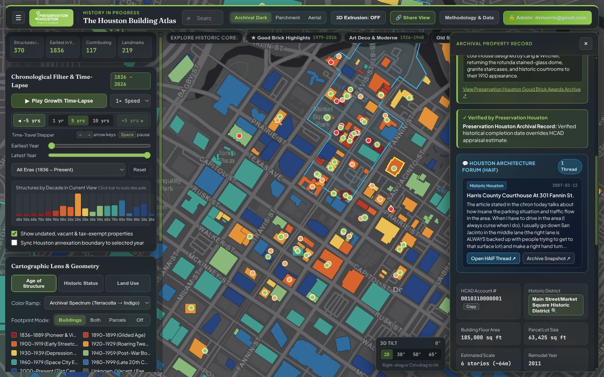
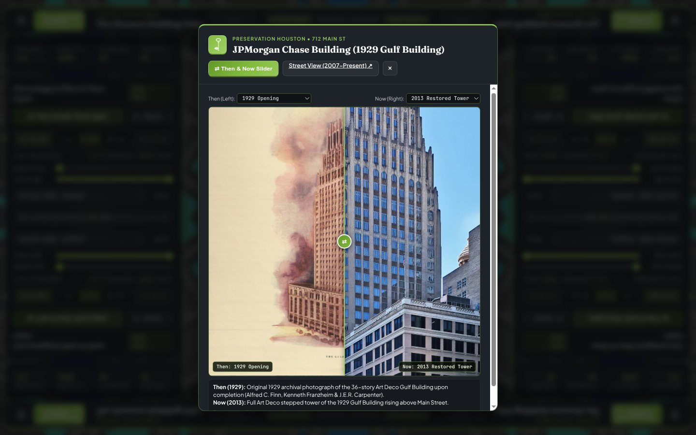

# Chapter 4: Preservation Layers, Landmark Designation Reports, HAIF & Archival Photography

[← Chapter 3: Chronology & Undated Resolution](03-chronology-institutions-and-undated-resolution.md) | [Back to Master README](../README.md) | [Next: Chapter 5 - Neighborhoods, Wards, Subdivisions & Deeds →](05-neighborhoods-wards-subdivisions-and-deeds.md)

---

## 1. Preservation Houston Good Brick Awards (`1979-2026`, `good_brick_awards.py`)

Since 1979, Preservation Houston has presented the **Good Brick Award** to recognize outstanding historic preservation, restoration, adaptive reuse, and architectural stewardship across Greater Houston. Turning 47 years of award records (`460` raw historical entries) into an accurate, clickable spatial layer (`overlays.json` -> `good_brick_awards`) required solving three data-hygiene problems:

### 1.1 Filtering Non-Building Awards (`460 → 359` Place-Based Awards across `339` Sites)
Roughly 100 historical Good Brick Awards honored publications, walking-tour docents, craftsmanship guilds, educational programs, or lifetime achievement recipients without a physical building address. When the initial geocoder ran those entries through a general address locator, entries with no street address defaulted to the geographic centroid of Downtown Houston (`Main St at Texas Ave`) or to the recipient's corporate P.O. Box!
- `pipeline/atlas_pipeline/good_brick_awards.py` classifies every award entry and retains only the **359 place-based structural/site awards** (`339` unique locations, as 20 historic landmarks won multiple Good Brick Awards across different decades).

### 1.2 Snapping Street-Centerline Geocodes Inside Building Footprints
Standard geocoders (US Census TIGER / Nominatim) return coordinates interpolated along the **public street centerline** (`20 to 45 meters` away from the actual building roof), or on the wrong side of divided boulevards:
- **Example (`5500 Main St` vs. `5501 Main St`):** The 2021 Good Brick Award for the **Nancy and Rich Kinder Building (Museum of Fine Arts, Houston)** at `5500 Main St` geocoded to the median of Main Street slightly closer to `5501 Main St`, binding the modern art museum award to the 1930 **St. Paul's United Methodist Church** across the street!
- **Example (`301 E 5th St`, `0210200000029` - Lund House & Modern Print Shop in the Heights):** The corner lot at `301 E 5th St` (intersecting Yale St) had its Good Brick marker sitting in the middle of the E 5th St asphalt, while the two historic structures on the lot (the `1905` Victorian Lund House and the `1929` Modern Print Shop) were represented by a single merged square. The pipeline split the lot into both true footprints (`1905` and `1929`) and snapped the Good Brick marker directly onto the landmark structure.
- **Example (`1125 Providence St`, `0400100000002` - San Jacinto Warehouse / The Docks):** Located in Fifth Ward at the corner of Providence and San Jacinto, this 1926 warehouse (`1,602 m²`) was outside the initial inner-core radius and had no footprint in `buildings.geojson`. Its full footprint was extracted from the Northeast PMTiles shard and added to the interactive core.
- **General Rule (`VERIFIED_CROSS_STREET_HCAD`):** Every Good Brick coordinate is snapped to the `representative_point()` of its verified building footprint (`0.0m` offset from the roof polygon), so clicking a gold star marker always opens the exact building dossier.

---

## 2. City of Houston Landmark Designation Reports (`448` Official HPO PDFs)

The City of Houston's official ArcGIS layer for **Protected Landmarks and Landmarks** (`COH_HISTORIC_LANDMARKS`, `509` points) suffered from severe metadata omissions in the city's public GIS table:
- **48% (`244` of `509`)** had `USER_YR_BUILT = 0` or `NULL`.
- **52% (`265` of `509`)** had `USER_STYLE = NULL`.
- **120 landmarks** lacked an `HCAD_NUM` link.
- None of the GIS points linked to the City's official **Landmark Designation Report PDFs** prepared by the Historic Preservation Office (`HPO`).

### 2.1 Crawling `archaeology.houstontx.gov` & Wayback Machine CDX (`crawl_landmark_reports.py`)
To recover the missing dates, architectural styles, architects, and full-text PDF reports:
1. We inspected the City of Houston Historic Preservation Office portal (`https://archaeology.houstontx.gov/designated_landmarks.html`) and discovered an embedded JavaScript array (`var mydata = [...]`) containing metadata and relative PDF filenames for hundreds of landmarks.
2. We queried the **Internet Archive Wayback Machine CDX API** across `houstontx.gov/planning/HistoricPres/*` and `archaeology.houstontx.gov/*`, indexing **628 unique historical PDF URLs** across two directory trees (`/landmarks/*.pdf` and `/docs_pdfs/*.pdf`).
3. Using PyMuPDF (`fitz`) text extraction across the downloaded PDFs, `apply_landmark_report_enrichments.py` linked **448 of the 509 designated landmarks (`88.0%`)** to their official HPO Landmark Designation Report PDF (`pdf_url`, `hpo_code`), extracting:
   - **`+140` missing construction years** (bringing landmark date coverage from `52%` to **99.8%**, with the sole undated point being the natural `1836` **Allen's Landing** bayou confluence site).
   - **`+144` missing architectural styles** and **`+27` verified architects**.
   - **`75` HCAD year overrides** where the official HPO archival deed/mechanic's-lien research proved HCAD's CAMA date was wrong.

### 2.2 Fixing 11 Off-By-One HPO Server Filename Typos
During PDF verification, 11 landmarks listed in the City's `var mydata` table returned `HTTP 404 Not Found` because City staff had mistyped the HPO file code by one digit or swapped the `L` (Landmark) / `PL` (Protected Landmark) prefix when uploading the PDF to the server:

| Landmark Name | Address | Broken HPO Code in City Table | Actual Working PDF on Server |
| :--- | :--- | :--- | :--- |
| **Mecom Rockwell Colonnade & Fountain** | Hermann Park | `16PL128.pdf` (`404`) | `16PL127.pdf` (`200 OK`) |
| **Thomas H. Monroe House** | `1624 Kirby Dr` | `08L203.pdf` (`404`) | `08L202.pdf` (`200 OK`) |
| **John M. Dorrance House** | `904 Lovett Blvd` | `07L181.pdf` (`404`) | `07PL48.pdf` (`200 OK`) |
| **William L. Clayton Summer House** | `3376 Inwood Dr` | `08PL62.pdf` (`404`) | `08PL062.pdf` (`200 OK`) |
| *(+ 7 additional off-by-one HPO filename repairs)* | *Various* | *Broken link in City table* | *Resolved via CDX filename directory scan* |

### 2.3 Isolating the 61 Unuploaded Post-2016 Landmark Reports for TPIA Request
Why did `61` of the `509` landmarks (`12.0%`) have no PDF on `archaeology.houstontx.gov` or in the Wayback Machine?
- Cross-tabulating by designation date revealed that the City of Houston HPO stopped uploading newly designated landmark PDFs (`16L319+` and `17PL135+`, designated between `2016` and `2024`) when the static `archaeology.houstontx.gov` site stopped being updated.
- Even for those 61 landmarks, our pipeline achieved **100% construction-year and HCAD coverage** by cross-referencing City Council agenda ordinances, HCAD records, and Preservation Houston archives, and exported a ready-to-file Texas Public Information Act (`TPIA`) checklist (`pipeline/data/coh_landmarks_missing_pdfs_tpia.csv`) so Preservation Houston staff can request the 61 post-2016 PDFs from the Planning Department in a single batch.

---

## 3. Houston Architecture Info Forum (`HAIF`) Integration (`29,467` Threads)

For over two decades, the **Houston Architecture Info Forum (`HAIF`, `https://www.houstonarchitecture.com`)** has served as Houston's most detailed community archive of construction photography, historic postcard scans, demolition tracking, and architectural research.

### 3.1 Crawling 29,467 HAIF Threads Despite Cloudflare Bot Protection (`crawl_haif_forum.py`)
Direct HTTP scraping of `houstonarchitecture.com` is blocked by Cloudflare (`HTTP 403 Just a moment...`). However:
1. We queried the **Wayback Machine CDX API** (`url=houstonarchitecture.com/haif/topic/*` and `houstonarchitecture.com/topic/*`), discovering **29,467 unique discussion threads** across 97 subforums (*Historic Houston*, *Going Up*, *Downtown*, *Midtown*, *Montrose*, *The Heights*, *Texas Medical Center*, *Uptown / Galleria*, etc.).
2. While `houstonarchitecture.com` HTML pages sit behind Cloudflare, HAIF's image CDN (`https://media.invisioncic.com/d301529/monthly_...`) serves high-resolution architectural photographs directly with `HTTP 200 OK` and no Cloudflare challenge!
3. `apply_haif_enrichments.py` parses street addresses, building names, and intersection references across all 29,467 thread titles and archived snapshots, linking **7,741 building footprints across 3,892 HCAD properties** to **3,385 curated HAIF threads** (`app/public/data/haif_index.json`, `3.1 MB`) and adding **163 archival building photographs** directly into `building_photos.json`.

### 3.2 Canonical Building Names, Historical Aliases (`AKA`) & Slug Hygiene (`enrich_building_names.py`)
Skyscrapers, theaters, churches, and corporate headquarters in Houston frequently change names over their lifespans (for example, `712 Main St` was built in 1929 as the **Gulf Building**, later became the **Texas Commerce Bank Building**, and now operates as the **JPMorgan Chase Building**). Previously, searching the atlas for `"Gulf Building"`, `"Enron"`, `"Transco Tower"`, `"Humble Oil Building"`, or `"Esperson"` failed if HCAD only stored `"712 MAIN ST"`.

`pipeline/atlas_pipeline/enrich_building_names.py` synthesizes a comprehensive name and alias dictionary across **4,833 HCAD accounts** (`1,184` curated multi-era landmark entries + `3,649` HPO/Good Brick/HAIF/OSM entries):
- **Primary Title (`building_name`) & Historical Aliases (`alt_names`):** Displayed at the top of the Inspector Panel with an `AKA:` badge strip (for example, **JPMorgan Chase Tower**: `AKA: Texas Commerce Tower • 600 Travis St`; **Williams Tower**: `AKA: Transco Tower • 2800 Post Oak Blvd`; **Daikin Park**: `AKA: Minute Maid Park • Enron Field • Union Station`).
- **Three Text-Hygiene Fixes Applied During Name Extraction:**
  1. **URL-Escaped UTF-8 Decoding:** Fixed raw percent-encoded strings inherited from URL slugs (such as `Richey-Fant House & Last Concert Caf%C3%A9` -> `Richey-Fant House & Last Concert Café`).
  2. **Fused Slash-Word Separation in HAIF Slugs:** Because HAIF URL slugs strip slashes (`714 Yale St / Heights Theater` -> `714-yale-st-heights-theater`), naive slug title-casing produced fused tokens like `"Stheights"`, `"Blvdphase"`, or `"Avebuilding"`. A regex de-fusion pass splits street suffixes (`St`, `Ave`, `Blvd`, `Dr`, `Rd`, `Ln`, `Fwy`, `Pkwy`) before capitalizing.
  3. **Duplicate HAIF Thread Deduplication (`1001 McKinney St`):** When a single property had multiple HAIF threads or multi-footprint references in `haif_index.json`, the search index and inspector previously showed `5 HAIF Threads` when 2 were duplicates of the same thread URL. Thread lists are now deduplicated by canonical topic ID before counting and rendering.

---

## 4. Archival Photography, Wikimedia Relevance Scoring & "Then & Now" Comparison

The Inspector Panel combines five photography streams (`app/js/photoService.js` and `app/public/data/building_photos.json`):
1. **Library of Congress HABS (Historic American Buildings Survey) & Carol M. Highsmith Archive** (`loc.gov`)
2. **City of Houston Historic Preservation Office (`HPO`) Landmark Photos**
3. **HAIF Archival & Construction Photography** (`media.invisioncic.com`)
4. **Wikimedia Commons Curated Category & File Matches** (`seed_building_photos.py`)
5. **Live Client-Side Wikimedia Commons GeoSearch (`photoService.js`)** within `250m` of the selected building.

|  |  |
| :---: | :---: |
| *Gulf Building Interactive "Then & Now" Photo Comparison Slider* | *1940 Air Terminal Museum Filtered Architectural Photography* |

### 4.1 Solving the Wikimedia GeoSearch Off-Topic Photo Problem (`evaluateCommonsCandidate`)
When querying Wikimedia Commons by geographic radius (`gsradius=250`) around a building, naive proximity matching frequently returned completely unrelated photographs taken nearby:
- At the **1940 Air Terminal Museum** (`8325 Travelair St` at Hobby Airport), a 250m GeoSearch returned close-up cockpit photos of a *Lockheed Lodestar*, a *1929 Curtiss Robin biplane*, and airline food trays instead of the 1940 Art Deco terminal building!
- At Downtown courthouses and City Hall, GeoSearch returned portraits of politicians, protest marches, or parked police motorcycles.

To eliminate off-topic imagery, `evaluateCommonsCandidate()` in `app/js/photoService.js` applies a multi-signal relevance filter:
1. **Hard Exclusion Regex:** Rejects files matching aircraft models (`Lockheed`, `Boeing`, `Cessna`, `Learjet`, `cockpit`, `fuselage`), vehicles (`locomotive`, `bus`, `automobile`, `motorcycle`), biological specimens, logos, maps, plaques, and close-up portraits (`headshot`, `portrait of`, `speaking at`).
2. **Positive Token Matching:** Requires non-curated GeoSearch candidates within `35m to 250m` to match either the building's street name, architectural landmark name, or explicit architectural categories (`Buildings in Houston`, `Houses in Houston`, `Churches in Houston`, `Historic American Buildings Survey`, `National Register of Historic Places`).
3. **TIFF Thumbnail Rendering Fix:** Library of Congress HABS and Carol M. Highsmith master scans on Wikimedia Commons end in `.tif` or `.tiff`. Previously, a rigid regex (`/\.(jpe?g|png|webp)$/i`) rejected all `.tif` files even though Wikimedia's `iiurlwidth=800` API parameter automatically transcodes `.tif` masters into browser-native `.jpg` thumbnails (`thumburl`). Allowing `.tif/.tiff` via `thumburl` unlocked hundreds of crisp 1930s HABS architectural photographs.

### 4.2 Interactive "⇄ Then & Now" Slider & Uncropped Vertical Photo Framing
- When a building has photographs from multiple eras (for example, a `1929` historic postcard of the **Gulf Building** and a `2020s` contemporary photograph), an interactive **⇄ Then & Now** split-screen wipe slider appears in both the Inspector Panel and the full-screen Lightbox.
- Because architectural photographs of skyscrapers and church steeples are frequently vertical (`portrait` aspect ratio), cropping them with `object-fit: cover` sliced off the tops of towers and roofs. The photo viewer now renders the full uncropped image (`object-fit: contain`) centered over a softly blurred, color-matched ambient backdrop (`filter: blur(22px) brightness(0.45)`) derived from the same photograph.

---

[← Chapter 3: Chronology & Undated Resolution](03-chronology-institutions-and-undated-resolution.md) | [Back to Master README](../README.md) | [Next: Chapter 5 - Neighborhoods, Wards, Subdivisions & Deeds →](05-neighborhoods-wards-subdivisions-and-deeds.md)
