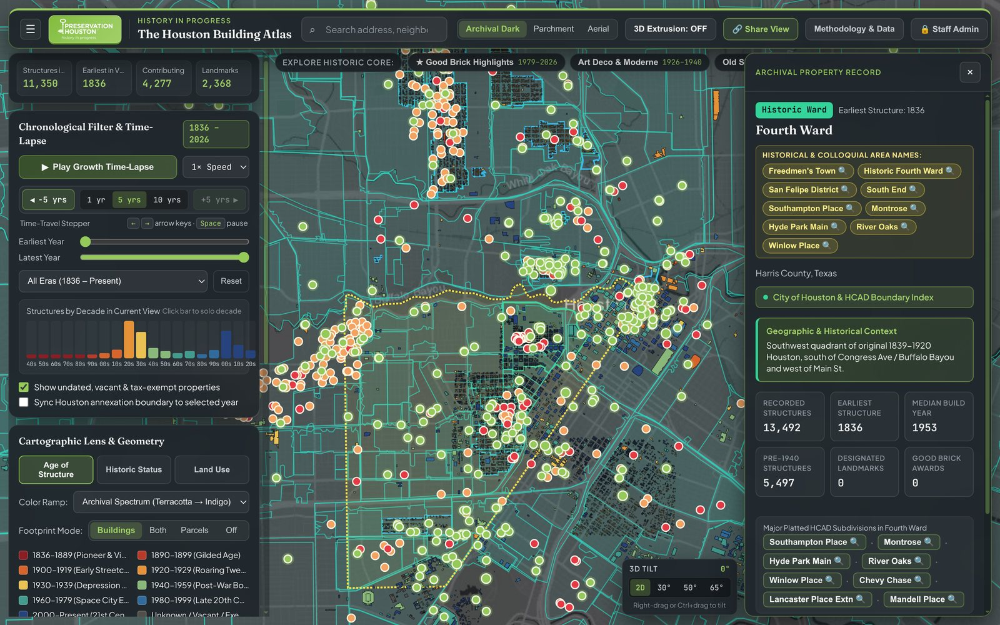
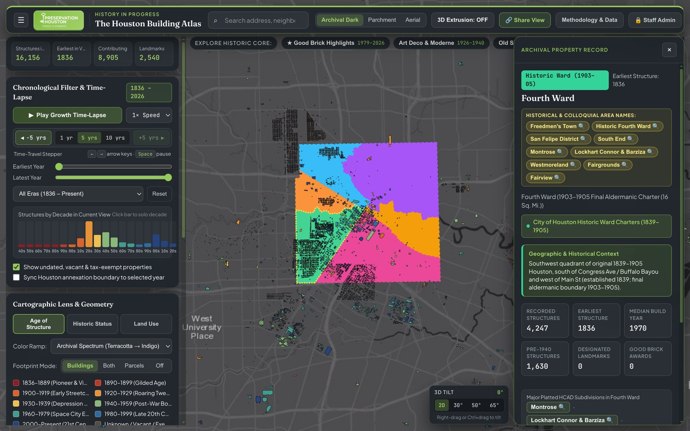
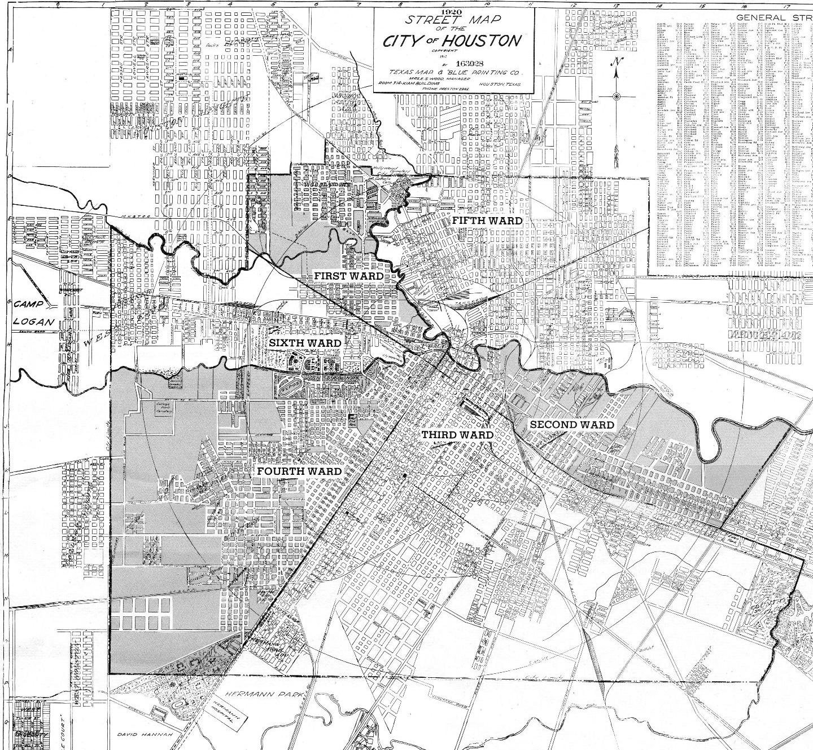
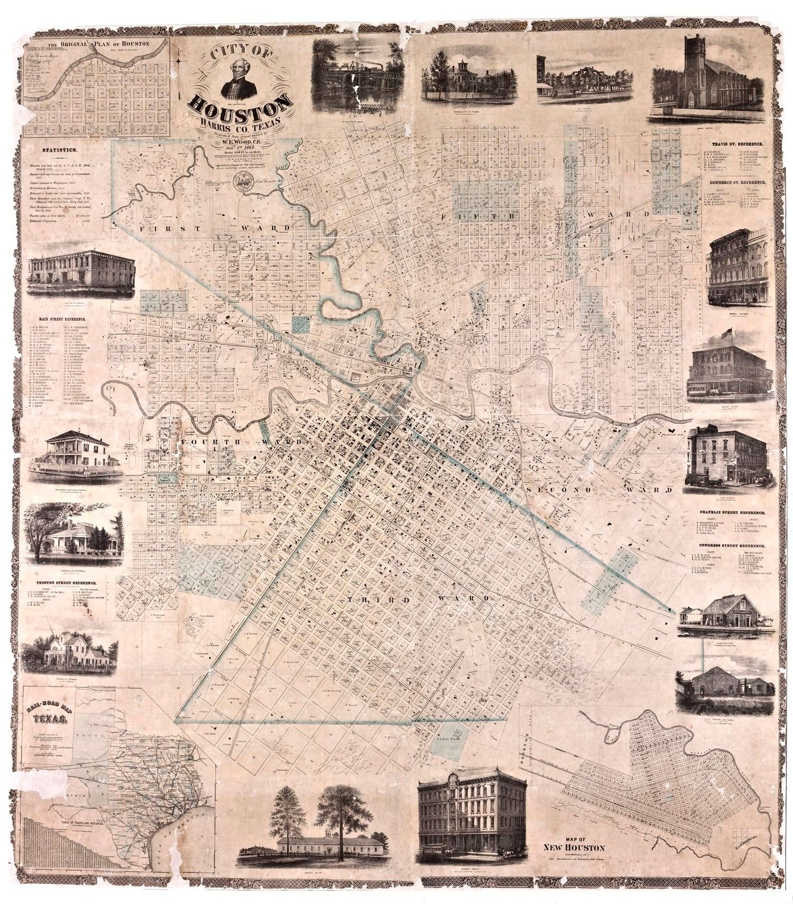
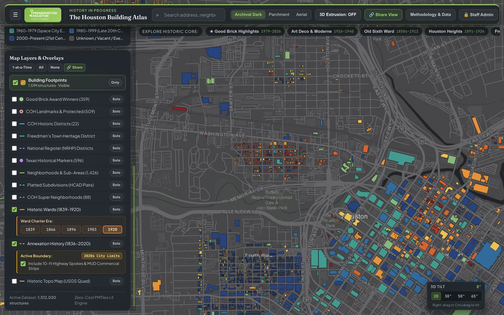
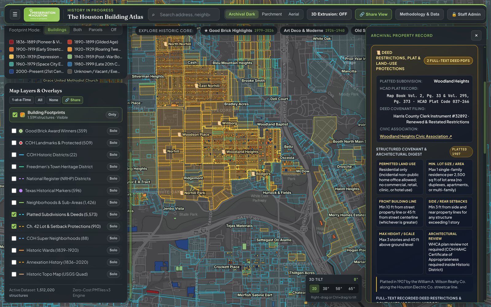

# Chapter 5: Neighborhoods, Historic Wards, Annexation History, Subdivisions & Deed Restrictions

[← Chapter 4: Landmarks, Good Brick, HAIF & Photos](04-landmarks-good-brick-haif-and-photos.md) | [Back to Master README](../README.md) | [Next: Chapter 6 - Sanborn Maps & Lost Houston →](06-sanborn-maps-and-lost-houston.md)

---

## 1. Multi-Source Neighborhood Harmonization (`1,387` Boundaries)

Houston famously has no municipal zoning code and no single canonical neighborhood map. Residents, realtors, civic clubs, and historians refer to overlapping vernacular neighborhoods (*Montrose*, *The Heights*, *East End / Segundo Barrio*, *Third Ward*, *Shady Acres*, *Eado*), while the City of Houston Planning Department divides the city into 88 administrative **Super Neighborhoods** (`SNB`) that are far too coarse for architectural research.

### 1.1 Extracting the 2009 Peter Brown / Tony Topping GeoPDF (`extract_peter_brown_geopdf.py`)
In 2009, former At-Large City Council Member (and architect/urban planner) **Peter Brown**, together with cartographer **Tony Topping** (`TexasRealEstateResearch.com`), compiled the most detailed map of vernacular Houston neighborhoods ever produced (`Houston_Neighborhoods.pdf`). However, the file was distributed only as an **ISO 32000 GeoPDF** where:
- Neighborhood boundaries were not stored as standard GeoJSON vectors, but as `125` lossless tiled raster strips (`3750 x 30 px`) inside Optional Content Groups `/OC2` (*Neighborhoods*) and `/OC13` (*Neighborhoods2*).
- The 661 neighborhood names were stored as floating vector PDF text objects inside Optional Content Group `/OC4` (*Labels*) projected in `EPSG:2278` (NAD83 Texas South Central Feet, `1:57,969` scale).

To unlock this dataset (`pipeline/atlas_pipeline/extract_peter_brown_geopdf.py`):
1. We parsed the PDF's `/LGIDict` projection matrix to recover the exact affine transformation from PDF points (`72 DPI`) to `EPSG:2278` feet and `EPSG:4326` (`WGS84`).
2. We reassembled the 125 lossless raster strips from `/OC2` and `/OC13`, isolated the boundary linework and contiguous color-filled neighborhood regions using connected-component image segmentation (`scipy.ndimage`), and matched each region to its interior `/OC4` vector text label.
3. We polygonized and simplified the resulting regions into **661 georeferenced vernacular neighborhood polygons**.

### 1.2 Harmonizing Five Neighborhood & Civic Datasets (`build_neighborhoods.py`)
`pipeline/atlas_pipeline/build_neighborhoods.py` merges five complementary boundary layers into a unified `1,387`-feature `neighborhoods.geojson` layer selectable by source tier:
1. **Peter Brown / Tony Topping 2009 Vernacular Map (`661` polygons)**
2. **COH GIS Neighborhoods 2021 (`597` polygons)** (`Layer 8` on `gis.houstontx.gov`)
3. **COH Patrol Region 3 Subdivisions (`237` polygons)** (`Layer 9`, fine-grained Southeast/East End subdivisions)
4. **COH Civic Clubs & Homeowner Associations (`470` polygons)**
5. **COH Super Neighborhoods (`88` polygons)** and **22 Designated Historic Districts**

### 1.3 Fixing 11 Official City of Houston GIS Spelling Errors & Historical Aliases
Auditing the City of Houston's official ArcGIS `Neighborhoods_2021` attribute table revealed 11 misspellings in `NEIGHBORHOOD_NAME` that broke text search and cross-referencing. All 11 are normalized in `build_neighborhoods.py`:

| Misspelled Name in COH GIS (`Layer 8`) | Corrected Canonical Name | Verification Source |
| :--- | :--- | :--- |
| `Woodkind Heights` | `Woodland Heights` | 1907 William A. Wilson Plat & HCAD Subdivisions |
| `Idlywood` | `Idylwood` | 1928 Idylwood Civic Club & City Landmark District |
| `Breaburn Glen` | `Braeburn Glen` | Brays Bayou Plat Records |
| `Breaburn Valley` | `Braeburn Valley` | Brays Bayou Plat Records |
| `Breaburn Valley West` | `Braeburn Valley West` | Brays Bayou Plat Records |
| `Yoacum Gardens` | `Yocum Gardens` | Harris County Subdivision Plat |
| `Pecan Park East Grid` | `Pecan Park East` | COH Super Neighborhood 68 |
| `Nottingham Forrest` | `Nottingham Forest` | Nottingham Forest Civic Association |
| `edgewood` *(lowercase)* | `Edgewood` | Case normalization |
| `sharpstown` *(lowercase)* | `Sharpstown` | Case normalization |
| `Frostwood,Memorial` *(missing space)* | `Frostwood / Memorial` | Punctuation normalization |

In addition, curated colloquial and historical alias dictionaries (`Freedmen's Town`, `Segundo Barrio`, `Frost Town`, `Germantown`, `The Nickel`, `Frenchtown`, `Schrimpf Alley`, `Quality Hill`) are attached so searching any historical neighborhood name flies directly to its boundary and opens a rich historical dossier.

---

## 2. Historic Wards (`1839-1905`) & Debunking the Erroneous 1920 COH GIS Ward Layer

Houston's **Six Historic Wards** (*First Ward* through *Sixth Ward*) are fundamental to the city's cultural geography. However, when we initially inspected the City of Houston's official ArcGIS Open Data layer (`WardBoundaries_1920`, `FeatureServer/6` at `gis.houstontx.gov`), we discovered a major historical and cartographic anomaly that had been copied across dozens of Houston maps since 2018.

|  |  |  |
| :---: | :---: | :---: |
| *Corrected 1903-1905 9-Sq-Mi Historic Wards with Solid Outer Charter Line* | *1981 Exhibit Poster Source Behind the Erroneous 1920 COH GIS Layer* | *1869 W. E. Wood Map Showing True 9-Sq-Mi 3x3 Mile Ward Boundary* |

### 2.1 Why the City's `WardBoundaries_1920` GIS Layer Is Historically Impossible
1. **Houston Abolished Wards in 1905 (15 Years Before 1920):** Following the December 10, 1904 municipal charter referendum, the 29th Texas Legislature enacted the **1905 Houston City Charter (March 18, 1905)**, which abolished all geographic aldermanic wards and replaced them with an at-large commission government. By 1920, wards had not existed as legal or political boundaries for 15 years.
2. **Wrong Outer Boundary (`22 sq. mi.` 1920 City Limits vs. `9 sq. mi.` Charter Boundary):** Throughout the entire aldermanic ward era (`1840-1905`), Houston's corporate limits formed a **3-mile by 3-mile (`9 sq. mi.`) square** centered on the Courthouse (`Main & Congress`). Houston did not expand beyond that 9-square-mile square until **1913** (after wards were already abolished). Yet `WardBoundaries_1920` extended the wards out to the **1920 city limits (`~22 sq. mi.`)**, falsely stretching First Ward across independent *Houston Heights* (an independent municipality until Feb. 20, 1918!), Fifth Ward into Kashmere Gardens, and Third/Fourth Wards south through Rice University (`1912`) and Hermann Park (`1914`).
3. **Forensic Origin of the Error (`HoustonWards1920.jpg`):** By inspecting the image attachments inside the City of Houston Planning Department's ArcGIS StoryMap (`42f018fb48664dc9a89d9b1ddde70bd6`), we found the exact raster image (`HoustonWards1920.jpg`) from which a GIS analyst digitized `Layer 6` on June 1, 2018. It was a photograph of a hand-lettered **March 1981 public library exhibit poster** (*"Metropolitan Houston Valuation & Economic Growth"*), where a graphic artist in 1981 had taken a **1920 Merle P. Wood street map** and drawn magic-marker lines along Main Street and Buffalo Bayou all the way to the 1920 outer city limit line!

### 2.2 Reconstructing the Four True Municipal Charter Ward Eras (`1839-1905`)
We removed the erroneous 1920 layer and reconstructed the **four authentic municipal charter ward eras** directly from the Republic of Texas and State of Texas legislative charters, bounded by the true `9 sq. mi.` (`3 x 3 mile`) 1840-1905 corporate square centered on the Courthouse (`29.76045° N, -95.36210° W`):
1. **1839 Original Four Wards** (*Jan. 26, 1839 Charter*, `62` blocks divided by Main St and Congress Ave)
2. **1866 Five Wards Era** (*Oct. 22, 1866 Charter*, creation of **Fifth Ward** north of Buffalo Bayou & east of White Oak Bayou, as depicted on W. E. Wood's `1869` map)
3. **1896 Six Wards Era** (*1876 Charter / May 18, 1896 Ordinance*, carving **Sixth Ward** out of Fourth Ward north of Buffalo Bayou & west of White Oak Bayou)
4. **1903-1905 Final Aldermanic Wards** (*April 1903 Special Charter*, shifting the Third/Fourth Ward boundary south of McGowen Ave from Main St east to Almeda Rd prior to the 1905 abolition of wards)

To make the maps immediately legible, a solid crimson outer perimeter ring (`wards-outer-limit-casing` + `wards-outer-limit`) frames the `9 sq. mi.` municipal charter boundary while internal dashed lines mark the bayou and street ward divisions.

---

## 3. City of Houston Annexation History (`1836-2020`): Dissolving Seams & Separating Highway Spokes

The City of Houston's raw `Annexation_History` GIS layer consists of **1,111 incremental annexation polygons** spanning 1836 to 2020. Rendering the raw polygons directly created three severe problems that had to be solved in the pipeline and frontend (`app/js/map.js`):

1. **Eliminating Internal "Donut Slice" Seams via Cumulative Topological Union:**
   - Because each annexation ordinance after 1840 was digitized as an incremental ring or parcel slice (`Ord. 1913`, `Ord. 1926`, `Ord. 1949`, `Ord. 1956`), drawing all polygons up to year $Y$ painted hundreds of crisscrossing internal cut-lines across the interior of the city.
   - The pipeline groups ordinances by year (`86` distinct annexation years) and computes a cumulative `shapely.unary_union` + small-gap buffer cleanup so any selected year renders as a clean outer municipal perimeter.
2. **Restoring the Repealed 1839 Tilted Survey Hole Inside the 1840 9-Sq-Mi Square:**
   - In the City's raw GIS layer, the **Jan. 28, 1840 Charter (`9 sq. mi.` cardinal square, `OBJECTID: 20`)** had the **Jan. 26, 1839 tilted Allen/Borden survey rectangle (`OBJECTID: 21`, rotated `-34.65°`)** boolean-subtracted from its center. Yet history records that the 1840 Act of the 4th Congress of the Republic of Texas *repealed and replaced* the 1839 boundary rather than annexing a donut around it!
   - We merged `OBJECTID: 21` into `OBJECTID: 20` so the 1840 boundary is a continuous `9.05 sq. mi.` square without an anachronistic tilted hole in the middle.
3. **Separating Full-Purpose City Limits from the 1963 `10-ft Strip` Highway Spokes & MUD SPAs:**
   - When filtering annexations to the 1960s, weird spiderweb tentacles suddenly shot 25 miles out into the countryside along `US-290`, `SH-249`, `I-45`, `I-10`, and a giant rectangular loop out to Katy and Hockley (`290 -> Hegar Rd -> Katy-Hockley Rd -> I-10`), plus a 1965 rectangular box around unincorporated Aldine (`IAH`).
   - Archival ordinance research revealed why: on **August 23, 1963**, the Texas Municipal Annexation Act took effect, granting Houston a 5-mile Extraterritorial Jurisdiction (`ETJ`) around any annexed territory. On **November 20, 1963 (`Ord. 63-1219`)**, the Houston City Council passed a famous defensive **"spoke / strip annexation"** ordinance annexing a **10-foot-wide strip down the center of six rural highways** solely to extend Houston's ETJ across 1,000+ square miles of future suburbs and block neighboring towns from incorporating! Similarly, in **1965 (`Ord. 65-1905`)**, Houston annexed thin highway strips up Hardy Rd and US-59 to connect the newly purchased **Intercontinental Airport (`IAH`)** site without annexing unincorporated Aldine inside the loop. And in the **2000s-2010s**, Houston added **770+ Limited-Purpose Strategic Partnership Agreement (`SPA`)** commercial strips inside suburban Municipal Utility Districts (`MUDs`) solely to collect a 1% sales tax without providing full municipal services.
   - **Solution:** Every annexation polygon is classified into `annex_type = "full_purpose"` vs. `"spoke_or_limited"`. By default, the **City of Houston Annexations** checkbox displays the clean **Full-Purpose Municipal Boundary**, while a secondary nested checkbox (`Include 1963 Highway Spokes & Limited-Purpose MUD Strips`) renders the 10-ft highway spokes and MUD SPAs in dashed amber with a full legal and historical explanation in the Inspector Panel.

---

## 4. Platted Subdivisions (`5,573` Polygons), WHCA Map Forensics & 3-Tier Deed Restrictions

Because Houston does not use municipal zoning, **platted subdivision boundaries** (`5,573` polygons in `subdivisions.geojson`) and **private deed restrictions / Chapter 42 ordinances** form the true legal DNA of Houston's neighborhoods.

### 4.1 Synthesizing `subdivisions.geojson` & Forensics of the 2019 WHCA Reference Map
To build a complete subdivision layer (`pipeline/atlas_pipeline/build_deed_restrictions.py`), we merged COH's `Sub_poly.zip` with dissolved HCAD parcels (`Parcels.gdb` joined to `real_acct.txt` on `subd_code`, `lgl_1`, `lgl_2`, `lgl_3`, and 6-digit Map Book prefix `acct[:6]`).

During verification of the **Woodland Heights** area against the Woodland Heights Civic Association's (*WHCA*) widely circulated 2019 *Subdivisions of the Woodland Heights* PDF map, our pipeline diagnosed three longstanding data bugs in the 2019 WHCA map:
1. **Why `Germantown` Was Misplaced on the 2019 WHCA Map (`BELTZ` OCR Bug):**
   - On the 2019 WHCA map, the area along Morrison St (`053184`) was labeled *"Belt 3"*, while *"Germantown"* was pushed west onto `034181` (*1894 Beauchamp Springs*).
   - Why? The true 1870s German immigrant plat at `053184` is **H. Beltz Subdivision** (named after developer **Henry Beltz**, recorded in Volume 2, Page 109 of Harris County Deed Records). Whoever drafted the 2019 WHCA map misread the `Z` in `BELTZ` as the numeral `3` (`"Belt 3"`), and then guessed that nearby Beauchamp Springs must have been Germantown! Our atlas restores both **Germantown (H. Beltz Subdivision)** (`053184`) and **Beauchamp Springs** (`034181`) to their true historical boundaries.
2. **Why Multi-Line HCAD Legal Descriptions Created `"WH ??"` Mystery Blocks (`lgl_3` Wrap-Around Fix):**
   - On the 2019 WHCA map, four residential blocks (`Block 10` on Bayland, `Block 26` on Omar, `Block 34` on Merrill, and `Park View`) were labeled `"WH ??"` because the mapmaker's script only read `lgl_2` in HCAD's `real_acct.txt`. When a property has a long legal description (`LT 11 & E 15 FT OF LT 12 & ADJ N 5 FT OF ABND ALLEY`), HCAD wraps the subdivision name (`WOODLAND HEIGHTS`) onto `lgl_3`! By reading `lgl_2 + " " + lgl_3` combined with the 6-digit HCAD Map Book prefix (`037001`), our pipeline resolves 100% of wrap-around lots.
3. **Resolving Single-Lot Replat Islands (`RICHARD RODGERS PAR AMEND`):**
   - Modern single-lot replats inside historic neighborhoods (such as `137563`, `RICHARD RODGERS PAR AMEND`, a single 2015 home at `903 Bayland Ave` surrounded by 1907 Woodland Heights) are flagged and absorbed into their parent historic subdivision perimeter (`parent_subdivision: "Woodland Heights"`) so they do not punch confusing pinholes in the historic plat map.

### 4.2 Three-Tier Deed Restrictions & Chapter 42 Land-Use Protections (`deed_restrictions_catalog.json`)
Every building and subdivision in the atlas is cross-referenced against three tiers of land-use and deed restriction documentation:
1. **Tier 1 - Mirrored Full-Text Searchable Deed Restriction PDFs (`65` PDFs across `52` Historic Subdivisions):** Hosted locally in `app/public/deeds/` (`Woodland Heights`, `Norhill`, `Eastwood`, `Idylwood`, `Broadacres`, `Boulevard Oaks`, `Southampton`, `26` `Riverside Terrace` sections, `8` `Garden Oaks / Oak Forest` sections, `8` `Shepherd Park Plaza / Candlelight` sections, `Glenbrook Valley`, `Sharpstown`, `Meyerland`, `Memorial Bend`, `braeburn`, etc.), recording minimum lot size, setback rules, architectural committee provisions, and whether historic racial covenants (`racial_covenant_history`) were originally present (unenforceable since *Shelley v. Kraemer*, 334 U.S. 1 (1948), and the Fair Housing Act of 1968).
2. **Tier 2 - City of Houston Chapter 42 Land-Use Protections (`910` Polygons):**
   - **711 Special Minimum Lot Size (`SMLS`) Blocks & Areas** (preventing subdivision of historic single-family lots into high-density townhome flag lots).
   - **192 Special Minimum Building Line (`SMBL`) Blocks** (preserving historic front-yard setback rhythms).
   - **7 Conservation Districts** (*Independence Heights*, *Freedmen's Town*, *Piney Point*, *Manchester*, *Edgewood*, *Pleasantville*).
3. **Tier 3 - Direct Harris County Clerk Real Property (`RP`) Search Integration:** One-click pre-filled Subdivision Name links to `https://www.cclerk.hctx.net/Applications/WebSearch/RP.aspx` for all 5,573 platted subdivisions.

---

[← Chapter 4: Landmarks, Good Brick, HAIF & Photos](04-landmarks-good-brick-haif-and-photos.md) | [Back to Master README](../README.md) | [Next: Chapter 6 - Sanborn Maps & Lost Houston →](06-sanborn-maps-and-lost-houston.md)
