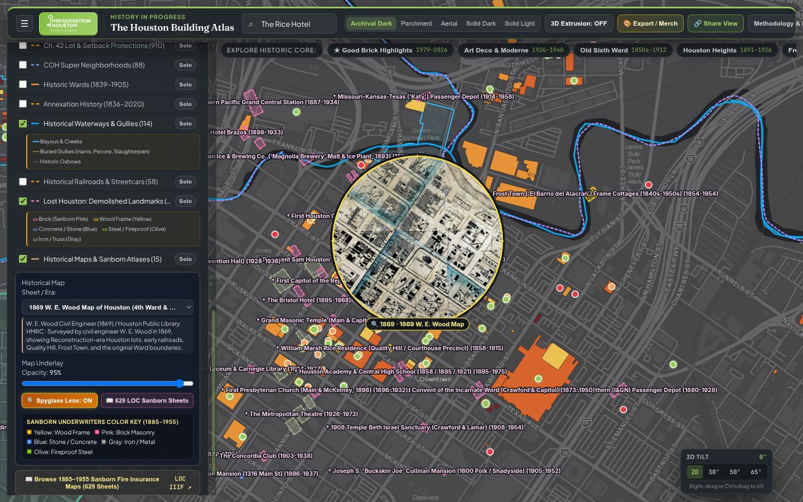
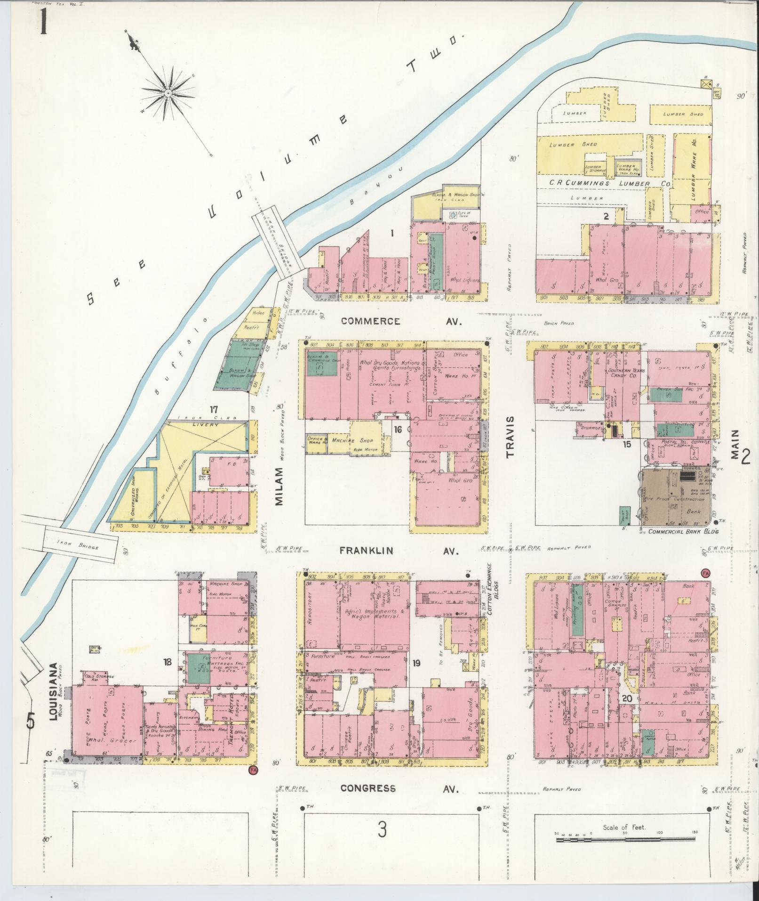
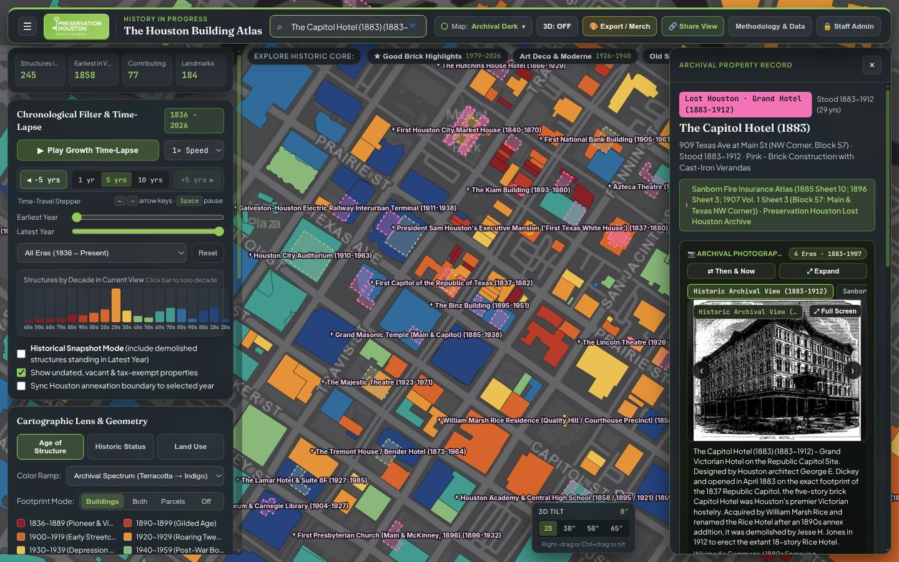

# Chapter 6: Library of Congress & UT Austin PCL Sanborn Fire Insurance Atlases, Historical Map Spyglass & Lost Houston

[← Chapter 5: Neighborhoods, Wards, Subdivisions & Deeds](05-neighborhoods-wards-subdivisions-and-deeds.md) | [Back to Master README](../README.md) | [Next: Chapter 7 - Waterways, Railroads, Permits & Contractors →](07-waterways-railroads-permits-and-contractors.md)

---

## 1. Georeferenced Historical Maps (`1869-1969`) & Interactive Spyglass Lens

To allow researchers to compare extant footprints directly against historical cartography and aerial photography, the atlas integrates **18 georeferenced historical map and aerial layers (`1869-1969`)** with both full-overlay opacity blending and a draggable **Spyglass Lens** (`#spy=map_id`).

|  |  |
| :---: | :---: |
| *Interactive Spyglass Lens Comparing 1869 W. E. Wood Map to Extant Buildings* | *Library of Congress 1907 Sanborn Fire Insurance Atlas Sheet 1 (Downtown / Allen's Landing)* |

### 1.1 Solving the Spyglass Lens Zoom-Offset & 3D Perspective Math (`mapController.js`)
The Spyglass Lens renders a circular magnifying portal over the WebGL canvas using an HTML5 2D overlay canvas (`#spyglass-canvas`). Two subtle coordinate-projection mismatches were diagnosed and fixed:
1. **Why the Spyglass Initially Looked Zoomed-Out (`512 px` vs. `256 px` World Size):**
   - Standard slippy-map tile math defines world size at zoom 0 as `256 pixels` ($256 \times 2^z$). However, MapLibre GL JS renders camera zoom levels using a **`512-pixel` world size at zoom 0** ($512 \times 2^z$), which is exactly $2\times$ larger (+1 zoom level) than a standard `256 px` raster tile pyramid!
   - When the initial Spyglass renderer computed tile coordinates using `256 * Math.pow(2, vpZoom)` centered on `map.getCenter()`, the historical map inside the circle was rendered at **half the scale (`0.5x`)** of the underlying MapLibre vector buildings, and drifted radially away from the cursor whenever the mouse moved away from the screen center!
   - **Fix:** The Spyglass renderer now computes `effectiveTileZoom = vpZoom + 1` and maps each screen pixel $(x, y)$ inside the lens circle through `map.unproject([x, y])` (and for tilted 3D views, samples a projective grid across the circle), guaranteeing pixel-accurate alignment between the historical map inside the lens and the modern buildings underneath at every zoom level, pan position, pitch, and bearing.
2. **Preventing Basemap Bleed-Through at High Zoom (`maxzoom` Clamping):**
   - Historical map tile services (`COH 1869 W. E. Wood`, `1895 Whitty`, `1913 Comey`, `Rice Fondren 1930-1969 Aerials`, `USGS Historical Topos`) have varying native maximum zoom levels (`z = 16` to `z = 19`). Requesting `z + 1` tiles above a service's native `maxzoom` returned `HTTP 404` or transparent blank tiles, causing the Spyglass to go blank when zooming in on an individual house. Clamping `tileZ = Math.min(maxZoom, Math.round(vpZoom + 1))` ensures smooth over-zooming down to parcel scale.

---

## 2. Digitized Sanborn Fire Insurance Atlases (`1877-1955`, `16` Volumes, `878` Sheets across LOC & UT Austin PCL)

Between 1877 and 1955, the **Sanborn Map Company** surveyed Houston block by block to assess fire insurance underwriting risk, recording building footprints, construction materials (**Yellow** = wood frame, **Pink** = brick, **Blue** = stone/concrete, **Gray** = iron/tin), roof composition, story heights, fire walls, and historic street numbers (including pre-1911 address numbers before Houston's citywide street renumbering ordinance).

`pipeline/atlas_pipeline/build_lost_houston_and_sanborn.py` and `build_ut_pcl_sanborn.py` index **`878` high-resolution digitized sheets across `16` Houston Sanborn volumes (`1877-1955`)** in `app/public/data/sanborn_catalog.json`:
- **`10` Library of Congress (`LOC`) Volumes (`1885`, `1890`, `1896`, `1907 Vol. 1`, `1907 Vol. 2`, `1924-1950 Vol. 1-4`, `1924-1955` - `626` IIIF Sheets)**; and
- **`6` University of Texas at Austin Perry-Castaneda Library (`UT PCL`) Volumes (`1877`, `1917`, `1919`, `1924 Vol. 2`, `1924 Vol. 3`, `1948 Vol. 6` - `252` Sheets mirrored locally as `504` optimized WebP plates in `app/public/data/sanborn_ut/` so inline views never hit UT's cross-origin Anubis PoW challenge; see [Chapter 9, Section 3.2](09-preservation-practice-social-history-and-hahc.md#32-expanding-sanborn-fire-insurance-coverage-from-10-loc-volumes-to-16-volumes-1877-1955-878-sheets))**.

### Four Library of Congress (`loc.gov`) IIIF & Metadata Pitfalls Solved

1. **LOC IIIF CDN Power-of-Two Scale Pre-Caching (`pct:12.5` & `pct:25` vs. `pct:35` Cold Decode):**
   - The Library of Congress serves Sanborn sheets from master JPEG2000 (`.jp2`) files via `https://tile.loc.gov/image-services/iiif/...`.
   - When our initial viewer requested arbitrary percentage scales such as `pct:35` or `pct:50`, every sheet took **4 to 7 seconds** to load because LOC's IIIF server had to decode the multi-megabyte JPEG2000 wavelet file on the fly (`X-Cache: Miss from cloudfront`).
   - Testing revealed that LOC's CloudFront CDN pre-warms and caches **exact power-of-two wavelet decomposition levels (`pct:6.25`, `pct:12.5`, `pct:25`, `pct:100`)** (`X-Cache: Hit from cloudfront`, `< 60 ms` response time!). Switching thumbnails to `pct:12.5` and modal full-sheet previews to `pct:25` (with a `High-Res Zoom (pct:100)` toggle) made browsing all 626 sheets instantaneous.
2. **Non-Sequential IIIF File Suffixes (`-covr`, `-0001s` Skeleton Maps, `-1101`, `-1201`):**
   - You cannot construct LOC Sanborn IIIF URLs by formatting `f"...-{sheet_num:04d}"`.
   - In the 1907 and 1924 volumes, LOC inserted unnumbered title covers (`-covr`), graphic index maps (`-0001`), **skeleton maps (`-0001s`, `-0002s`, `-0003s`, `-0004s`)**, and decimal supplement sheets (`-1101`, `-1201`), shifting the sequential image file number (`0007`) up to **6 positions ahead** of the printed Sanborn sheet number (`Sheet 3`)!
   - Our crawler (`build_lost_houston_and_sanborn.py`) fetched the full `?fo=json` manifest for all 10 LOC items and recorded each sheet's true `service_id`, `thumb`, `full`, and printed sheet `code`.
3. **Printed Sheet Number (`code`) vs. Sequential Manifest Index (`sp`) Resolution:**
   - When a Lost Houston landmark or historic building cites `"1907 Vol. 1 Sheet 3"`, matching against `sp == 3` opened the *Graphic Index Map* instead of *Sheet 3*! `_resolve_sanborn_sheet()` in `app.js` matches the printed Sanborn sheet `code` first before falling back to sequential `sp`.
4. **Canonical LOC Item URL Format (`/item/sanborn08580_...` vs. `/resource/g4034hm...`):**
   - LOC `/resource/g4034hm.g4034hm_g08580_1907_1/?sp=7` URLs fail (`HTTP 404`) when underscores are used in the resource slug (`g08580190701` has no underscores). All viewer links use the canonical `/item/{item_id}/?sp={sp}` URL format, which resolves `200 OK` across every volume.

---

## 3. Lost Houston: 81 Surveyed Demolished Landmarks (`1837-2006`)

Over the past 190 years, Houston has demolished scores of architectural landmarks - from the **1837 First Capitol of the Republic of Texas** and **1883 Capitol Hotel** on the Rice Hotel site, to the **1884 Cotton Exchange annotations**, **1901 Binz Building**, **1904 Carnegie Library**, **1910 City Auditorium**, **1911 Galveston-Houston Electric Interurban Terminal**, **1923 Majestic Theatre** (John Eberson's atmospheric masterpiece), **1926 Lamar Hotel**, and **1928 Shamrock Hotel**.

`pipeline/atlas_pipeline/build_lost_houston_and_sanborn.py` (together with `lost_houston_catalog.py` and `lost_houston_catalog_2.py`) constructs `overlays.json` (`lost_houston`: **81 surveyed demolished landmarks**, complemented by **16 demolished `"Gone"` National Register properties** in `nrhp_properties`), rendered with Sanborn Underwriters material-colored dashed outlines (**Pink** = Brick/Masonry, **Blue** = Stone/Terra Cotta/Concrete, **Amber** = Wood Frame, **Slate** = Cast Iron/Steel) and `† Landmark Name (Built-Demolished)` labels.

### 3.1 Fixing the `-34.65°` Borden Survey Grid Rotation & Parcel Fitting (`fit_rect_in_parcel`)
When generating the surveyed footprints for demolished Downtown structures (`build_lost_houston_and_sanborn.py`), two geometric problems had to be solved:
1. **Counter-Clockwise (`-34.65°`) vs. Clockwise (`+35°`) Grid Rotation:**
   - Downtown Houston's 1836 Borden Survey blocks run parallel to Buffalo Bayou near Allen's Landing: streets running SW-to-NE (`Main`, `Travis`, `Milam`, `Fannin`, `San Jac`) are tilted **`34.65°` West of North** (or `+55.35°` East of North for cross streets `Commerce`, `Franklin`, `Congress`, `Preston`, `Prairie`, `Texas`, `Capitol`).
   - An initial sign error rotated Downtown Lost Houston footprints by `+35.0°` instead of `-34.65°` (`~70°` off the street grid), causing demolished footprints to sit diagonally across sidewalks!
2. **Automated 9x9 Point-in-Polygon Parcel Fitting (`fit_rect_in_parcel`):**
   - For every Lost Houston landmark tied to an extant HCAD parcel (`site_hcad`), `fit_rect_in_parcel()` searches a `9 x 9` grid around the historical corner/lot position inside the exact `Parcels.gdb` polygon, aligns the footprint angle to the block's Borden Survey or cardinal grid, and shrinks dimensions if needed so **100% of the demolished footprint lies cleanly inside its historical block parcel without crossing into public street rights-of-way**.

### 3.2 Bidirectional Site Cross-Referencing & Historical Snapshot Mode
- **Clicking an Extant Building on a Demolished Site:** When a user clicks the extant **1913 Rice Hotel** (`909 Texas Ave`, `0010570000001`), the Inspector Panel automatically renders a **"Previous Historic Structures on This Site"** section showing both the **1837 First Capitol of the Republic of Texas (`1837-1882`)** and the **1883 Capitol Hotel (`1883-1912`)**, complete with archival engravings and one-click buttons to inspect their demolished footprints and Sanborn sheets.
- **Historical Snapshot Mode (`#snapshot=1`):** Checking **Historical Snapshot Mode (include demolished structures standing in Latest Year)** in the Chronological Filter sidebar dynamically filters both extant buildings (`year_built <= endYear`) and Lost Houston structures (`year_built <= endYear AND year_demolished > endYear`), reconstructing the architectural fabric of Houston as it stood in any chosen year between `1836` and `2026`.

---

[← Chapter 5: Neighborhoods, Wards, Subdivisions & Deeds](05-neighborhoods-wards-subdivisions-and-deeds.md) | [Back to Master README](../README.md) | [Next: Chapter 7 - Waterways, Railroads, Permits & Contractors →](07-waterways-railroads-permits-and-contractors.md)
