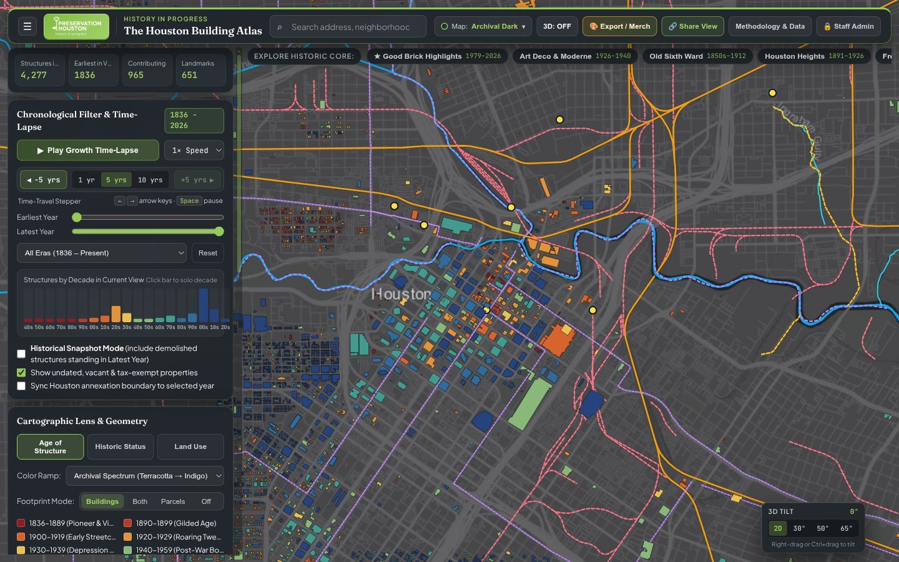
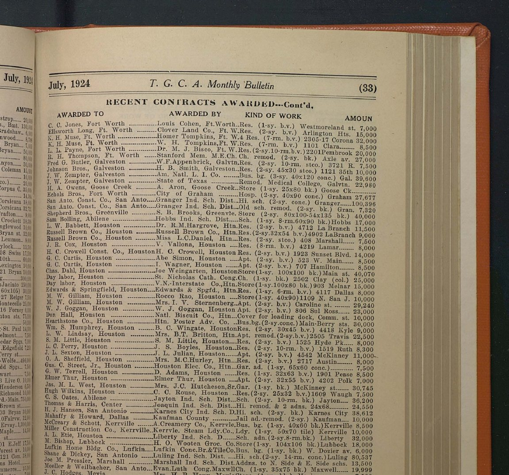

# Chapter 7: Historical Waterways, Railroads, Multi-Era Permits & HMRC Contractor Archives

[← Chapter 6: Sanborn Maps & Lost Houston](06-sanborn-maps-and-lost-houston.md) | [Back to Master README](../README.md) | [Next: Chapter 8 - Crowdsourcing, Live HCAD API & Admin Operations →](08-crowdsourcing-and-admin-operations.md)

---

## 1. Historical Waterways, Open Bayous & Buried Downtown Gullies (`225` Segments, `1,896.8 km`)

Houston's urban form was shaped by **Buffalo Bayou**, **White Oak Bayou**, **Brays Bayou**, **Sims Bayou**, **Greens Bayou**, **Hunting Bayou**, and dozens of spring-fed gullies that originally carved deep ravines through Downtown, Midtown, the Heights, and Eastwood before being placed in underground brick and concrete storm sewers in the early 20th century.

### 1.1 Merging USGS NHD, HCFCD & TNRIS Hydrography (`build_waterways_and_railroads.py`)
No single hydrography layer provides both named major bayous and fine-grained neighborhood tributary channels:
- **USGS National Hydrography Dataset (`NHD`, `6,017` flowline segments):** High geometric detail along natural meanders, but splits every bayou into hundreds of tiny reach segments and lacks Harris County Flood Control District (`HCFCD`) unit codes.
- **HCFCD Open Data (`2,426` channel segments across all 22 watersheds `A` through `W`, including `M3` tributary sub-basins):** Provides official watershed unit IDs (`W100-00-00` Buffalo Bayou, `E100-00-00` White Oak Bayou, `D100-00-00` Brays Bayou, `D118-00-00` Poor Farm Ditch, `E101-00-00` Little White Oak Bayou) and engineering histories.
- **TNRIS / TxDOT Major Streams:** Provides clean regional continuity.

In `pipeline/atlas_pipeline/build_waterways_and_railroads.py`, these three datasets are spatially joined, dissolved by waterway name and HCFCD unit code, and processed through an **endpoint confluence snapper** (`<= 120m` gap bridging across underground freeway box culverts so tributary creeks connect cleanly to their receiving bayous without visual breaks), yielding **218 named open bayous and creeks (`1,881.2 km`)**.

### 1.2 Reconstructing 7 Daylighted & Buried Historic Gullies (`1836-1954` Cartography)
Why do certain Downtown blocks have angled foundations or mid-block alleys, and why do streets in the Heights or Montrose dip into subtle topographic bowls? Using the **1836 Borden Survey**, **1869 W. E. Wood Map**, **1891 Whitty Map**, **1913 Arthur Comey Park System Plan**, and **1915-1954 USGS 1:24,000 Topographic Quadrangles**, we traced and digitized **7 buried or culverted historic gullies** (rendered in dashed cyan with full historical dossiers):
1. **Downtown East Gully (Caroline / Austin Ravine):** Drained northward across Capitol, Rusk, Texas, Prairie, Preston, and Congress into Buffalo Bayou east of Main Street (`buried in brick sewer c. 1889-1902`).
2. **Downtown West Gully (Smith / Louisiana Ravine):** Drained the marshy depression along Smith and Louisiana streets into Buffalo Bayou near Sam Houston Park (`culverted c. 1900-1914`).
3. **Second Ward / Frost Town Slaughterhouse Gully:** Drained north through Frost Town and the early German settlement into Buffalo Bayou east of the Elysian Viaduct.
4. **Fourth Ward / Freedmen's Town West Gully (Heiner St Ravine):** Separated the Freedmen's Town brick-street grid from the San Felipe bluff along present-day I-45.
5. **Heights Blvd / Carter's Gully (West White Oak Tributary):** Traced from 1915 USGS contour swales draining the eastern Houston Heights into White Oak Bayou.
6. **Montrose / Mandell Street Gully (`D120` Historic Swale):** Drained southern Montrose and the Castle Court / Westheimer corridor southward toward Brays Bayou and Poor Farm Ditch (`culverted under Dunlavy/Mandell storm trunks in the 1920s`).
7. **Third Ward / Blodgett Gully (`D112` Historic Ravine):** Drained Third Ward, TSU, and the University of Houston campus southwest into Brays Bayou near Hermann Park.

---

## 2. Historical Railroads, Abandoned Rights-of-Way, Electric Streetcars & Depots

Houston's 19th-century motto - *"Where Seventeen Railroads Meet the Sea"* - is visible in the diagonal angles of its industrial wards, hike-and-bike trails, and street grids. `pipeline/atlas_pipeline/build_waterways_and_railroads.py` constructs two companion rail layers:
- **`historical_railroads.geojson` (`80` named corridors):**
  - **Active Historic Freight & Passenger Trunks (Solid Amber):** Merged from the Federal Railroad Administration (`FraN`, `717` segments) and `TxDOT Rail` (`692` segments), annotated with their original 19th-century charter names (*Galveston, Harrisburg & San Antonio / Sunset Route 1853*, *Houston & Texas Central 1856*, *International & Great Northern 1871*, *Gulf, Colorado & Santa Fe 1880*, *Houston East & West Texas 1875*).
  - **Abandoned Rail Rights-of-Way Now Preserved as Trails or Boulevards (Dashed Coral Pink):** Traced along exact historic alignments where the rails were pulled up (*1856 Columbia Tap / Houston Tap & Brazoria*, *1893 Missouri-Kansas-Texas / MKT Heights Trail*, *1886 San Antonio & Aransas Pass / Blodgett-Westpark Corridor*, *Houston Belt & Terminal West Belt*).
  - **Historic Electric Streetcar & Interurban Lines (`1891-1938`, Dashed Violet):** Traced along exact historic street centerlines from the 1913 Bontjes Map and 1924 Stone & Webster Houston Electric Co. franchise maps (*Houston Heights Streetcar via Washington Ave & Heights Blvd*, *Montrose & South End Streetcar*, *woodland Heights / Houston Ave Line*, *Harrisburg & Magnolia Park Line*, and the **1911-1936 Galveston-Houston Electric Interurban** running from its Downtown terminal at `514 Bagby St` along the Pierce Elevated alignment and I-45 corridor to Galveston).
- **`historic_rail_depots.geojson` (`14` historic passenger stations, freight depots & rail shops):** Including **1911 Union Station**, **1934 Southern Pacific Grand Central Station** (`902 Washington Ave` site), **1897 MKT Passenger Depot**, **1880s International & Great Northern Depot**, **1911 Galveston-Houston Electric Interurban Terminal** (`514 Bagby St`, `0011220000001`), and the **1880s Hardy Street Southern Pacific Locomotive Shops**.

---

## 3. Multi-Era Building Permits, HMRC Contractor Monographs & Relocated Structures

One of the richest additions to the atlas (`pipeline/atlas_pipeline/build_permits_and_contractors.py`) links properties across Harris County to three distinct eras of construction and permit documentation:

|  |  |
| :---: | :---: |
| *408 Marshall St July 1924 Contractor & Permit Dossier in the Inspector Panel* | *Raw Scan of July 1924 T.G.C.A. Monthly Bulletin Page 33 (HMRC ContentDM ID 22003)* |

### 3.1 Era 1 (`1880-1945`): Digitized HMRC Contractor Monographs & *T.G.C.A. Monthly Bulletin* (`95` Portfolio Sites)
Because the City of Houston did not preserve continuous municipal building permit ledgers prior to the 1980s, early-20th-century general contractor names, structural engineers, original contract costs, and subcontractor lists must be recovered from trade journals and promotional contractor monographs preserved in the **Houston Metropolitan Research Center (`HMRC`)** at the Houston Public Library (`https://cdm17006.contentdm.oclc.org`):
1. **_Texas General Contractors Association (T.G.C.A.) Monthly Bulletin_ (`1922-1924`, `952` pages across `18` monthly issues):**
   - Published monthly tables titled *"RECENT CONTRACTS AWARDED"* listing the General Contractor (`AWARDED TO`), Owner/Architect (`AWARDED BY`), Building Type & Address (`KIND OF WORK`), and Contract Dollar Amount (`AMOUNT`), plus competitive bidding tables (*"BIDS OPENED"*) showing every bidding contractor's exact bid price.
   - **Example (`408 Marshall St`, `0370370000007` in Westmoreland / Montrose):** HCAD listed a rounded placeholder year of `1920` with no builder. Page 33 of the **July 1924 *T.G.C.A. Monthly Bulletin*** (`ContentDM books/22003`) records:
     > `Russell Brown Co., Houston ... Miss L. C. Daniel, Htn. Res. (2-sy. stco.) 408 Marshall ... $7,500`
     This single archival line established the exact construction month (**July 1924**), general contractor (**The Russell Brown Company**), original client (**Miss L. C. Daniel**), structural description (**2-story stucco residence**), and contract cost (**\$7,500**).
2. **HMRC Promotional Contractor Monographs (`books/6913`, `books/2437`, `p17006coll39/338`):**
   - *Architectural & Structural Views: Work Done by The Russell Brown Company (`1917` & `1929` editions)* (featuring custom residences in Broadacres, Courtlandt Place, Rossmoyne, and Montrose, plus the **Warwick Hotel**, **River Oaks Country Club**, and **Hermann Park Golf Clubhouse**).
   - *Buildings Constructed by T. D. Howe Construction Company (`1940s`)* (commercial, industrial, and warehouse complexes).
3. **448 Official City of Houston Landmark Designation Report PDFs:**
   - Regex and NLP extraction across all 448 downloaded HPO PDFs recovered original general contractors, master builders (such as **American Construction Co.**, **W. S. Bellows Construction Co.**, **Southwestern Construction Co.**, **Fretz Construction Co.**, **Tellepsen Construction Co.**, **Tomball Lumber Co.**), structural engineers (**Robert J. Cummins**), and original mechanic's-lien contract amounts.

### 3.2 Solving Two ContentDM URL & Media-Type Pitfalls (`digital.houstonlibrary.org` vs. `cdm17006.contentdm.oclc.org`)
During verification of the HMRC archive links in the Inspector Panel, two external library URL issues were discovered and fixed:
1. **Retirement of `https://digital.houstonlibrary.org/digital/...` (`HTTP 302` Redirect to Library Homepage):**
   - The Houston Public Library retired its vanity custom domain `digital.houstonlibrary.org` and configured a wildcard `HTTP 302` redirect sending every deep link (`/digital/collection/books/id/22003`) to the generic marketing landing page `https://houstonlibrary.org/digital-archives`!
   - However, the underlying OCLC ContentDM repository remains live at **`https://cdm17006.contentdm.oclc.org/digital/collection/books/id/22003`**. Every link in the codebase, pipeline scripts, and JSON datasets was migrated to `https://cdm17006.contentdm.oclc.org`.
2. **ContentDM `books` Collection PDF Pages vs. IIIF Image Endpoints:**
   - Unlike the `images` collection (which stores JPEGs/TIFFs served via `/digital/iiif/...`), items in the ContentDM `books` collection (`filetype: 'pdf'`, such as `books/22003` -> `22594.pdf`) are stored as single-page PDFs, so `/digital/iiif/books/22003/...` returns `HTTP 404`.
   - Instead, ContentDM serves the inline single-page PDF directly at **`https://cdm17006.contentdm.oclc.org/digital/api/collection/books/id/{id}/page/0/inline/books_{id}_0`** (`200 OK application/pdf`). Each contractor dossier provides both **View HMRC Archive Page ↗** and **View Scanned Page (PDF) ↗**.

### 3.3 Era 2 (`1950-2026`): Streaming 1,300,027 HCAD Permits & 649,693 Appraiser Remodel Notes into 152 Prefix Shards
To surface remodeling history, roof replacements, additions, demolitions, and appraiser field notes for every parcel in Harris County without bloating initial page load:
- `build_permits_and_contractors.py` streams HCAD's `permits.txt` (`1,300,027` permit rows), `real_acct.txt`, `building_res.txt` (`649,693` CAMA appraiser remodel/condition notes), and `extra_features.txt`, partitioning them by the first 3 digits of the 13-digit HCAD account number into **152 lightweight JSON shards (`app/public/data/permits/permits_<prefix3>.json`, covering `1,258,149` accounts)**.
- When a user clicks any building on the map, `app.js` fetches only the single ~150 KB `permits_<prefix3>.json` shard for that account prefix on demand and renders a chronological **Building Permit & Remodel Timeline** alongside the appraiser's inspection notes.

### 3.4 Era 3 (`1823-2025`): Relocated Historic Structures & Filtering Out HCAD `permit_type = 15` (`OMITTED IMPS`) False Positives
Houston has a rich tradition of physically moving historic houses on flatbed trucks to save them from demolition (for example, the 12 historic structures relocated to **Sam Houston Park**, the **1893ofuran-moved Victorian cottages in Old Sixth Ward**, and houses moved to **514 Michigan St** or **1415 California St**).

When mining HCAD's `permits.txt` for relocated houses, we discovered a major HCAD coding trap:
- In HCAD's permit table, `permit_type = 15` is labeled `"COH - Moved"` in older codebooks.
- However, querying all rows with `permit_type = 15` returned thousands of properties whose permit description read **`OMITTED IMPS`** (*Omitted Improvements*)! Whenever an HCAD appraiser discovers an unrecorded backyard shed, garage apartment, or wood deck on aerial photography (such as the `2006-11-13` rear wood deck picked up via aerial on `408 Marshall St`), HCAD enters an administrative tax-roll catch-up assessment using `permit_type = 15` (`OMITTED IMPS`).
- Treating `permit_type = 15` (`OMITTED IMPS`) as a physical building move falsely flagged hundreds of stationary houses as "Relocated Structures"!
- **The Fix:** `build_permits_and_contractors.py` explicitly reclassifies `OMITTED IMPS` as `"HCAD Omitted Improvement Assessment"` (`cat: "add"`) and restricts the **Relocated Historic Structures** layer (`385` verified sites in `overlays.json`) strictly to permits and landmark records containing genuine physical-move evidence (`MOVE IN`, `MOVED ONTO LOT`, `RELOCATED FROM`, or curated Heritage Society / HPO relocation provenance).

---

[← Chapter 6: Sanborn Maps & Lost Houston](06-sanborn-maps-and-lost-houston.md) | [Back to Master README](../README.md) | [Next: Chapter 8 - Crowdsourcing, Live HCAD API & Admin Operations →](08-crowdsourcing-and-admin-operations.md)
