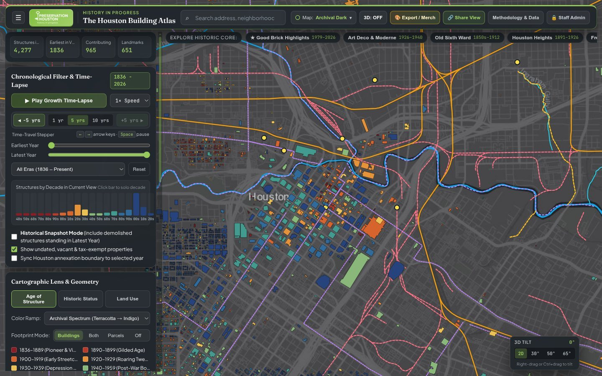
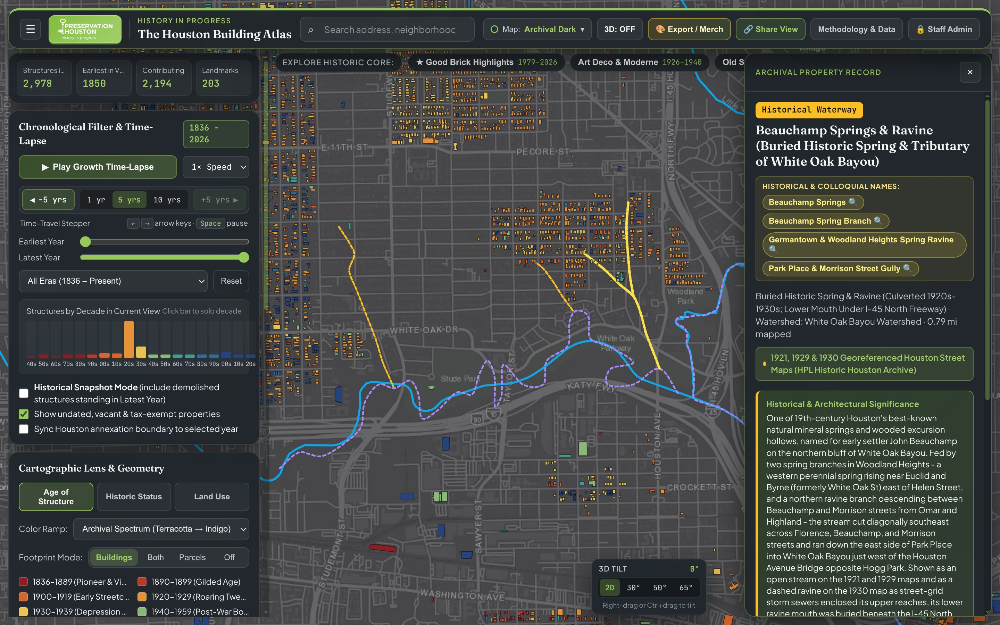
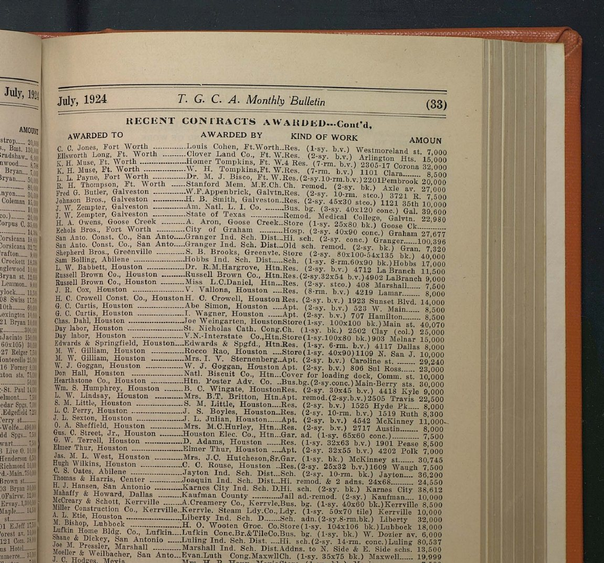
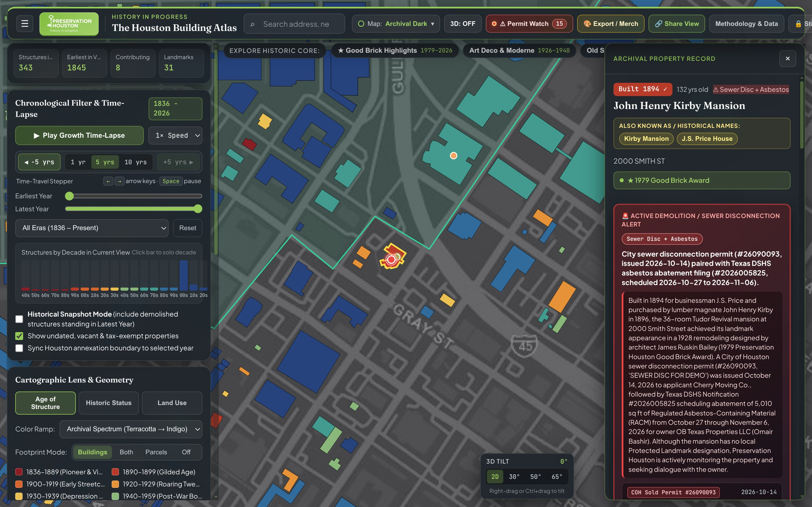

# Chapter 7: Historical Waterways, Railroads, Multi-Era Permits & HMRC Contractor Archives

[← Chapter 6: Sanborn Maps & Lost Houston](06-sanborn-maps-and-lost-houston.md) | [Back to Master README](../README.md) | [Next: Chapter 8 - Crowdsourcing, Live HCAD API & Admin Operations →](08-crowdsourcing-and-admin-operations.md)

---

## 1. Historical Waterways, Open Bayous & Buried Downtown Gullies (`225` Segments, `1,896.8 km`)

Houston's urban form was shaped by **Buffalo Bayou**, **White Oak Bayou**, **Brays Bayou**, **Sims Bayou**, **Greens Bayou**, **Hunting Bayou**, and dozens of spring-fed gullies that originally carved deep ravines through Downtown, Midtown, the Heights, and Eastwood before being placed in underground brick and concrete storm sewers in the early 20th century.

### 1.1 Merging USGS NHD, HCFCD & TNRIS Hydrography (`build_waterways_and_railroads.py`)
No single hydrography layer provides both named major bayous and fine-grained neighborhood tributary channels:
- **USGS National Hydrography Dataset (`NHD`, `6,017` flowline segments):** High geometric detail along natural meanders, but splits every bayou into hundreds of tiny reach segments and lacks Harris County Flood Control District (`HCFCD`) unit codes.
- **HCFCD Open Data (`2,426` channel segments across all 22 watersheds `A` through `W`, including `M3` tributary sub-basins):** Provides official watershed unit IDs (`W100-00-00` Buffalo Bayou, `E100-00-00` White Oak Bayou, `D100-00-00` Brays Bayou, `D118-00-00` Poor Farm Ditch, `E101-00-00` Little White Oak Bayou) and engineering histories.
- **TNRIS / TxDOT Major Streams:** Provides clean regional continuity.

In `pipeline/atlas_pipeline/build_waterways_and_railroads.py`, these three datasets are spatially joined, dissolved by waterway name and HCFCD unit code, and processed through an **endpoint confluence snapper** (`<= 120m` gap bridging across underground freeway box culverts so tributary creeks connect cleanly to their receiving bayous without visual breaks), yielding **218 named open bayous and creeks (`1,881.2 km`)**.

### 1.2 Reconstructing 7 Daylighted & Buried Historic Gullies (`1836-1954` Cartography)
Why do certain Downtown blocks have angled foundations or mid-block alleys, and why do streets in the Heights or Montrose dip into subtle topographic bowls? Using the **1836 Borden Survey**, **1869 W. E. Wood Map**, **1891 Whitty Map**, **1913 Arthur Comey Park System Plan**, and **1915-1954 USGS 1:24,000 Topographic Quadrangles**, we traced and digitized **7 buried or culverted historic gullies** (rendered in dashed cyan with full historical dossiers):
1. **Downtown East Gully (Caroline / Austin Ravine):** Drained northward across Capitol, Rusk, Texas, Prairie, Preston, and Congress into Buffalo Bayou east of Main Street (`buried in brick sewer c. 1889-1902`).
2. **Downtown West Gully (Smith / Louisiana Ravine):** Drained the marshy depression along Smith and Louisiana streets into Buffalo Bayou near Sam Houston Park (`culverted c. 1900-1914`).
3. **Second Ward / Frost Town Slaughterhouse Gully:** Drained north through Frost Town and the early German settlement into Buffalo Bayou east of the Elysian Viaduct.
4. **Fourth Ward / Freedmen's Town West Gully (Heiner St Ravine):** Separated the Freedmen's Town brick-street grid from the San Felipe bluff along present-day I-45.
5. **Heights Blvd / Carter's Gully (West White Oak Tributary):** Traced from 1915 USGS contour swales draining the eastern Houston Heights into White Oak Bayou.
6. **Montrose / Mandell Street Gully (`D120` Historic Swale):** Drained southern Montrose and the Castle Court / Westheimer corridor southward toward Brays Bayou and Poor Farm Ditch (`culverted under Dunlavy/Mandell storm trunks in the 1920s`).
7. **Third Ward / Blodgett Gully (`D112` Historic Ravine):** Drained Third Ward, TSU, and the University of Houston campus southwest into Brays Bayou near Hermann Park.

### 1.3 Case Study: Recovering Beauchamp Springs, the Woodland Heights Ravines & Pre-1960s White Oak Bayou Oxbows
Why were **Beauchamp Springs**, the **Western Woodland Heights Ravine**, the **Stude Park / Beverly-Studewood Ravine**, and the **Pre-1960s White Oak Bayou oxbow loops** initially absent from modern GIS hydrography layers (`USGS NHD`, `HCFCD M3`, and `COH Water Lines`)?

1. **Why Modern GIS Datasets Missed the Three Spring Ravines:**
   - `USGS NHD` and `HCFCD M3` only include channels that remain open waterways (`E100-00-00` White Oak Bayou and `E101-00-00` Little White Oak Bayou) or giant regional HCFCD box-culvert trunks (`D109-00-00` Harris Gully).
   - Comparing the **1921**, **1929**, and **1930** georeferenced Houston maps reveals the exact moment these spring-fed tributaries were enclosed: on the 1921 and 1929 maps, all three appear as solid open streams, whereas by the 1930 map they appear as dashed intermittent ravines as municipal street-grid storm sewers replaced their upper reaches, and in the late 1950s the **I-45 North Freeway (`NORTH FWY`)** embankment buried the lower mouth of Beauchamp Springs just west of Houston Avenue.
2. **Why the 1903 Ward Boundary Oxbow Extractor Missed White Oak Bayou West of Houston Avenue:**
   - Our 1903 Aldermanic Ward boundary oxbow extractor (`ward_boundary_pair: ("FIRST", "FIFTH")`) followed the charter boundary between First Ward and Fifth Ward, which ran up lower White Oak Bayou only as far as **Hogg Park / Wrightwood** and then turned **north up Little White Oak Bayou** along the east side of Woodland Park. Because White Oak Bayou west of Houston Avenue lay entirely inside First Ward (and west of Sabine/Studewood lay outside the 1840-1903 `9 sq. mi.` city limits), the ward boundary never traced the four dramatic natural oxbow loops of White Oak Bayou that were later bypassed when the U.S. Army Corps of Engineers built the straight concrete flood-control channel (`HCFCD E100-00-00`) in the 1960s.
3. **Four Surveyed Features Digitized from the 1915, 1921, 1929 & 1930 Maps:**
   - **`waterway_beauchamp_springs_gully` (Beauchamp Springs & Ravine):** Includes both the perennial spring branch rising near `Euclid` and `Byrne` (called `White Oak St` on the 1921 map) east of `Helen St` and the northern ravine fork descending between `Beauchamp` and `Morrison` from `Omar` and `Highland`, converging across `Florence`, `Beauchamp`, and `Morrison` and running down the east side of `Park Place` into White Oak Bayou just west of the Houston Avenue bridge.
   - **`waterway_woodland_terrace_sabine_gully` (Woodland Heights West - Byrne, Peetshorn & Ridge Ravine):** Rises near `Euclid` and `Byrne` east of `Reagan` and `Louise`, flowing southeast across `Peetshorn` (called `Reichman St` on the 1921 map) and `Ridge St` into the northern apex of White Oak Bayou's N. Sabine bluff loop (where `Gladys`, `Thelma`, and `Greenleaf` cul-de-sacs were platted into the ravine walls by 1930).
   - **`waterway_stude_beverly_gully` (Stude Park & Beverly-Studewood Ravine):** Rises in the eastern Houston Heights at `E. 8 1/2 St` and `Beverly St` just west of `Studewood St`, winding south across `8th`, `7 1/2`, `7th`, `6 1/2`, and `6th` (`White Oak Dr`) and down the diagonal curve of `Threlkeld St` through **Stude Park** into White Oak Bayou.
   - **`waterway_white_oak_stude_sabine_oxbows` (White Oak Bayou - Pre-1960s Olivewood, Stude Park, N. Sabine & Mattie St Natural Oxbows):** Traces the four pre-channelization horseshoe meander loops from Olivewood Cemetery (`MKT Railroad`) through Stude Park, the Taylor Street bridge, the N. Sabine bluff, and the Mattie/Maud peninsula to Hogg Park.

---

## 2. Historical Railroads, Abandoned Rights-of-Way, Electric Streetcars & Depots

Houston's 19th-century motto - *"Where Seventeen Railroads Meet the Sea"* - is visible in the diagonal angles of its industrial wards, hike-and-bike trails, and street grids. `pipeline/atlas_pipeline/build_waterways_and_railroads.py` constructs two companion rail layers:
- **`historical_railroads.geojson` (`80` named corridors):**
  - **Active Historic Freight & Passenger Trunks (Solid Amber):** Merged from the Federal Railroad Administration (`FraN`, `717` segments) and `TxDOT Rail` (`692` segments), annotated with their original 19th-century charter names (*Galveston, Harrisburg & San Antonio / Sunset Route 1853*, *Houston & Texas Central 1856*, *International & Great Northern 1871*, *Gulf, Colorado & Santa Fe 1880*, *Houston East & West Texas 1875*).
  - **Abandoned Rail Rights-of-Way Now Preserved as Trails or Boulevards (Dashed Coral Pink):** Traced along exact historic alignments where the rails were pulled up (*1856 Columbia Tap / Houston Tap & Brazoria*, *1893 Missouri-Kansas-Texas / MKT Heights Trail*, *1886 San Antonio & Aransas Pass / Blodgett-Westpark Corridor*, *Houston Belt & Terminal West Belt*).
  - **Historic Electric Streetcar & Interurban Lines (`1891-1938`, Dashed Violet):** Traced along exact historic street centerlines from the 1913 Bontjes Map and 1924 Stone & Webster Houston Electric Co. franchise maps (*Houston Heights Streetcar via Washington Ave & Heights Blvd*, *Montrose & South End Streetcar*, *woodland Heights / Houston Ave Line*, *Harrisburg & Magnolia Park Line*, and the **1911-1936 Galveston-Houston Electric Interurban** running from its Downtown terminal at `514 Bagby St` along the Pierce Elevated alignment and I-45 corridor to Galveston).
- **`historic_rail_depots.geojson` (`14` historic passenger stations, freight depots & rail shops):** Including **1911 Union Station**, **1934 Southern Pacific Grand Central Station** (`902 Washington Ave` site), **1897 MKT Passenger Depot**, **1880s International & Great Northern Depot**, **1911 Galveston-Houston Electric Interurban Terminal** (`514 Bagby St`, `0011220000001`), and the **1880s Hardy Street Southern Pacific Locomotive Shops**.

---

## 3. Multi-Era Building Permits, HMRC Contractor Monographs & Relocated Structures

One of the richest additions to the atlas (`pipeline/atlas_pipeline/build_permits_and_contractors.py`) links properties across Harris County to three distinct eras of construction and permit documentation:

|  |  |
| :---: | :---: |
| *408 Marshall St July 1924 Contractor & Permit Dossier in the Inspector Panel* | *Raw Scan of July 1924 T.G.C.A. Monthly Bulletin Page 33 (HMRC ContentDM ID 22003)* |

### 3.1 Era 1 (`1880-1945`): Digitized HMRC Contractor Monographs & *T.G.C.A. Monthly Bulletin* (`95` Portfolio Sites)
Because the City of Houston did not preserve continuous municipal building permit ledgers prior to the 1980s, early-20th-century general contractor names, structural engineers, original contract costs, and subcontractor lists must be recovered from trade journals and promotional contractor monographs preserved in the **Houston Metropolitan Research Center (`HMRC`)** at the Houston Public Library (`https://cdm17006.contentdm.oclc.org`):
1. **_Texas General Contractors Association (T.G.C.A.) Monthly Bulletin_ (`1922-1924`, `952` pages across `18` monthly issues):**
   - Published monthly tables titled *"RECENT CONTRACTS AWARDED"* listing the General Contractor (`AWARDED TO`), Owner/Architect (`AWARDED BY`), Building Type & Address (`KIND OF WORK`), and Contract Dollar Amount (`AMOUNT`), plus competitive bidding tables (*"BIDS OPENED"*) showing every bidding contractor's exact bid price.
   - **Example (`408 Marshall St`, `0370370000007` in Westmoreland / Montrose):** HCAD listed a rounded placeholder year of `1920` with no builder. Page 33 of the **July 1924 *T.G.C.A. Monthly Bulletin*** (`ContentDM books/22003`) records:
     > `Russell Brown Co., Houston ... Miss L. C. Daniel, Htn. Res. (2-sy. stco.) 408 Marshall ... $7,500`
     This single archival line established the exact construction month (**July 1924**), general contractor (**The Russell Brown Company**), original client (**Miss L. C. Daniel**), structural description (**2-story stucco residence**), and contract cost (**\$7,500**).
2. **HMRC Promotional Contractor Monographs (`books/6913`, `books/2437`, `p17006coll39/338`):**
   - *Architectural & Structural Views: Work Done by The Russell Brown Company (`1917` & `1929` editions)* (featuring custom residences in Broadacres, Courtlandt Place, Rossmoyne, and Montrose, plus the **Warwick Hotel**, **River Oaks Country Club**, and **Hermann Park Golf Clubhouse**).
   - *Buildings Constructed by T. D. Howe Construction Company (`1940s`)* (commercial, industrial, and warehouse complexes).
3. **448 Official City of Houston Landmark Designation Report PDFs:**
   - Regex and NLP extraction across all 448 downloaded HPO PDFs recovered original general contractors, master builders (such as **American Construction Co.**, **W. S. Bellows Construction Co.**, **Southwestern Construction Co.**, **Fretz Construction Co.**, **Tellepsen Construction Co.**, **Tomball Lumber Co.**), structural engineers (**Robert J. Cummins**), and original mechanic's-lien contract amounts.

### 3.2 Solving Two ContentDM URL & Media-Type Pitfalls (`digital.houstonlibrary.org` vs. `cdm17006.contentdm.oclc.org`)
During verification of the HMRC archive links in the Inspector Panel, two external library URL issues were discovered and fixed:
1. **Retirement of `https://digital.houstonlibrary.org/digital/...` (`HTTP 302` Redirect to Library Homepage):**
   - The Houston Public Library retired its vanity custom domain `digital.houstonlibrary.org` and configured a wildcard `HTTP 302` redirect sending every deep link (`/digital/collection/books/id/22003`) to the generic marketing landing page `https://houstonlibrary.org/digital-archives`!
   - However, the underlying OCLC ContentDM repository remains live at **`https://cdm17006.contentdm.oclc.org/digital/collection/books/id/22003`**. Every link in the codebase, pipeline scripts, and JSON datasets was migrated to `https://cdm17006.contentdm.oclc.org`.
2. **ContentDM `books` Collection PDF Pages vs. IIIF Image Endpoints:**
   - Unlike the `images` collection (which stores JPEGs/TIFFs served via `/digital/iiif/...`), items in the ContentDM `books` collection (`filetype: 'pdf'`, such as `books/22003` -> `22594.pdf`) are stored as single-page PDFs, so `/digital/iiif/books/22003/...` returns `HTTP 404`.
   - Instead, ContentDM serves the inline single-page PDF directly at **`https://cdm17006.contentdm.oclc.org/digital/api/collection/books/id/{id}/page/0/inline/books_{id}_0`** (`200 OK application/pdf`). Each contractor dossier provides both **View HMRC Archive Page ↗** and **View Scanned Page (PDF) ↗**.

### 3.3 Era 2 (`1950-2026`): Streaming 1,300,027 HCAD Permits & 914,980 Appraiser Inspection Notes into 152 Deterministic `.json.gz` Shards + Plain-English Shorthand Decoder
To surface remodeling history, roof replacements, additions, demolitions, appraiser field notes, and recorded mechanic's liens (`ml`) for every parcel in Harris County without bloating initial page load or exceeding GitHub Pages' 1 GiB bundle limit:
- `build_permits_and_contractors.py` streams HCAD's `permits.txt` (`1,300,027` permit rows), `real_acct.txt`, `building_res.txt` (`914,980` CAMA appraiser remodel/condition notes across residential and commercial accounts), and `extra_features.txt`, partitioning them by the first 3 digits of the 13-digit HCAD account number into **152 deterministic RFC 1952 gzipped JSON shards (`app/public/data/permits/permits_<prefix3>.json.gz`, `73.4 MiB` total down from `367.05 MiB` uncompressed, covering `1,210,554` standing/referenced accounts while preserving `33,183` `TX Tax Code Sec. 25.025` `"conf": 1` privacy shields)**.
- **Official 25-Code HCAD `permits.txt` Category Alignment (`classify_hcad_permit_category_and_label` & `cli.py --mode repair-permit-categories`):** Every row in HCAD's `permits.txt` carries one of `25` official `(permit_type, permit_tp_descr)` codes (`07` Outbuilding / Yard Feature `OB&Y`, `08`/`14` Manufactured Homes, `09`/`10`/`20`/`30`/`39`/`40` New Residential, Condo & Commercial Construction, `11`/`21`/`31` Residential, Condo & Commercial Additions/Remodels, `12`/`41` Foundation & General Maintenance / Fire Damage Repairs, `13`/`33`/`43` Residential & Commercial Demolitions, `15` Moved Structures vs. `OMITTED IMPS`, `16`/`35` Fire Damage Reports, `17`/`50` Storm & Disaster Reviews, `32` Paving/Parking/Slab, `60` Property Owner Mailer Checks, and `84` Tax-Exempt Property Permits, alongside legacy pre-2005 synthetic codes `01`..`06`, `18`, `TX`, `W`). Where municipal feeds reuse broad codes (such as City of Houston Type `13` building permits covering non-load-bearing interior partition remodels and pool/garage removals, Type `07`/`11`/`12` re-roofs and foundation repairs, or Type `31` commercial lease build-outs), `classify_hcad_permit_category_and_label` (`pipeline/atlas_pipeline/schema.py`) applies conservative description-level refinements while guarding echoed generic `permit_tp_descr` headers against false re-tagging. Running `uv run --no-sync python -m atlas_pipeline.cli --mode repair-permit-categories --apply` reclassifies all `1,124,683` HCAD shard permit entries in ~85 seconds while leaving `"conf": 1` shields, live `coh_live`/`coh_weekly`/`tx_dshs` rows, and top-level deed chains untouched.
- **Plain-English Appraiser Note & Municipal Permit Shorthand Decoder (`app/js/permitPlainEnglish.js`):** When a user clicks any building (or opens a `&tab=permits` deep link such as [`#hcad=0620950000004&tab=permits`](https://davemorris-gcp.github.io/houston-building-atlas/#hcad=0620950000004&tab=permits) for `1016 Algregg St`), `app.js` decompresses the matching `permits_<prefix3>.json.gz` shard via browser `DecompressionStream("gzip")` and renders `#inspector-permits-body` through `buildInspectorPermitsBodyHtml`:
  1. **Cryptic HCAD Appraiser Notes (Plain-English First + 1-Tap Verbatim Disclosure):** Multi-date CAMA inspection strings (`4/1/26 NC: WORK DOES NOT APPEAR TO BE DONE @ TOI 11/22/24 FR: DWG WELL MAINTAINED, KEPT CDU @ GD`) are split with preposition guards (`AS OF 1/1/2022` stays intact), disambiguating prefix `FR:` (*Field review*) from grade `FR` (*Fair*) while protecting `PO Box` and street `AVE` names, expanding `exterior.txt` subarea sketch codes (`BAS`, `BAU`, `OFP`, `EFP`, `FSP`, `FGP`, `CRP`, `MPP`, `WDP`, `FUP`, `ATF`) and tax-roll abbreviations (`P/U`, `N/PU`, `N/T`, `N/V`, `RVST`, `CDU/PCR`, `@ TOI`, `TOS`, `PER MLS`) into clean dated bullets above a zero-border `

Verbatim HCAD text
...
` toggle (`>= 32px` mobile touch height). Notes that are already plain English render on 1 line with zero extra disclosure chrome.
  2. **Municipal Permits & 40-Char Extra Features (Verbatim Primary + Conditional Plain-English Sub-Line):** Exact public-record permit descriptions remain primary (`.permit-desc-text`), and a quiet `.permit-plain-english-sub` translation renders underneath **only** when technical municipal jargon or truncation appears (`ONE-STOP REMODEL`, `AS PER SPEC LIST`, `DEMO RES/SEWER DISC`, `INTERIOR NON-LOAD BEARING`, `HCHA - MINOR`/`MAJOR`, `FLOOD PROJECT` / `CH 19`, `COH - MINOR`, `OMITTED IMPS`, `Subareas (581-588F)`, `Extra Features (OB&Y)`, `COM PH II` / `LEASE SPACE`, `IRC`/`IECC`/`IBC`, `RACM`/`NESHAP`, or truncated 40-character `xf.d` strings). All interpolated public-record text passes through `escapePermitHtml` and `VALID_PERMIT_CAT_CODES` allowlist sanitization.

### 3.4 Era 3 (`1823-2025`): Relocated Historic Structures & Filtering Out HCAD `permit_type = 15` (`OMITTED IMPS`) False Positives
Houston has a rich tradition of physically moving historic houses on flatbed trucks to save them from demolition (for example, the 12 historic structures relocated to **Sam Houston Park**, the **1893ofuran-moved Victorian cottages in Old Sixth Ward**, and houses moved to **514 Michigan St** or **1415 California St**).

When mining HCAD's `permits.txt` for relocated houses, we discovered a major HCAD coding trap:
- In HCAD's permit table, `permit_type = 15` is labeled `"COH - Moved"` in older codebooks.
- However, querying all rows with `permit_type = 15` returned thousands of properties whose permit description read **`OMITTED IMPS`** (*Omitted Improvements*)! Whenever an HCAD appraiser discovers an unrecorded backyard shed, garage apartment, or wood deck on aerial photography (such as the `2006-11-13` rear wood deck picked up via aerial on `408 Marshall St`), HCAD enters an administrative tax-roll catch-up assessment using `permit_type = 15` (`OMITTED IMPS`).
- Treating `permit_type = 15` (`OMITTED IMPS`) as a physical building move falsely flagged hundreds of stationary houses as "Relocated Structures"!
- **The Fix:** `build_permits_and_contractors.py` explicitly reclassifies `OMITTED IMPS` as `"HCAD Omitted Improvement Assessment"` (`cat: "add"`) and restricts the **Relocated Historic Structures** layer (`385` verified sites in `overlays.json`) strictly to permits and landmark records containing genuine physical-move evidence (`MOVE IN`, `MOVED ONTO LOT`, `RELOCATED FROM`, or curated Heritage Society / HPO relocation provenance).

### 3.5 Era 4 (`Live Daily Automated Surveillance`): City of Houston Sold Permits & Texas DSHS Asbestos/Demolition Early-Warning Pipeline (`fetch_live_permits.py`)
Because HCAD's annual bulk CAMA extract (`permits.txt`) lags municipal permit issuance by weeks or months, endangered historic structures without local Protected Landmark designation can be disconnected from city utilities, stripped of interior materials, and demolished before their permits ever appear on the county tax roll.

To give Preservation Houston and the public an automated early-warning system, `pipeline/atlas_pipeline/fetch_live_permits.py` (scheduled daily at `12:00 UTC` via `.github/workflows/update_live_permits.yml`) ingests two live municipal and state regulatory feeds and cross-references every filing against the `26,419` historic structures in the Atlas:

|  |  |
| :---: | :---: |
| *John Henry Kirby Mansion (`2000 Smith St`, built 1894 / remodeled 1928) Active Alert in the Inspector Panel* | *Active Permit & Demolition Watchlist Modal (`15` Flagged Historic Structures)* |

1. **City of Houston Permitting Center Live WebFOCUS Feed, Weekly `.xlsx` Reports & 2-Stage Demolition Permit Sequence:**
   - Queries `http://cohtora.houstontx.gov/ibi_apps/WFServlet` (`online_per_se.fex`) across parallel 5-day date slices so every slice stays below WebFOCUS's 100-row HTML table cap (`ARstrings` + `T_cont`), capturing all `DEMO` (`BLD DEMO`, `SEWER DISC`, `DGR BLDG DEMO`) and `PT=SD` (*Standard Demolition*) permits.
   - **Understanding the 2-Stage City of Houston Demolition Permit Sequence (`1 of 2 · Sewer Disconnect` vs. `2 of 2 · Building Demo`):** Before a structure can be demolished in the City of Houston, the Houston Permitting Center issues **two distinct permits under the same 8-digit Project Number (`proj_no`)**:
     - **Stage 1 (`1 of 2 · Sewer Disconnect`):** Issued under **Permit Type `12` (`Plumbing Pmt`)** or **`4P`** with description `BLD DEMO/SEWER DISC` to cap the sanitary sewer line at the property line.
     - **Stage 2 (`2 of 2 · Building Demo`):** Issued under **Permit Type `SD` (`Standard Demolition`)** or **`4D` (`Dangerous Building Demolition`)** with description `DEMO ... / SEWER DISC` once utility disconnects and any required HAHC/landmark waiting periods are cleared.
     - **Why HCAD `permits.txt` Often Looks Identical:** When HCAD imports municipal permits into `permits.txt`, HCAD collapses both permits under code `13` (`COH - Demo Res`) with the same truncated string `DEMO RES/SEWER DISC`. `fetch_live_permits.py` (`classify_coh_demo_permit_stage` and `compute_alert_demo_permit_stage`) pairs both permits by 8-digit `proj_no` and stamps every alert in `active_permit_alerts.json` with `demo_permit_stage` (`stage_2_both`, `stage_2_demo_issued`, `stage_1_sewer_only`, `asbestos_only`), `sewer_permit_count`, `demo_permit_count`, and a clear UI stage pill (`2 of 2 Permits: Sewer + Demo`, `2/2 Demo Issued`, or `1 of 2: Sewer Disc Only`).
   - **Two-Key Auto-Graduation Rule for Annual HCAD Roll Updates (`update_annual_hcad_roll.py`):** During annual HCAD CAMA roll updates, an improvement value drop to `impr_val == 0` (`\$0` improvement flip) on a pre-1940 parcel **never** auto-graduates a building into *Lost Houston* Cohort 5 on its own (nor on a Stage 1 `12`/`4P` sewer disconnect alone). Auto-graduation requires a **second confirming key**: a paired Stage 2 `SD`/`4D` building demolition permit or an HCAD `13`/`33`/`43` demolition permit (`has_confirming_demo_permit_for_zero_flip`). Any `\$0` flip without a confirming building demolition permit is routed to the `Historical_Audit_Queue` (`hcad_zero_flip_unconfirmed`) for human verification.
   - For every permit matching a historic Atlas address, queries the project drilldown endpoint (`sold_permit_d.fex?PN=<project_no>&PT=<permit_type>`) to extract the exact paid date, FCC group (`Demo; Single Familty Dwelling`, `Demo; Other Buildings`), listed occupant (`*KIRBY MANSION`), and licensed contractor/applicant (`CAMACHO ROBERT`), supplemented by the weekly Sold Permits `.xlsx` spreadsheets published on `houstonpermittingcenter.org/sold-permits-search`.
   - Automatically filters out non-structural interior partition buildouts (`NON-LOAD BEARING`, `NONFIRE RATED`, `SWIMMING POOL DEMOLITION`) and separates detached-garage-only permits (`GARAGE ONLY`, `- GA`) from main-structure demolition and sewer disconnection permits.
2. **Texas Department of State Health Services (`DSHS`) Online Asbestos & Demolition Notification System:**
   - Queries `https://vo.ras.dshs.state.tx.us/datamart/notificationSearchAction.do` for Harris County (`facility_county=101`, `facility_city=25185` Houston). Under federal NESHAP and Texas DSHS rules, property owners must file advance notification at least 10 working days before beginning regulated asbestos abatement or structural demolition.
   - For every matched historic property, downloads the 3-page DSHS notification PDF (`notificationSearchResultAction.do?noteId=...`) and parses it via `pdftotext` to extract the work type (`Abatement`, `Demolition`, `Abatement/Demolition`), scheduled start/end dates, Regulated Asbestos-Containing Material (`RACM`) square footage, full scope description, facility owner, licensed abatement operator, project consultant, and TCEQ waste disposal site.
3. **Case Study: The John Henry Kirby Mansion (`2000 Smith St`, HCAD `0152300000001`, `1894-2026`):**
   - Built in `1894` for businessman J.S. Price, purchased by lumber magnate **John Henry Kirby** in `1896`, and remodeled in `1926-1928` into a 36-room Tudor Revival mansion by architect **James Ruskin Bailey** (`1979` Preservation Houston Good Brick Award), the Kirby Mansion was previously listed in HCAD with a fallback remodel year (`1970`).
   - The pipeline enriched `0152300000001` with its true `1894` construction date (`yr_remodel: 1928`, architect `James Ruskin Bailey`, style `Tudor Revival`) and paired both stages of City of Houston Project `#26090093` (**Stage 1 `Type 12 Plumbing Pmt` sewer disconnect** issued October 14, 2026 and **Stage 2 `Type SD Demolition` building permit** issued October 30, 2026, occupant `*KIRBY MANSION`, applicant `CAMACHO ROBERT`) with its Texas DSHS Asbestos Abatement Notification (`#2026005825`, filed October 13, 2026 for `5,010 sq ft` of RACM scheduled October 27 through November 6, 2026 by operator `AAR INCORPORATED` for owner `Omair Bashir` / `OB Texas Properties LLC`).
   - **End-to-End Watchlist -> *Lost Houston* Graduation (`lost_kirby_mansion_1894`):** Demolition began on the morning of Friday, October 30, 2026, and the mansion was completely reduced to rubble by Monday, **November 2, 2026** (`2026-11-02`). Rather than waiting months for HCAD's next certified tax roll (`impr_val -> $0`) or satellite tile refresh, graduating `0152300000001` (`suppress_only: true`, `is_demolished: true`, `year_demolished: 2026`, `demolished_date: "2026-11-02"`, `lost_houston_id: "lost_kirby_mansion_1894"`) suppresses the standing building polygon while promoting its exact 23-vertex observed Tudor Revival footprint (`_pre_suppress_geometry`) into *Lost Houston* ([`?id=lost_kirby_mansion_1894&layers=lost_houston#lat=29.75143&lng=-95.37483&z=18`](https://davemorris-gcp.github.io/houston-building-atlas/?id=lost_kirby_mansion_1894&layers=lost_houston#lat=29.75143&lng=-95.37483&z=18)), updating its 1979 Good Brick Award (`demolished: true`), transitioning `prop-kirby-mansion` on the 15-Point Watchlist ([`plat-monitor.html?tab=watchlist&hcad=0152300000001`](https://davemorris-gcp.github.io/houston-building-atlas/plat-monitor.html?tab=watchlist&hcad=0152300000001)) to `trackerStatus: "Lost"` (pausing daily 8-agency live sweeps while preserving the full 15-point investigative dossier in the Case Archive), and badging the 45-day permit alert as `⚫ Demolished (Nov 2, 2026)`.
4. **UI Integration (`active_permit_alerts.json`, Map Layer, Watchlist Modal, Companion Plat Monitor & Plain-English Early-Warning Decoder):**
   - Writes `app/public/data/active_permit_alerts.json` (`19` flagged historic properties across a 45-day rolling window, separating Critical Demolition / Sewer Disconnection threats in crimson `#EF4444` from Asbestos Abatement / Accessory Demo Watch sites in amber `#F59E0B`) and merges all new permits into the per-account `app/public/data/permits/permits_<prefix3>.json.gz` shards (`src: "coh_live"` and `src: "tx_dshs"`).
   - Surfaces a `⚠ Permit Watch` topbar pill and modal (`#permit-watch-modal` with 1-click jump links to the companion [`app/plat-monitor.html`](../app/plat-monitor.html) Biweekly Plat & 15-Point Property Watchlist and `#hahc-tracker-modal`), a `Permit & Demo Watch` map overlay toggle (`permitWatch`), and a high-visibility **Active Demolition / Sewer Disconnection Alert** banner at the top of the Inspector Panel (`#inspector-permit-alert-card`) with a **`🚨 Report Site Activity to PH`** action button that opens `#correction-modal` in `[SITE ACTIVITY OBSERVATION]` field-reporting mode (routing physical signage, fencing, or equipment reports directly into Preservation Houston's `Pending_Submissions` Google Sheet queue; see [Chapter 9](09-preservation-practice-social-history-and-hahc.md) and [Chapter 10](10-sources-integrations-and-curation-workflows.md)).
   - **Plain-English Early-Warning Shorthand Decoder (`explainCohWatchPermit`, `explainDshsNotification`, `explainMultiAgencyFiling`, and `explainWatchlistCheckText` in `app/js/permitPlainEnglish.js`):** Across `#inspector-permit-alert-card` (`.inspector-permit-filing-plain`), `#permit-watch-modal` (`.pw-item-filing-plain`), and `app/plat-monitor.html` (`What's New & Daily Log` `.act-card-plain-note` via `sanitizeActivityEventForRender` plus the 15-Point Watchlist Checklist & Chronological Findings Log `.wl-check-plain-note`), verbatim municipal and state filing strings remain 100% intact while a compact left-accented Plain-English sub-line explains technical shorthand for regular Houstonians:
     - **City of Houston Sold Permits (`coh_permits` & `chk-14`):** Distinguishes Stage 1 Pre-Demolition Sewer Disconnection plumbing permits (`Type 12/4P`, where a separate Stage 2 `SD` permit is still required before structural teardown), Stage 2 Standard Demolition permits (`Type SD` authorizing physical teardown), City of Houston Dangerous Building / Demolition Assistance Program orders (`Type 4D`, `COH D.B./RESIDENTIAL DEMO/2026 DAP LIST/`), detached garage / garage-apartment / no-sewer-disconnect accessory teardowns (`GARAGE ONLY`, `GARAGE APT ONLY`, `(NO SD REQUIRED)- GA` where the main house is not covered), and Private Provider Review interior non-load-bearing partition permits (`PPR DEMO OF NON-LOAD BEARING/NON- FIRE R` Type `13` and `Type PX` plan-review fees).
     - **Texas DSHS Asbestos & Demolition Filings (`dshs_notifications` & `chk-15`):** Explains 10-working-day NESHAP structural demolition notices (`work_type: "Demolition"`), Routine Operations & Maintenance (`O & M Work`) localized maintenance filings, negative-pressure Full Containment (`25 TAC Sec. 296.212`, `D-CON`) RACM abatement, and Category I/II non-friable floor-tile and adhesive-mastic removal (`RFCI`).
     - **8-Agency Watchlist & Chapter 42 Plat Shorthand (`chk-05`, `chk-09`, `chk-10`, `chk-13`):** Explains `TDLR TABS` commercial accessibility registrations (`>= $50,000`), `Houston 311 Dangerous Buildings` Department of Neighborhoods structural hazard investigations, Chapter 42 `Section K DPV` Development Plat Variances (including `CMU` concrete masonry unit wall requests), `Class 3 Subdivision Replat (C3N)` public hearing notifications, `Class 2 Replat (C2R)` / `Class 3 Final Plat (C3F)` dockets, HCAD `Impr $0` zero-improvement tax-roll assessments, and HAHC `Certificate of Remediation (COR)` rulings, while returning `""` on routine quiet checks (`"no results"`, `"no demo permit"`, `"No new filings"`) so quiet rows stay clean.

### 3.6 Annual (`2020-2025`) & `2026 YTD` Demolition Permit Benchmarks, Grant Citations & Pool/Partial/Garage Screening Methodology
Both `#permit-watch-modal` (`app/index.html`) and `#demoBenchmarksDrawer` (`app/plat-monitor.html`) surface a 3-table **Demolition & Preservation Activity Benchmarks (`2020 - 2026 YTD`)** reference panel with a one-click **`📋 Copy Grant / Annual Report Summary`** button (`formatDemolitionBenchmarksGrantText` in `app/js/platMonitorHelpers.js`):

1. **Table 1 - City of Houston Permitting Center (`2024 - 2026 YTD`):**
   - **Official Grant Citation:** *City of Houston, Houston Public Works, Building Code Enforcement - Sold Permits Database (`houstonpermittingcenter.org`)* (Permit Type `SD` Standard Demolition + Permit Type `4D` Dangerous Building Demolition).
   - **How Partial/Addition Remodels & Swimming Pools Are Screened:** In the Houston Permitting Center system, interior non-load-bearing wall demolitions (`DEMO OF INTERIOR NON-LOAD BEARING NON-FIRE RATED WALLS`), partial rear-addition removals for remodels (`RESIDENTIAL DEMO FOR FUTURE REMODEL`, `RESIDENTIAL ADDITION/REMODEL`), and standard swimming pool fill-ins (`EXISTING POOL DEMO 2021 IBC`, `SF RESIDENTIAL SWIMMING POOL DEMO`) are issued under **Permit Type `13` (`BUILDING PMT`)** rather than Demolition Permits (`SD`/`4D`). Restricting strictly to Permit Types `SD` and `4D` already excludes those `289-397` remodel/pool building permits per year (`289` excluded in 2026 YTD, `397` in 2025, `353` in 2024).
   - **Total `SD`+`4D` vs. Net Full Main-Building Teardowns:** Within `SD`+`4D`, the scope description (`use_desc`) separates detached garages/carports/sheds (`GARAGE ONLY`: `118` in 2026 YTD, `151` in 2025, `210` in 2024) as well as the tiny fraction (`< 0.7%`) of sewer-connected swimming pool demos (`1` in 2026 YTD, `5` in 2025, `5` in 2024) and commercial drive-thru/gas-station canopy demos (`2` in 2026 YTD, `10` in 2025, `4` in 2024), yielding **`1,634` Net Full Main-Building Teardowns in 2026 YTD** (out of `1,755` total `SD`+`4D`), **`2,021` in 2025** (out of `2,187`), and **`2,161` in 2024** (out of `2,380`).
2. **Table 2 - HCAD Countywide CAMA Permit Roll (`2020 - 2025` Calendar Years):**
   - **Official Grant Citation:** *Harris County Appraisal District (`HCAD`) Real Property CAMA Permit Roll (`Real_acct_owner.zip -> permits.txt`, Permit Types `13` Residential Demolition, `33` Commercial Demolition & `43` General Demolition).*
   - **How Partial/Addition Remodels, Pools & Garages Are Screened:** Filtering to codes `13`, `33`, and `43` already excludes HCAD Remodel/Addition permit codes (`Types 11 & 31`, removing `397-531` partial/remodel demos per year). Because HCAD appraisers log any demolition that removes a taxable extra feature (such as a swimming pool or detached garage) under code `13`/`33`, the table breaks out swimming pool/spa removals (`40-88/yr`), partial/addition demos (`19-43/yr`), and detached garage/carport/shed demos (`91-203/yr`) from the `dscr` text to report **Net Countywide Full Main-Building Teardowns** (`2,542` in 2025 out of `2,791`; `2,561` in 2024 out of `2,869`; `2,325` in 2023 out of `2,592`; `2,341` in 2022 out of `2,566`; `2,180` in 2021 out of `2,416`; `1,923` in 2020 out of `2,096`).
3. **Table 3 - HAHC Historic District COA Filings (`2024 - 2026 YTD`):**
   - **Official Grant Citation:** *City of Houston Planning and Development Department - Houston Archaeological and Historical Commission (`HAHC`) Certificate of Appropriateness (`COA`) Action Packets (`houstontx.gov/planning/Commissions/HAHC.html`).*
   - Separates **Main Residential Structures Approved (`0` in 2026 YTD, `2` in 2025, `0` in 2024)** and **Main Residential Structures Denied (`2` in 2026 YTD, `3` in 2025, `1` in 2024)** from **Detached Garage / Carport / Partial Addition Approvals (`5` in 2026 YTD, `2` in 2025, `1` in 2024)**.

---

[← Chapter 6: Sanborn Maps & Lost Houston](06-sanborn-maps-and-lost-houston.md) | [Back to Master README](../README.md) | [Next: Chapter 8 - Crowdsourcing, Live HCAD API & Admin Operations →](08-crowdsourcing-and-admin-operations.md)
