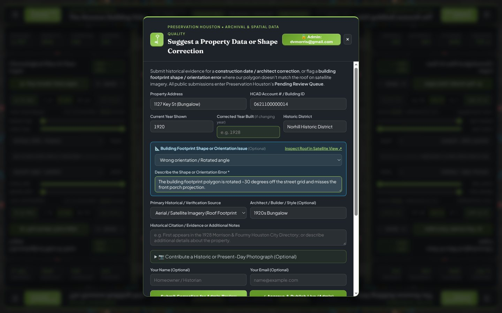
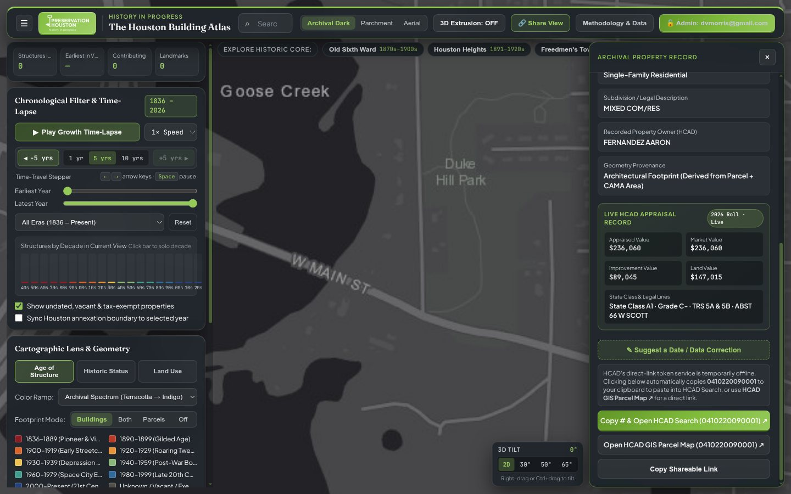

# Chapter 8: Crowdsourced Moderation Pipeline, Live HCAD API & Admin Operations

[← Chapter 7: Waterways, Railroads, Permits & Contractors](07-waterways-railroads-permits-and-contractors.md) | [Back to Master README](../README.md) | [Next: Chapter 9 - Preservation Practice, Research Kit, Social History & HAHC →](09-preservation-practice-social-history-and-hahc.md)

---

## 1. Zero-Cost Community Crowdsourcing & Google Sheets Moderation Pipeline

Because archival research across 1.51 million structures is an ongoing community effort ("History in Progress"), the Houston Building Atlas includes a built-in **Suggest Archival Correction / Report Footprint Error** workflow that requires **zero database hosting costs**.

|  |  |
| :---: | :---: |
| *Footprint & Geometry Error Reporting Modal* | *Live HCAD Appraisal Record Fetch in the Inspector Panel* |

### 1.1 Dual-Purpose Submission Modal (`#correction-modal`)
From any building's Inspector Panel, users or researchers can click:
- **Suggest Archival Date / Data Correction:** Pre-fills the property's address, 13-digit HCAD account number (or `<hcad>#<slug>` sub-building ID), current `year_built`, and historic district, allowing the user to submit a corrected construction year (`1836-2026`, or `0` to mark a demolished building whose lot is currently vacant), architectural style, architect, original general contractor/builder, building permit citation, archival source type (*Houston City Directory*, *Sanborn Fire Insurance Map*, *Harris County Deed / Mechanic's Lien*, *HMRC Contractor Archive*, *Historical Newspaper*), and an optional historical photograph URL (`photo_url`, `photo_year`, `photo_caption`).
- **Report Missing, Demolished, or Incorrect Building Footprint:** Pre-selects `#corr-footprint-issue` with a structured checklist (`Wrong building shape / Generic rectangular box`, `Wrong orientation / Rotated angle`, `Missing main building`, `Merged with adjacent building(s)`, `Overlapping / conflicting polygons`, `Shifted / offset from satellite roof`, `Building demolished - lot currently vacant (hide footprint)`, or `Building demolished & replaced by newer structure`). Selecting `Building demolished - lot currently vacant (hide footprint)` (or entering `0` / `Vacant` in `Corrected Year Built` or Google Sheet Column `D` `year_built`) sets `suppress_only: true` upon staff approval, immediately hiding the demolished ghost footprint on the live map (scoped to the single `<hcad>#<slug>` sub-building on multi-building parcels, or the whole parcel when keyed by 13-digit `hcad_num`) while marking the underlying lot as `Vacant / Exempt` (`year_built: 0`) in Parcels view.

### 1.2 Architecture of the Google Sheets Moderation Backend (`app/docs/google_apps_script_webhook.js`)
1. **Submission Ingestion (`POST` to Google Apps Script Web App):**
   - Public submissions are sent to a Google Apps Script webhook tied to Preservation Houston's Moderation Workbook and appended as `Pending` rows in the **`Pending_Submissions`** tab.
   - Simultaneously, the user's browser saves the submission in `localStorage` (`ph_atlas_local_submissions`) and displays a `"Pending Your Local Review"` badge so the researcher can immediately preview their suggested date and photo on their own map.
2. **One-Click Staff Approval (`Admin_Hub_&_Quick_Filter` & `Approved_Edits`):**
   - Preservation Houston staff review incoming submissions using the workbook's **`Admin_Hub_&_Quick_Filter`** dashboard or any of the **12 Saved Filter Views** (*Pending Date Corrections*, *Footprint & Geometry Errors*, *Submissions with Archival Photos*, *City Directory Citations*, *Sanborn Map Citations*, etc.).
   - Changing a row's `Status` dropdown to **`Approved`** triggers an `onEdit(e)` Google Apps Script hook that copies the verified record into the published **`Approved_Edits`** tab.
3. **Live Client-Side CSV Hydration (`curatedEdits.js`) & Offline Bundling:**
   - On startup, `app/js/curatedEdits.js` fetches the published `Approved_Edits` CSV endpoint (`cache: "no-store"`), parses approved overrides in memory, and applies them on top of both `buildings.geojson` and the 5 countywide PMTiles shards in real time.
   - Staff with an unlocked **Staff Admin** session (`#btn-toggle-admin-auth`) can also click **Approve & Publish Live (Admin)** inside the map UI to push verified corrections straight into `Approved_Edits`.

### 1.3 Four-Tier Evidentiary Provenance System, HCAD Rounded-Decade Estimates & 1-Click Public Flagging
To distinguish primary archival records from mass-appraisal estimates and automated web enrichments, `app/js/curatedEdits.js` (`classifyFieldEvidentiaryTier`) and `app/js/photoService.js` classify every displayed claim and photograph into a **4-Tier Evidentiary Provenance System**:
1. **Tier 1 - Verified Primary Record:** Official City of Houston HPO Landmark Designation Reports, National Register (NRHP) nominations, Sanborn Fire Insurance Atlases (`1877-1955`), digitized Houston City Directories (`1866-1926`), HMRC *T.G.C.A.* contractor bulletins, original building permits, Harris County deeds, and Preservation Houston staff-approved `Approved_Edits`.
2. **Tier 2 - Published Architectural Survey:** Peer-reviewed architectural monographs and field surveys (*AIA Houston Architectural Guide*, Stephen Fox, Barrie Scardino Bradley, Rice Campus GIS, Preservation Houston Good Brick Archive).
3. **Tier 3 - HCAD Appraisal Roll & Rounded-Decade Estimates (`c. 1920 (HCAD Est.)`):** Un-overridden HCAD CAMA dates between `1890` and `1950` ending in `0` (`yr % 10 === 0`, `3,047` parcels in the Historic Core) are explicitly badged as **`c. 1920 (HCAD Est.)`** / **`HCAD Appraisal Roll - Rounded Decade Estimate (unverified exact year)`**. Whenever `citydir_index.json` (`absent_through_1926`) proves an HCAD `<= 1925` structure had zero directory listings through 1926, the Property Inspector renders an explicit **Archival Contradiction Banner** directing researchers to the 5-Step House History Research Kit.
4. **Tier 4 - Unverified Automated Match & 1-Click Public Flagging:** Unverified HAIF forum thread titles, automated Wikimedia Commons / Geograph photo matches (`evaluateCommonsCandidate` with cross-parcel street-number/street-name and cross-landmark exclusions plus a 22m unnamed GPS cap), and editorial narrative cards carry explicit provenance badges alongside 1-click flag buttons:
   - **`⚑ Wrong Building`** (`PHOTO_MISATTRIBUTION_FLAG` on parcel photos)
   - **`⚑ Flag` / `⚑ Flag Name`** (`CLAIM_DISPUTE_FLAG` on unverified building names, dates, or architects)
   - **`⚑ Flag Error`** (`NARRATIVE_ERROR_FLAG` on Guided Chapters, Portfolio Monographs, Walking Tours, Deed Digests, and *Lost Houston* / overlay cards, alongside clickable primary-source `.narrative-citation-pill` links)
   - Clicking any flag button **suppresses the disputed photo or claim immediately in the user's browser** (`localStorage`) and posts a structured review ticket to `Pending_Submissions`. Once a Preservation Houston moderator sets that row's `status` to **`Approved`**, `parseGlobalRejectionsFromSheetRows()` (`curatedEdits.js`) and `registerGloballyRejectedPhotos()` (`photoService.js`) **globally suppress** the misattributed photo or claim across all visitors automatically.

---

## 2. Live HCAD Property Appraisal & Token-Brokered API Integration (`hcadLink.js`)

While the countywide PMTiles shards and `permits_<prefix3>.json` files bundle HCAD structural dates, square footages, land uses, and permit histories for instant offline rendering, researchers often need to inspect **live, current-year HCAD ownership, legal descriptions, land/improvement appraised values, and building sub-area breakdowns**.

`app/js/hcadLink.js` implements a resilient multi-tier live HCAD lookup service when the user clicks **Fetch Live HCAD Appraisal Record** in the Inspector Panel:
1. **Tier 1 - HCAD Public ArcGIS REST FeatureServer (`arcweb.hcad.org`):**
   - Queries HCAD's live public parcel & account summary layer by 13-digit `HCAD_NUM`, returning current owner name, mailing address, legal description (`lgl_1..4`), state property class, land area, total building area, market value, and appraised value.
2. **Tier 2 - Encrypted Token Handshake with `api.hcad.org` (`server.py` Proxy):**
   - HCAD's modern Blazor web portal (`search.hcad.org`) authenticates requests to `https://api.hcad.org/api/RealProperty/...` using a short-lived AES-encrypted bearer token minted by `https://search.hcad.org/api/Token`.
   - When running via `app/server.py`, the local backend can proxy the token handshake and fetch detailed sub-building CAMA tables (`building_res`, `building_other`, `extra_features`, `deeds`) on demand, caching responses in `sessionStorage` so repeated clicks are instantaneous.

---

## 3. O(1) Global Search Index & Pre-Warmed Instant Autocomplete (`search_index.json`)

With `1,507,553` countywide buildings, `7,242` curated inner-core buildings, `1,387` neighborhoods, `5,573` platted subdivisions, `509` designated landmarks, `359` Good Brick Awards, `74` Lost Houston sites, `225` waterways, `80` railroads, and `29,467` HAIF threads, naive linear scanning on keystroke would freeze the browser main thread.

Instead, the atlas uses a two-stage search architecture (`app/public/data/search_index.json` + in-memory spatial/overlay indices in `app.js`):
1. **Pre-Warming on Idle (`requestIdleCallback`):**
   - One second after initial map load, `_ensureSearchIndexLoaded()` asynchronously fetches and indexes `search_index.json` (`12 MB` uncompressed, `~1.8 MB` gzipped) in the background so that by the time the user clicks the search bar (`#search-input`), the index is already warm in memory.
2. **Multi-Faceted Instant Querying:**
   - Typing in `#search-input` searches across:
     - **Street Addresses & 13-Digit HCAD Account Numbers** (`408 Marshall St`, `0370370000007`)
     - **Canonical Building Names & Historical Aliases (`AKA`)** (`Gulf Building`, `Capitol Hotel`, `Transco Tower`, `Last Concert Café`)
     - **Architects & General Contractors** (`Alfred C. Finn`, `William Ward Watkin`, `John Staub`, `Russell Brown`, `Joseph Finger`, `MacKie & Kamrath`)
     - **Architectural Styles** (`Art Deco`, `Queen Anne`, `Craftsman`, `Mid-Century Modern`, `Spanish Eclectic`)
     - **Neighborhoods, Historic Wards, Platted Subdivisions, Waterways & Railroads** (`Freedmen's Town`, `Sixth Ward`, `Woodland Heights`, `Columbia Tap`, `Buffalo Bayou`)
     - **Lost Houston Demolished Landmarks** (`† The Capitol Hotel (1883-1912)`, `† Majestic Theatre`)
   - Selecting any result automatically enables the corresponding map layer if hidden, flies the camera smoothly to the feature's geometry, opens the full archival dossier in the Inspector Panel, and pushes a browser history entry (`window.history.pushState`) so the user can navigate back and forth with the browser **Back** and **Forward** buttons.

---

## 4. Complete Data Pipeline Rebuild Checklist (`pipeline/atlas_pipeline/`)

All 39 data processing scripts (`40` Python modules including `__init__.py`) live under `pipeline/atlas_pipeline/` and are managed with `uv` (`Python 3.13`, `pyogrio`, `shapely`, `pyproj`, `numpy`, `scipy`, `pillow`). To run a full rebuild or incremental update:

| Pipeline Script | Primary Input Sources | Output Artifacts Updated | Purpose |
| :--- | :--- | :--- | :--- |
| `ingest.py`, `spatial_join.py`, `full_build.py` | HCAD `Parcels.gdb`, CAMA `.txt` tables, OSM Overpass, Microsoft `MSBFP2` | Raw quadrant GeoJSONs, `buildings.geojson` | Spatial join of 1.85M footprints to 1.55M HCAD parcels (`EPSG:2278 -> EPSG:4326`). |
| `recover_dropped_footprints.py` | `Parcels.gdb` (`MultiPolygon` sub-parts), OSM Overpass | Quadrant GeoJSONs, `buildings.geojson` | Recovers 6,315 footprints on multi-block `MultiPolygon` parcels (`301 St Joseph Pkwy`) and performs 2-stage `STRtree` deduplication. |
| `fix_polygon_orientations.py` | `Parcels.gdb`, Quadrant GeoJSONs | 5 `.pmtiles` shards, `buildings.geojson` | Replaces 155,497 cardinal fallback boxes with `shapely.oriented_envelope` rotated footprints (`-34.65°` Borden Survey grid) and fixes 5,609 `ring[0]` party-wall shifts. |
| `fix_warehouse_district.py` | HCAD sub-buildings, OSM, aerial survey | `curated_overrides.json`, `buildings.geojson` | Removes 420m Elysian Viaduct bridge deck from `902 Hardy St`, splits `Last Concert Café & Richey-Fant House`, suppresses transit canopies. |
| `fix_industrial_multi_footprints.py` | OSM `man_made=storage_tank`, Esri `World_Basemap_v2` MVT tiles | 5 `.pmtiles` shards, `curated_overrides.json` | Restores 4,746 multi-building industrial footprints and extracts 7,292 circular refinery storage tanks (`12,038` total footprints). |
| `enrich_institutions.py` | Rice GIS, TSU GIS, UH GIS, Hermann Park / Zoo / Heritage Society | `buildings.geojson`, `curated_overrides.json` | Splits tax-exempt super-parcels into 525 individually dated campus buildings (excluding Rice `Covered Walkway` roofs). |
| `resolve_undated_countywide.py` | HCAD `extra_features`, `parcel_tieback`, `permits`, `deeds`, `subd_code` | 5 `.pmtiles` shards, `curated_overrides.json` | 4-phase resolution bringing all 43,983 undated (`year_built == 0`) footprints to 100.00% dated coverage with `year_source` provenance. |
| `city_directory_audit.py` & `build_house_history_index.py` | HPL ContentDM (`cdm17006.contentdm.oclc.org`, `39` directories `1866-1926`) | `curated_overrides.json`, `citydir_index.json` | Audits rounded-decade properties via `^exact^and` matching and builds `citydir_index.json` (`2,859` OCR sightings, `4,682` absences, `16` street renamings). |
| `good_brick_awards.py` | Preservation Houston Good Brick Archive (`1979-2026`) | `overlays.json` (`good_brick_awards`) | Filters 460 raw entries to 359 place-based awards (`338` snapped sites) onto verified building footprints. |
| `crawl_landmark_reports.py` & `apply_landmark_report_enrichments.py` | `archaeology.houstontx.gov` (`var mydata`) + Wayback CDX API | `overlays.json`, `curated_overrides.json`, `buildings.geojson` | Links 448 of 509 COH Landmarks to official HPO Designation Report PDFs, fixes 11 HPO filename typos, fills +140 dates and +144 styles. |
| `build_preservation_layers.py` | COH HPO Landmarks (`PLM` vs. `Waiver LM`), 2019 COH Plan, THC/NPS NRHP, TCA | `overlays.json` (`landmarks`, `potential_historic_districts`, `nrhp_properties`, `cultural_districts`) | Classifies `200` `PLM` + `86` `LM-in-HD` + `223` `90-Day Waiver LM`, adds `60` Potential HDs, `238` Individual NRHPs (`16` `"Gone"`), and `7` Cultural Arts Districts. |
| `crawl_haif_forum.py`, `apply_haif_enrichments.py`, `enrich_building_names.py`, `enrich_styles_and_search_index.py`, `seed_building_photos.py` | Wayback CDX (`29,467` HAIF threads), `media.invisioncic.com`, Wikimedia, HPO | `haif_index.json`, `building_photos.json`, `search_index.json` | Links `5,576` HAIF threads, populates `building_name` + `alt_names`, seeds `279` curated photos (excluding favicons & text tables), and compiles the `25,915`-entry `search_index.json`. |
| `extract_peter_brown_geopdf.py` & `build_neighborhoods.py` | 2009 Peter Brown GeoPDF (`/OC2`, `/OC13`, `/OC4`), COH GIS | `overlays.json` (`neighborhoods`, `historic_wards`, `annexations`) | Extracts 661 Peter Brown neighborhoods (`1,387` total), fixes 11 COH GIS typos, reconstructs 1839-1905 Charter Wards, separates 1963 highway spokes. |
| `build_deed_restrictions.py` | `Sub_poly.zip`, `Parcels.gdb`, `real_acct.txt` (`lgl_2`+`lgl_3`), COH Ch. 42 | `overlays.json` (`platted_subdivisions`, `land_use_protections`), `deed_restrictions_catalog.json` | Synthesizes 5,573 platted subdivisions, fixes WHCA `BELTZ -> Belt 3` & `lgl_3` bugs, links 65 local deed PDFs + 910 SMLS/SMBL/Conservation zones + primary citations. |
| `build_lost_houston_and_sanborn.py`, `lost_houston_catalog*.py`, `build_ut_pcl_sanborn.py` | LOC Sanborn IIIF (`626` sheets) + UT Austin PCL (`252` sheets), historical surveys | `sanborn_catalog.json`, `public/data/sanborn_ut/` (`504` WebPs), `overlays.json` (`lost_houston`) | Indexes `16` Sanborn volumes (`1877-1955`, `878` sheets), mirrors `504` UT PCL WebP plates (solving Anubis PoW), and maps `74` verified demolished landmarks (purging extant structures). |
| `build_social_history_layers.py` | Rice Woodson Research Center (`1915 Red Book` FeatureServer + Quartex), *Mapping Inequality* v3.0 (`1937 HOLC`), HARC Heat Watch | `overlays.json` (`red_book_1915`, `holc_1937_zones`, `holc_1937_grade_summary`) | Maps `970` *1915 Red Book* African American sites (`29` surviving, `85` Quartex plates) and `47` 1937 HOLC redlining zones with heat & protection equity stats. |
| `build_waterways_and_railroads.py` | USGS NHD, HCFCD (`M3` basins), TNRIS, FraN, TxDOT, 1869-1954 maps | `overlays.json` (`historical_waterways`, `historical_railroads`) | Builds `1,957` waterway features (`218` open bayous/creeks + `7` buried gullies + White Oak oxbows), `61` rail/streetcar corridors, and `14` historic depots. |
| `build_permits_and_contractors.py` | HCAD `permits.txt` (`1.3M`), `building_res.txt`, HMRC ContentDM (`T.G.C.A.`) | `permits/permits_<prefix3>.json` (`152` shards), `overlays.json` (`relocated_structures`) | Builds 152 permit shards (`1.26M` accounts), extracts 1917-1929 HMRC contractor monographs & *T.G.C.A.* awards, filters `permit_type=15` (`OMITTED IMPS`). |
| `fetch_live_permits.py`, `fetch_plat_and_watchlist.py`, `fetch_hahc_tracker.py` | COH WebFOCUS/Sold Permits, TX DSHS Asbestos, COH Planning `.xlsx`/PDFs, `data.texas.gov` Socrata, TDLR TABS, COH 311, COH `HAHC.html` | `active_permit_alerts.json`, `plat_agenda_monitor.json`, `property_watchlist.json`, `hahc_coa_tracker.json`, `overlays.json` | Automated daily/biweekly/monthly ingestion for `18` active demo/asbestos alerts, Planning Commission plats & Section K DPV variances, `60` watched properties, and `403` HAHC COA filings. |
| `audit_historical_accuracy.py` | `buildings.geojson`, `curated_overrides.json`, `overlays.json`, `citydir_index.json`, `haif_index.json`, `building_photos.json` | `historical_audit_summary.json`, `pipeline/cache/historical_audit_findings.csv`, `Historical_Audit_Queue` Sheet tab | Reconciles COH Landmark vs. HCAD/HAIF contradictions (`19` landmarks promoted, `2,592` cross-dataset contradictions audited, `3,047` Historic Core HCAD rounded-decade estimates quantified, top `250` queued for PH review). |
| `sync_curated_edits.py`, `setup_admin_sheet.py`, `tile_builder.py`, `cli.py`, `schema.py`, `fetch_data.py` | Google Sheet `Approved_Edits` CSV, Quadrant GeoJSONs, `curated_overrides.json`, `tippecanoe v2.82.0` | `curated_overrides.json`, `houston_buildings_{nw_w,nw_e,ne,sw,se}.pmtiles` | Syncs Google Sheet edits into Git, configures the 10-tab Admin Google Sheet, and compiles the 5 Zoom-11 tile-aligned PMTiles shards (`< 80 MB` each). |

---

## 5. Automated 4-Layer Verification & External Archive Link Health Monitoring

Because the Houston Building Atlas links across `55` municipal, county, state, university, and archival portals (City of Houston HPO & HAHC, HCAD, Harris County Clerk, Texas Historical Commission, National Park Service, Houston Public Library ContentDM, Rice University Woodson Research Center, Library of Congress, and UT Austin Perry-Castaneda Library) while rendering `1,507,553` footprints across `22` overlay layers, every deployment and external archive dependency is verified systematically:

1. **Live External Archive Link Health Report ([GitHub Issue #1](https://github.com/davemorris-gcp/houston-building-atlas/issues/1)):**
   - Canonical status page: **[https://github.com/davemorris-gcp/houston-building-atlas/issues/1](https://github.com/davemorris-gcp/houston-building-atlas/issues/1)** (also accessible in 1 click from the Preservation Houston Moderation Google Sheet on **`Admin_Hub_&_Quick_Filter` Cell `H14`** and **`Instructions_&_Apps_Script` Row `21`**).
   - Every Monday at `13:00 UTC` (`8:00 AM Central`) and via on-demand `workflow_dispatch`, `.github/workflows/external-link-health.yml` boots the full Playwright Headless Chromium suite across all `45` stratified property archetypes to harvest every dynamically rendered `<a href="http...">` external link, merges static HTML/JSON catalog links (`776` unique URLs), checks each link with polite per-host rate limiting and soft-404 detection (`Maintenance.aspx`, `"Page Not Found"` HTML titles), and updates [GitHub Issue #1](https://github.com/davemorris-gcp/houston-building-atlas/issues/1) in place. If any municipal or archive URL moves or breaks, the workflow automatically reopens Issue `#1` and posts an alert comment citing the exact affected UI component or JSON dataset.
2. **Pre-Deploy Stratified CI Gate (`.github/workflows/deploy-pages.yml`):**
   - Blocks GitHub Pages deployment unless both **Layer 1** (`node tests/unit/run_all.mjs`: schema/foreign-key integrity, WGS84 bounds, 504 mirrored UT PCL Sanborn WebP plates, 65 local deed PDFs, GitHub Pages `< 95 MB` per-file / `< 980 MB` total bundle budgets, `filterStore.js` URL state round-trips, portfolio deduplication, and `app/js/urlValidators.js` retired-URL rejection) and **Layer 2** (`uv run --directory pipeline pytest ../tests/e2e -v`: `HTTP 206 Partial Content` PMTiles range check, zero `pageerror` / `console.error` / local `>= 400` responses, global modals, Guided Chapters `1..6`, Architect/Style Portfolios, `plat-monitor.html`, and all **45 Stratified Property & Overlay Archetypes** across `15` equivalence classes `c01..c15`) pass 100%.
3. **Remediating a Moved External Archive URL:**
   - Update the URL template in `app/js/` or catalog entry in `app/public/data/`, add the retired path regex to `KNOWN_DEAD_URL_PATTERNS` in `app/js/urlValidators.js` so it can never regress in future commits, run `node tests/unit/run_all.mjs && node scripts/check_external_links.mjs`, and push to `main` (which automatically re-runs `.github/workflows/external-link-health.yml` and refreshes [GitHub Issue #1](https://github.com/davemorris-gcp/houston-building-atlas/issues/1)).

---

[← Chapter 7: Waterways, Railroads, Permits & Contractors](07-waterways-railroads-permits-and-contractors.md) | [Back to Master README](../README.md) | [Next: Chapter 9 - Preservation Practice, Research Kit, Social History & HAHC →](09-preservation-practice-social-history-and-hahc.md)
