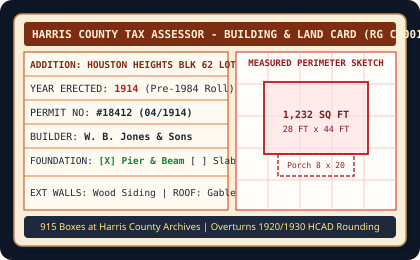
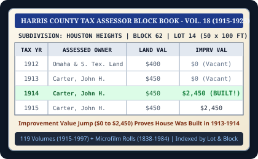
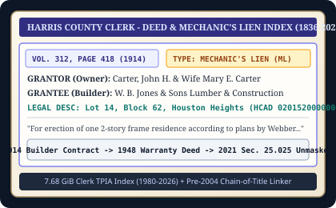

# Harris County Archives (CR001 & MC003) Reading Room Pull Sheet

- **Repository:** Harris County Archives (`CR001` Tax Assessor-Collector Building & Land Assessment Cards & Block Books; `MC003` Abstracts of Title)
- **Reading Room Address:** 11525 Todd St, Suite 300, Houston, TX 77055 (`arc@cco.hctx.net`, `713-274-9680`)
- **13-Digit HCAD Account Call Number Key:** `VVV-PPP-SSS-IIII` -> `Volume [3 digits] | Page [3 digits] | Sub-block [3 digits] | Item [4 digits]`
- **Indexed CR001 Coverage:** `915` BLA Card boxes across `112` volumes (`v. 001` to `v. 114`), `23` Priority 1 Watchlist parcels, and `2203` Priority 2 Historical Audit Queue parcels (`81` distinct BLA boxes, `401` distinct `1915-1927_VVV_PPP.tif` digitized Block Book files).

## Visual Guide to Harris County Archival Records (`CR001` & `MC003`)

| Record Group / Document Type | Stylized Archival Illustration | What to Look For in the Reading Room |
| :--- | :--- | :--- |
| **`CR001` Building & Land Assessment (BLA) Card** (`Mid-1920s to 1980`, `915` boxes) |  | Original City of Houston Building Permit `#` and issue date, Builder/Contractor name, `[X] Pier & Beam` vs. `Concrete Slab` foundation check, pre-1984 erection year (overturning `1920`/`1930` HCAD computer-conversion rounding), and the red-ruled measured perimeter footprint sketch. |
| **`CR001` Tax Assessor Block Book Ledger** (`1915-1997`, `119` bound volumes) |  | Organized by **Subdivision, Block, and Lot** (immune to 1911 street renumbering). Follow the **Improvement Value (`$`)** column year by year: the exact tax year when Improvement Value jumps from `$0` (vacant land) to a building valuation (e.g. `$2,450`) proves the construction year. |
| **`MC003` Abstracts of Title & County Clerk Deeds / Mechanic's Liens** (`1836-Present`) |  | `Grantor -> Grantee` warranty deed chains, Volume/Page & Film Code tokens, and **Mechanic's Lien (`ML`)** builder contracts that name the original contractor, architect, and contract price prior to construction. |

## 1. Already Digitized & Ingested Sample Records (Received Nov 13, 2026)

| HCAD Account | Address / Landmark | Call No. (`Vol / Page / Item`) | BLA Box & Shelf Loc | Key Primary-Source Finding |
| :--- | :--- | :--- | :--- | :--- |
| `0621100000014` | **1127 Key St** (North Norhill) | `Vol. 062, Page 110, Item 14` | `Box 291A` (`1222-D-01`) | Original **COH Building Permit #8111** issued **Nov 30, 1925** (`$3,500`) to builder **C. L. Null** (rendered by **R. E. Lovejoy**, `26'x42'` 5-room frame bungalow + `10'x16'` garage); `1932-1935` **W. J. Walden**; `1936-1978` **Joe Norwood** (`Oct 6, 1953` carport permit). |
| `0620620000018` | **1001 Bayland Ave / 1001 Norhill** (Norhill) | `Vol. 062, Page 062, Item 18` | `Box 290` (`1222-C-05`) | Original **COH Building Permit #744** issued **Sep 6, 1932** (`$2,500`) under corner address **1001 Norhill** to **Mrs. Bertha Mirring** (`2,108 sq ft` 1-story 7-room brick veneer residence); `Jul 12, 1939` card lists **`1001 Norhill + Bayland`** for **Louis & Odys Kihnel**. |
| `0152300000001` | **2000 Smith St** (John Henry Kirby Mansion) | `Vol. 015, Page 230, Item 1` | `Box 64` (`1207-E-06`) & `1915-1927_015_230.tif` | `1915-1927` Block Book with Stewart Abstract Plat No. 3516 (`All Block 12, Hadley & Franklin`, `O. Smith Survey Abstract 696`) and annual renditions by **Jno. H. Kirby** jumping from `$29,175` to **`$56,250` improvements in `1927`** (James Ruskin Bailey expansion); `1978` Land Card for **Gulf States Oil & Ref. Co.** (`$253,100`). |
| `0202540000006` | **727 Arlington St** (Houston Heights) | `Vol. 020, Page 254, Item 6` | `Box 78` (`1209-B-02`) | `1959`, `1968` (`Al Ladeau`), and `1976/1978` BLA cards (`934 sq ft` frame bungalow + `130 sq ft` porch, `60%` depreciated in 1968 for **Zoe Ellen Hicks**), proving HCAD's modern `1995` `year_built` is a remodel overwrite (`1922` City Directory occupancy). |
| `0620270000005` | **2219 Dorrington Blvd** (Braeswood Block 20) | `Vol. 062, Page 027, Items 5-25` | `1970 Tax Roll p. 9937` (`00000016.tif`) | `1970` Real Property Tax Roll recording `Braeswood Block 20` (`HCAD 0620270000005..0025`, **Benjamin H. Lewis Jr.**). |

## 2. Priority 1: Active Property Watchlist Pulls (Pre-Sorted by Volume, Page & BLA Box)

| HCAD Account | Vol | Page | Item | BLA Box | Shelf Location | 1915-1927 Block Book TIFF | Property / Landmark | Address | Year |
| :--- | :--- | :--- | :--- | :--- | :--- | :--- | :--- | :--- | :--- |
| `0032500000003` | `003` | `250` | `0003` | **Box `009A`** | `1220-E-02` | `1915-1927_003_250.tif` | Granger Place | 908 Morris St | c. 1930 |
| `0040570000008` | `004` | `057` | `0008` | **Box `010A`** | `1220-E-02` | `1915-1927_004_057.tif` | Liberty Green | 4705 LIBERTY RD | 1925 |
| `0152300000001` | `015` | `230` | `0001` | **Box `045A`** | `1220-E-06` | `1915-1927_015_230.tif` | John Henry Kirby Mansion | 2000 SMITH ST | 1894 |
| `0191920000001` | `019` | `192` | `0001` | **Box `060A`** | `1220-D-02` | `1915-1927_019_192.tif` | Southwestern Bell / ICC Building | 3333 FANNIN ST | 1959 |
| `0201140000001` | `020` | `114` | `0001` | **Box `065A`** | `1220-D-03` | `1915-1927_020_114.tif` | Lambert Hall; Heights Christian Church | 1701 HEIGHTS BLVD | 1927; 1965 |
| `0222350000001` | `022` | `235` | `0001` | **Box `080A`** | `1220-D-05` | `1915-1927_022_235.tif` | James D. Burrus Elementary | 701 E 33RD ST | 2006 |
| `0261520000021` | `026` | `152` | `0021` | **Box `097A`** | `1220-C-01` | `1915-1927_026_152.tif` | Hamman House | 802 LOVETT BLVD | 1926 |
| `0283120000009` | `028` | `312` | `0009` | **Box `500B`** | `1226-C-04` | `1915-1927_028_312.tif` | Park Place Methodist Church | 3827 BROADWAY ST | 1961 |
| `0332280550022` | `033` | `228` | `0022` | **Box `113A`** | `1220-C-03` | `1915-1927_033_228.tif` | Eastwood Street Villas | 7108 EASTWOOD | 1949 |
| `0352750130042` | `035` | `275` | `0042` | **Box `126A`** | `1220-C-05` | `1915-1927_035_275.tif` | 1501 Wichman Street | 1501 WICHMAN ST |  |
| `0380450000001` | `038` | `045` | `0001` | **Box `137A`** | `1220-C-06` | `1915-1927_038_045.tif` | 5208 HARRISBURG BLVD | 5208 HARRISBURG BLVD | 1930 |
| `0391930200024` | `039` | `193` | `0024` | **Box `147A`** | `1220-B-01` | `1915-1927_039_193.tif` | 3747 Dreyfus Street A and B | 3747 DREYFUS ST | 1950 |
| `0451400020105` | `045` | `140` | `0105` | **Box `482B`** | `1226-D-05` | `1915-1927_045_140.tif` | Aeric Oaks | 50 BRIAR HOLLOW LN | 1978 |
| `0522690000004` | `052` | `269` | `0004` | **Box `205A`** | `1220-A-03` | `1915-1927_052_269.tif` | Miriam Grove | 627 E 14TH ST | 1929 |
| `0561210000025` | `056` | `121` | `0025` | **Box `232A`** | `1220-A-06` | `1915-1927_056_121.tif` | Sul Ross Views | 2038 SUL ROSS ST | 1950 |
| `0611650000001` | `061` | `165` | `0001` | **Box `283A`** | `1222-E-06` | `1915-1927_061_165.tif` | Wheeler Residences | 2802 WHEELER ST | 1940 |
| `0650100070010` | `065` | `010` | `0010` | **Box `313B`** | `1224-C-06` | `1915-1927_065_010.tif` | Amplified Properties | 1131 VERA LOU ST | 1942 |
| `0660640410042` | `066` | `064` | `0042` | **Box `325B`** | `1224-B-01` | `1915-1927_066_064.tif` | Eleanor Enclave | 407 ELEANOR ST | 1949 |
| `0780870010001` | `078` | `087` | `0001` | **Box `484B`** | `1226-D-05` | `1915-1927_078_087.tif` | Kafi Commons | 4710 W ALABAMA ST | 1956 |
| `0812420000020` | `081` | `242` | `0020` | **Box `014B`** | `1222-D-04` | `1915-1927_081_242.tif` | 6102 Waltway Drive | 6102 WALTWAY DR | 1954 |
| `0915710000011` | `091` | `571` | `0011` | **Box `080B`** | `1222-C-06` | `1915-1927_091_571.tif` | 323 Wycliffe Drive | 323 WYCLIFFE DR | 1960 |
| `0961080000014` | `096` | `108` | `0014` | **Box `102B`** | `1222-B-03` | `1915-1927_096_108.tif` | 13515 Perthshire Road | 13515 PERTHSHIRE RD | 1966 |
| `1023520000101` | `102` | `352` | `0101` | **Box `156B`** | `1222-A-04` | `1915-1927_102_352.tif` | Forest Green Reserve | 8803 FOREST HOLLOW ST | 1968 |

## 3. Priority 2: Top Historical Audit Queue Box Batch (First 50 Pre-Sorted by BLA Box)

| HCAD Account | Vol | Page | Item | BLA Box | Shelf Location | 1915-1927 Block Book TIFF | Address | District / Subdivision |
| :--- | :--- | :--- | :--- | :--- | :--- | :--- | :--- | :--- |
| `0010190000020` | `001` | `019` | `0020` | **Box `001A`** | `1220-E-01` | `1915-1927_001_019.tif` | 204 Travis St | Main Street/Market Square Historic District |
| `0010200000002` | `001` | `020` | `0002` | **Box `001A`** | `1220-E-01` | `1915-1927_001_020.tif` | 202 MAIN ST | Main Street/Market Square Historic District |
| `0010550000006` | `001` | `055` | `0006` | **Box `001A`** | `1220-E-01` | `1915-1927_001_055.tif` | 1112 PRAIRIE ST | Christ Church Cathedral |
| `0032180000034` | `003` | `218` | `0034` | **Box `009A`** | `1220-E-02` | `1915-1927_003_218.tif` | 115 Marie Street | Protected Landmark |
| `0050150000011` | `005` | `015` | `0011` | **Box `013A`** | `1220-E-03` | `1915-1927_005_015.tif` | 1110 Victor St | Protected Landmark |
| `0050210000005` | `005` | `021` | `0005` | **Box `013A`** | `1220-E-03` | `1915-1927_005_021.tif` | 1319 Andrews St | Protected Landmark |
| `0050390000009` | `005` | `039` | `0009` | **Box `013A`** | `1220-E-03` | `1915-1927_005_039.tif` | 1514 Wilson St | Protected Landmark |
| `0051810000002` | `005` | `181` | `0002` | **Box `015A`** | `1220-E-03` | `1915-1927_005_181.tif` | 2216 KANE ST | Old Sixth Ward Historic District |
| `0051810000010` | `005` | `181` | `0010` | **Box `015A`** | `1220-E-03` | `1915-1927_005_181.tif` | 2215 Decatur St | Old Sixth Ward Historic District |
| `0051990000009` | `005` | `199` | `0009` | **Box `015A`** | `1220-E-03` | `1915-1927_005_199.tif` | 2009 Kane St | Old Sixth Ward Historic District |
| `0052090000004` | `005` | `209` | `0004` | **Box `016A`** | `1220-E-03` | `1915-1927_005_209.tif` | 1910 Decatur St | Old Sixth Ward Historic District |
| `0052250000007` | `005` | `225` | `0007` | **Box `016A`** | `1220-E-03` | `1915-1927_005_225.tif` | 1808 LUBBOCK ST | Old Sixth Ward Historic District |
| `0052260000013` | `005` | `226` | `0013` | **Box `016A`** | `1220-E-03` | `1915-1927_005_226.tif` | 1807 Decatur St | Old Sixth Ward Historic District |
| `0090480000031` | `009` | `048` | `0031` | **Box `023A`** | `1220-E-04` | `1915-1927_009_048.tif` | 1914 Gano Street | Landmark |
| `0090770000006` | `009` | `077` | `0006` | **Box `024A`** | `1220-E-04` | `1915-1927_009_077.tif` | 1318 ROBIN ST | Duplex at 1318 Robin |
| `0142570000002` | `014` | `257` | `0002` | **Box `042A`** | `1220-E-06` | `1915-1927_014_257.tif` | 2011 Johnson Street | Protected Landmark |
| `0191850000001` | `019` | `185` | `0001` | **Box `060A`** | `1220-D-02` | `1915-1927_019_185.tif` | 1311 Holman St | Protected Landmark |
| `0200670000010` | `020` | `067` | `0010` | **Box `063A`** | `1220-D-03` | `1915-1927_020_067.tif` | 2009 HARVARD ST | Fayette C. Lowry House |
| `0200980000026` | `020` | `098` | `0026` | **Box `065A`** | `1220-D-03` | `1915-1927_020_098.tif` | 245 W 18th St | Landmark |
| `0200980000035` | `020` | `098` | `0035` | **Box `065A`** | `1220-D-03` | `1915-1927_020_098.tif` | 227 W 18th St | Protected Landmark |
| `0201010000014` | `020` | `101` | `0014` | **Box `065A`** | `1220-D-03` | `1915-1927_020_101.tif` | 1802 Harvard St | Houston Heights East Historic District |
| `0201290000016` | `020` | `129` | `0016` | **Box `066A`** | `1220-D-03` | `1915-1927_020_129.tif` | 124 W 17th St | Houston Heights East Historic District |
| `0201340000013` | `020` | `134` | `0013` | **Box `066A`** | `1220-D-03` | `1915-1927_020_134.tif` | 301, 303 E 15th St | Houston Heights East Historic District |
| `0201350000007` | `020` | `135` | `0007` | **Box `066A`** | `1220-D-03` | `1915-1927_020_135.tif` | 1517 Cortlandt St | Houston Heights East Historic District |
| `0201410000001` | `020` | `141` | `0001` | **Box `066A`** | `1220-D-03` | `1915-1927_020_141.tif` | 1541 Tulane St | Houston Heights West Historic District |
| `0201520000004` | `020` | `152` | `0004` | **Box `066A`** | `1220-D-03` | `1915-1927_020_152.tif` | 1435 Heights Blvd | Houston Heights East Historic District |
| `0201840000011` | `020` | `184` | `0011` | **Box `069A`** | `1220-D-04` | `1915-1927_020_184.tif` | 221 E 12TH ST | Houston Heights East Historic District |
| `0202140000023` | `020` | `214` | `0023` | **Box `070A`** | `1220-D-04` | `1915-1927_020_214.tif` | 1046 Harvard St | Protected Landmark |
| `0202450000023` | `020` | `245` | `0023` | **Box `072A`** | `1220-D-04` | `1915-1927_020_245.tif` | 844 CORTLANDT ST | Houston Heights South Historic District |
| `0202470000024` | `020` | `247` | `0024` | **Box `072A`** | `1220-D-04` | `1915-1927_020_247.tif` | 844 COLUMBIA ST | Houston Heights South Historic District |
| `0202560000006` | `020` | `256` | `0006` | **Box `072A`** | `1220-D-04` | `1915-1927_020_256.tif` | 725 HARVARD ST | Houston Heights South Historic District |
| `0202560000011` | `020` | `256` | `0011` | **Box `072A`** | `1220-D-04` | `1915-1927_020_256.tif` | 703 HARVARD ST | Houston Heights South Historic District |
| `0400030000013` | `040` | `003` | `0013` | **Box `150A`** | `1220-B-02` | `1915-1927_040_003.tif` | 212 Dallas St | Protected Landmark |
| `0401120000010` | `040` | `112` | `0010` | **Box `152A`** | `1220-B-02` | `1915-1927_040_112.tif` | 2500 Summer St | Landmark |
| `0523010000002` | `052` | `301` | `0002` | **Box `210A`** | `1220-A-03` | `1915-1927_052_301.tif` | 2 Waverly Ct | Protected Landmark |
| `0601360000010` | `060` | `136` | `0010` | **Box `271A`** | `1222-E-05` | `1915-1927_060_136.tif` | 3311 Del Monte Dr | Landmark |
| `0601500290005` | `060` | `150` | `0005` | **Box `272A`** | `1222-E-05` | `1915-1927_060_150.tif` | 3003 Chevy Chase Dr | Landmark |
| `0601530360008` | `060` | `153` | `0008` | **Box `272A`** | `1222-E-05` | `1915-1927_060_153.tif` | 2504 Brentwood Dr | Landmark |
| `0601530360013` | `060` | `153` | `0013` | **Box `272A`** | `1222-E-05` | `1915-1927_060_153.tif` | 2404 Brentwood Dr | Landmark |
| `0601550460003` | `060` | `155` | `0003` | **Box `272A`** | `1222-E-05` | `1915-1927_060_155.tif` | 2219 Brentwood Dr | Landmark |
| `0601550460008` | `060` | `155` | `0008` | **Box `272A`** | `1222-E-05` | `1915-1927_060_155.tif` | 2129 Brentwood Dr | Landmark |
| `0601550440017` | `060` | `155` | `0017` | **Box `272A`** | `1222-E-05` | `1915-1927_060_155.tif` | 2111 Del Monte Dr | Landmark |
| `0601560500005` | `060` | `156` | `0005` | **Box `273A`** | `1222-E-05` | `1915-1927_060_156.tif` | 2135 Looscan Ln | Landmark |
| `0601560530016` | `060` | `156` | `0016` | **Box `273A`** | `1222-E-05` | `1915-1927_060_156.tif` | 2164 Troon Rd | Landmark |
| `0611070000006` | `061` | `107` | `0006` | **Box `281A`** | `1222-E-06` | `1915-1927_061_107.tif` | 2506 Rosedale Street | Protected Landmark |
| `0611070000020` | `061` | `107` | `0020` | **Box `281A`** | `1222-E-06` | `1915-1927_061_107.tif` | 2520 Rosedale St | Protected Landmark |
| `0641720010003` | `064` | `172` | `0003` | **Box `307B`** | `1224-C-05` | `1915-1927_064_172.tif` | 2911 Ella Lee Ln | Landmark |
| `0441840000035` | `044` | `184` | `0035` | **Box `481B`** | `1226-D-05` | `1915-1927_044_184.tif` | 1401 Castle Ct | Landmark |
| `0442250000170` | `044` | `225` | `0170` | **Box `481B`** | `1226-D-05` | `1915-1927_044_225.tif` | 1952-2050 W Gray St | Landmark |
| `0321930000008` | `032` | `193` | `0008` | **Box `501B`** | `1226-C-04` | `1915-1927_032_193.tif` | 1611 Bass St | Protected Landmark |
